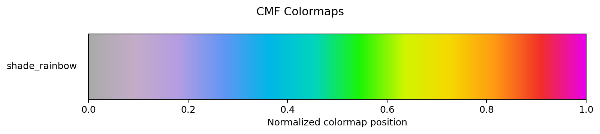
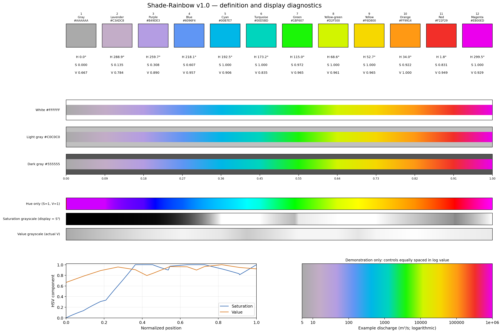

# CMF Colormaps

CMF Colormaps is a small, reusable Python library for palettes developed for
CaMa-Flood visualizations. The initial map, **Shade-Rainbow**, is a sequential,
multihue colormap designed to make low values visually muted and high values
more prominent. It is intended as an additional option, not a universal
replacement for existing palettes.

## Install

From a CaMa-Flood checkout:

```bash
python -m pip install -e ./visualization/cmf_colormap
```

The package can also be installed from a standalone clone of this directory:

```bash
python -m pip install -e .
```

Matplotlib is the only runtime dependency. NumPy is used by the gallery example
and is already a Matplotlib dependency.

The package carries the CaMa-Flood repository's Apache License 2.0 text. Confirm
that this is the intended standalone license before publishing the independent
repository.

## Use

```python
import matplotlib.pyplot as plt
from matplotlib.colors import LogNorm

from cmf_colormap import get_cmap

cmap = get_cmap("shade_rainbow")
image = ax.pcolormesh(lon, lat, discharge, cmap=cmap,
                      norm=LogNorm(vmin=5, vmax=1_000_000, clip=True))
fig.colorbar(image, ax=ax, label="Discharge (m³/s)")
```

The package does not select a variable, unit, or normalization range. Choose a
normalization appropriate to the plotted quantity: `Normalize` for a linear
scale, `LogNorm` for positive values spanning orders of magnitude, or another
Matplotlib norm where appropriate. The `LogNorm` range above is only an example.

Available maps come from the package registry:

```python
from cmf_colormap import get_cmap, list_colormaps, register_colormaps

print(list_colormaps())  # ['shade_rainbow']
cmap = get_cmap("shade_rainbow")

# Optional global Matplotlib lookup as "cmf.shade_rainbow".
register_colormaps()
```

Importing the package does not modify Matplotlib's global registry. Registration
is explicit and safe to repeat. A pre-existing unrelated `cmf.<name>` entry is
reported as a collision. Unknown names raise `ValueError` and list registered
choices.

## Shade-Rainbow definition

The authoritative colors and metadata are in
[`src/cmf_colormap/data/shade_rainbow.json`](src/cmf_colormap/data/shade_rainbow.json).
Twelve controls are evenly spaced on normalized `[0, 1]`; adjacent RGB channel
values are interpolated piecewise-linearly in numerical sRGB values. There is no
HSV, HSL, Lab, perceptual-space, or gamma-corrected light interpolation. The
first and last control colors are the exact endpoints. HSV values in the detail
preview are derived for diagnostics only; they do not define the palette.

Matplotlib exposes finite lookup tables for colormap objects. This adapter uses
131,072 entries to keep lookup sampling fine; the JSON interpolation rule remains
the mathematical source of truth.

## Previews

The registry-driven gallery shows each available map on a normalized 0–1 axis.
The detailed Shade-Rainbow image includes control HEX/HSV diagnostics,
background comparisons, HSV component strips and curves, and an example
log-discharge axis. Its discharge values are illustrative only.





Regenerate both images after changing or adding a registry entry:

```bash
python examples/plot_colormap_gallery.py
```

Run the focused tests from this package directory with
`python -m unittest discover -s tests` (or use `pytest tests`).

The plotting program reads definitions from package data and writes preview PNGs
beside itself. It does not maintain separate color definitions.

## Add a colormap

1. Add a JSON definition under `src/cmf_colormap/data/` with a unique name,
   version, type, interpolation rule, description, and named HEX controls.
2. Add one row to `colormaps.csv`, pointing to that JSON file.
3. Keep units and data normalization outside the definition.
4. Add focused definition/API tests and regenerate the gallery.

The implementation currently accepts `linear_srgb` definitions with at least
two named HEX controls. Add other interpolation methods only with an explicit
definition and matching tests.

## Limitations

Shade-Rainbow is not designed to be perceptually uniform: equal normalized
steps need not appear equally different. Rainbow-like transitions can also be
difficult for some color-vision deficiencies and may imply boundaries that are
not present in the data. Consider the data, background, audience, and alternative
palettes when choosing a map, and do not interpret the color sequence as a
scientific classification.

## Development and subtree synchronization

This directory is designed to be used either inside CaMa-Flood or as the root
of the future `global-hydrodynamics/cmf_colormap` repository. The intended
integration prefix is `visualization/cmf_colormap`; no submodule is needed by
CaMa-Flood users.

### Initial subtree setup

The standalone repository returned HTTP 404 when checked during initial
implementation, so its existence and default branch must be confirmed before
setup. Do not create it or push to it without maintainer authorization. The
package currently has no committed path history in CaMa-Flood, so there is not
yet a subtree history to export.

After the standalone repository exists and maintainers approve the import:

1. Commit the complete package directory on the approved CaMa-Flood development
   branch. Git subtree split only includes committed history.
2. Add the standalone remote locally if it is not already configured:

   ```bash
   git remote add cmf-colormap https://github.com/global-hydrodynamics/cmf_colormap.git
   ```

3. Export the package's path history without rewriting CaMa-Flood history, then
   push it to a dedicated import branch and open a PR to the standalone repo's
   `main`:

   ```bash
   git subtree split --rejoin --prefix=visualization/cmf_colormap -b cmf-colormap-export
   git push cmf-colormap cmf-colormap-export:initial-subtree-import
   ```

4. Merge that PR without squash/rebase so the exported commit ancestry is
   retained. Once it is on standalone `main`, synchronize the established
   subtree with the routine pull command below.

This path exports the existing package content rather than trying `git subtree
add` over a directory that already exists. It does not amend, rebase, or replace
CaMa-Flood commits. Review the resulting histories before the first import; if
the standalone repository has any independent commits or starter files, stop
and agree on a merge plan rather than overwriting either side.

### Routine synchronization

Choose one repository for a change and synchronize before editing the other.
Commit all package changes first; subtree operations do not include uncommitted
files. Do not independently edit both copies and reconcile them later.

From CaMa-Flood, pull standalone changes:

```bash
git subtree pull --prefix=visualization/cmf_colormap cmf-colormap main
```

To send CaMa-Flood changes back, export to a dedicated branch and open a PR to
standalone `main`:

```bash
git subtree push --prefix=visualization/cmf_colormap cmf-colormap cmf-colormap-update
```

These are non-squashed subtree operations. Preserving commit ancestry lets the
two repositories recognize shared package history and makes later two-way
syncs easier to review. Do not squash the subtree commits or force-push either
project's shared branch. If a pull reports conflicts, resolve the package files
as an ordinary merge, run this package's tests, and commit the merge before
continuing. Never synchronize while the package has uncommitted changes.
