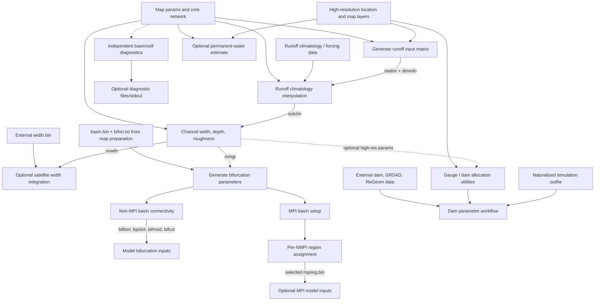

# CaMa-Flood v5 Parameter and Analysis Tools Migration Plan

**Status:** Phase B2.1 and the approved Phase B2.2 channel-parameter workflow are implemented. The v4 source tree and legacy workflow files remain unchanged. Later parameter migrations are still proposals unless identified as approved decisions.

## Scope and evidence

This plan covers the legacy parameter tools in `map/src/src_param/`, the dam workflow in `map/src/src_dam/`, the existing shared code and regional workflow under `map/tools/`, and the registry in `map/map_variables.csv`. Source behavior below is marked **verified** when read directly from source or scripts. The family organization described below includes the maintainer-approved decision to place gauge and dam allocation wrappers in `script_params/`; other migration details remain proposals unless identified as approved. Filenames and defaults quoted below are source defaults, not recommendations for scientific use.

The repository is on `feature/map-data-tools` (Issue [#122](https://github.com/global-hydrodynamics/CaMa-Flood_v4/issues/122)). `map/src/` remains the legacy tree. The established v5 regional layout places shared executables in `map/tools/code/` and map-local wrappers in `map/tools/script_region/`; regional scripts rely on a map-local working directory and do not build tools themselves.

## Existing programs

The legacy `map/src/src_param/Makefile` builds 17 programs. `calc_outclmday.F90` is also present but is **not** in its target list. All legacy Fortran sources are retained under `map/src/` regardless of a future migration.

| Legacy source / proposed family name | Function; arguments and defaults (verified) | Inputs → outputs / side effects | CWD, workflow, dependencies and migration notes |
| --- | --- | --- | --- |
| `generate_inpmat.F90` → `param_generate_inpmat` | Map/runoff-grid remapping matrix. Positional arguments: `TAG [GRSIZE WEST EAST NORTH SOUTH OLAT DIMINFO INPMAT]`. The legacy wrapper sets a 0.25-degree grid, global longitude bounds, 90 to -60 latitude bounds, `NtoS`, `diminfo_test-15min_nc.txt`, and `inpmat_test-15min_nc.bin`; the Fortran source does not initialize every optional argument (notably grid spacing and output names), so the wrapper passes every setting explicitly. | Reads `params.txt`, `<TAG>/location.txt`, each area's `catmxy.bin`, and `grdare.bin` when present. Writes configured diminfo and input matrix; existing output paths may be replaced. Does not read runoff values. | The v5 shared copy is `map/tools/code/param_generate_inpmat.F90`, built by `make -C map/tools/code param`; its wrapper template is `map/tools/script_params/s03-generate_inpmat.sh`. The wrapper sets map-root CWD. Requires map geometry and high-resolution catchment layers. It remains distinct from the fixed standard climatology product made by `region_default_inpmat`. |
| `calc_outclm.F90` → `param_calc_outclm` | Calculates annual mean discharge. CLI: `TYPE INTERP DIMINFO CROF [NETCDF_VAR]`; source defaults are binary, `inpmat`, `./diminfo_test-1deg.txt`, `../data/runoff_1981-2000_ave.bin`; NetCDF variable default `RO`. The standard v5 wrapper supplies `ELSE_GPCC_clm-1981-2010.one` in mm/s. Binary and optional NetCDF paths, plus `near`/`inpmat` interpolation, are retained. | Reads `nextxy.bin`, `ctmare.bin`, diminfo, input matrix in `inpmat` mode, and runoff; writes/replaces one-record float32 `outclm.bin` in m3/s. | Migrated mechanically to `map/tools/code/param_calc_outclm.F90`; invoked by v5 `s01-channel_params.sh` from map-root CWD. NetCDF support depends on build configuration. The data-rich package supplies the standard runoff file; its redistribution terms are not confirmed for GitHub use. |
| `calc_outclmday.F90` (legacy only) | Historical daily-climatology variant. The maintainer identifies it with the older maximum-30-day approach associated with Yamazaki et al. (2011); later evaluation favored annual mean runoff. | Reads daily runoff and writes `outclm.bin` plus an intermediate `tmp.bin`; not built by the legacy Makefile and not invoked by the active recipe. | Explicitly retained only under legacy `map/src/`; not migrated or used by v5. Its historical method was not scientifically revalidated by this task. |
| `calc_rivwth.F90` → `param_calc_rivwth` | Empirical river width, depth, roughness and infinite-depth products. Args: `TYPE DIMINFO HC HP HO HMIN WC WP WO WMIN`. Source defaults differ from the standard wrapper's explicit coefficient choices. | Reads `outclm.bin`, `nextxy.bin`, diminfo; writes/replaces `rivwth.bin`, `rivhgt.bin`, `rivman.bin`, `rivhgt_inf.bin`; CDF mode can write partial `rivpar.nc`. | Migrated mechanically to `map/tools/code/param_calc_rivwth.F90`; called by v5 `s01-channel_params.sh` with the legacy standard workflow's coefficients and map-root CWD. Optional NetCDF behavior remains conditional on build configuration. |
| Legacy `set_gwdlr.F90` → v5 `param_set_merit_width.F90` / `param_set_merit_width` | Merges the power-law width with MERIT Hydro width using unchanged legacy thresholds; one `DIMINFO` argument. | Reads diminfo, `nextxy.bin`, power-law `rivwth.bin`, and `width.bin`; v4 writes `rivwth_gwdlr.bin`, v5 writes `rivwth_merit.bin`. Neither replaces power-law `rivwth.bin` or depth `rivhgt.bin`. | The shared utility is built by `make -C map/tools/code param` and called by v5 `s01-channel_params.sh` from map-root CWD. The v5 output is not automatically selected by the current core reader, which opens `rivwth.bin`; legacy scripts remain unchanged. |
| `calc_prmwat.F90` → `param_calc_prmwat` | Estimates permanent-water parameter from high-resolution maps; one `TAG` argument. | Reads root `params.txt`, `nextxy.bin`, `ctmare.bin`, and `<TAG>/location.txt`, per-area `catmxy.bin`, optional `grdare.bin`, and `flddif.bin`; writes `prmwat.bin`. | Future `s05-permanent_water.sh`; not included in the v5 channel workflow. Requires auxiliary high-resolution products; not a standard prerequisite for every run. |
| `set_bifparam.F90` → `param_set_bifparam` | Derives bifurcation hydraulic parameters. Args: input river-height file, output text file, level count, optional diminfo. | Reads `nextxy.bin`, `basin.bin`, `bifori.txt`, and river height; writes specified bifurcation text and `bifdph.bin` (two direct-access records for depth/width). | Called by channel and MPI sample workflows. Requires `basin.bin`/`bifori.txt` from map preparation and channel depth from parameterization. Outputs can overwrite existing products. |
| `set_bif_basin.F90` → `param_set_bif_basin` | Reconciles basin connectivity through bifurcation channels. No CLI arguments. | Reads parent `params.txt`, `nextxy.bin`, `basin.bin`, and `bifprm.txt`; writes `bifbsn.bin`, `bpoint.bin`, `bifmod.bin`, `bifcol.bin`. | Legacy wrapper calls it after changing into map-local `src_param/`. This map-local CWD is required by its `../` paths. Independent of MPI setup; outputs are overwritten. |
| `set_bif_basin_mpi.F90` → `param_set_bif_basin_mpi` | MPI-oriented basin/bifurcation setup. Optional `MaxMPI` argument; source contains different thresholds for the alternate mode. | Reads the same parent map inputs and `bifprm.txt`; writes MPI variants `bifbsn_mpi.bin`, `bpoint_mpi.bin`, `bifmod_mpi.bin`, `bifcol_mpi.bin`, plus `bifprm_mpi.txt`. | Called only by `s03-mpi_map_setup.sh`; run from map-local `src_param/`. The optional threshold trade-off is scientifically consequential and must retain its current documented meaning. |
| `set_mpi_region.F90` → `param_set_mpi_region` | Creates a region assignment for a requested processor count. Required `N_MPI` argument. | Reads parent `params.txt`, `bifbsn_mpi.bin`, `bifprm.txt`; writes `mpireg-N.bin` and `bifprm-N.txt`. The wrapper selects/copies one result to `mpireg.bin`. | MPI-only step in `s03-mpi_map_setup.sh`, called from map-local `src_param/`. Shell repeats it for several counts. Preserve the wrapper's selected processor count and copy behavior. |
| `get_rivinfo.F90` → `analysis_get_rivinfo` | Prints river cell/network information. `xy IX IY` or `latlon LAT LON` (the `type` selects mode). | Reads parent params, `nextxy`, `basin`, `upgrid`, `uparea`, `ctmare`, `elevtn`, `lonlat`; lat/lon mode may read high-resolution `location.txt` and `catmxy`. Prints to stdout; no persistent output. | Standalone diagnostic, not part of the channel shell workflow. Legacy relative paths imply map-local `src_param/` CWD. High-resolution details depend on installed layers/tags. |
| `get_upbasin.F90` → `analysis_get_upbasin` | Produces upstream-basin mask from an outlet cell. Args `IX IY [OUTPUT]`; default output `../upbasin.bin`. | Reads parent params, `nextxy.bin`, `upgrid.bin`, `uparea.bin`; writes/overwrites selected binary. | Standalone diagnostic from map-local `src_param/`; output path default is CWD-relative. |
| `get_subbasin.F90` → `analysis_get_subbasin` | Extracts a basin using an upstream-area threshold. One numeric threshold argument is parsed; source has a nominal default but its empty-argument path stops, so a caller should pass the argument. | Reads parent params, `nextxy.bin`, `uparea.bin`; writes/overwrites `subbsn.bin`, `subcol.bin` in parent map. | Standalone analysis; map-local `src_param/` CWD. Do not encode a default that the source does not actually accept as a no-argument invocation. |
| `get_vecmap.F90` → `analysis_get_vecmap` | Prints network/outlet diagnostics for a geographic rectangle. Args west, east, south, north; source also supports a no-argument usage path. | Reads parent params, `nextxy`, `uparea`, `elevtn`, `lonlat`; emits stdout, no map output file. | Standalone analysis; relative paths require map-local `src_param/` CWD. |
| `wrte_ctl_map.F90` → candidate `analysis_wrte_ctl_map` or remain legacy-only | Writes a GrADS CTL description. Args binary path, CTL path, type, xy mode, west, east, south, north, grid size. | Writes the requested text CTL; does not read the binary. | No current parameter workflow calls it. V5 `map/tools/code/generate_ctl.py` is the active registry-aware tool. Preserve source; whether to build an additional legacy-named CTL executable is a maintainer choice. |
| `allocate_flow_gauge.F90` → `allocate_flow_gauge` | Allocates flow-gauge locations against map and high-resolution network. Args gauge-list path and optional mode (`multi`/`single`); any omitted or unrecognized mode defaults to `multi`. | Reads map `params`, `uparea`, `nextxy`, high-resolution location/uparea/catmxy/downxy; writes `gauge_alloc.txt` in CWD. | `t01-alloc_flow_gauge.sh` runs from map-local `src_param/`, moves output to map root's GRDC location. External gauge list required. Source expects a single high-resolution area in its handling; multi-area location is a compatibility risk. |
| `allocate_level_gauge.F90` → `allocate_level_gauge` | Allocates level/observation gauges using channel/elevation and high-resolution maps. One input list argument. | Reads map params, `uparea`, `elevtn`, `nextxy`, high-resolution `uparea`, `catmxy`, `downxy`, `elevtn`; writes `gauge_alloc.txt`. | `t03-alloc_level_gauge.sh`; map-local `src_param/` CWD; external observation list. Similar single-area limitation. |
| `allocate_dam.F90` → `allocate_dam` | Allocates a dam list to river and small-catchment locations. One dam-list argument. | Reads map params, `uparea`, `ctmare`, `nextxy`, high-resolution `uparea`, `catmxy`, `downxy`; writes `dam_alloc_river.txt`, `dam_alloc_small.txt`, `dam_alloc_error.txt` in CWD. | `t02-alloc_dams.sh` moves selected outputs to map root. External dam list and high-resolution maps required. Uses the same general high-resolution selection pattern as allocation tools. |

### Dam parameter workflow (Python; not a Fortran migration)

`map/src/src_dam/` is a separate workflow, not a program family to mechanically move into the Fortran executable build. `s00-link.sh` creates links under its local `inp/` from a configured map, allocated dam list, naturalized simulation outputs and external GRSAD/ReGeom datasets. `s01-calc_damparam.sh` then invokes:

1. `p01_get_annualmax_mean.py`: yearly `outflw` inputs and allocated dam cells → annual maxima and means.
2. `p02_get_100yrDischarge.py`: annual maxima → Gumbel 100-year discharge estimate.
3. `p03_est_fldsto_surfacearea.py`: dam list plus GRSAD surface-area history and ReGeom geometry → flood-control/total storage intermediate table.
4. `p04_complete_damcsv.py`: merges records, filters by `MINUPAREA`, handles multiple dams per map cell, writes a final table; wrapper prepends a count line as `dam_param.csv`.

The checked-in sample uses years 2000–2001 and is explicitly a demonstration setting. `modify_damloc.py` and `est_fldsto_totalsto.py` are separate utilities, not called by the main shell workflow. Inputs are external and may carry terms of use. Keep this workflow's Python dependencies, data provenance and scientific method separate from the Fortran `allocate_dam` location-allocation program. The approved `script_params/` family includes gauge and dam allocation; it does not by itself decide whether to move the legacy Python estimation templates from map-local `src_dam/`. A future template may remain there and be linked from `script_params/` documentation, or be organized as a clearly separate recipe within `script_params/`; no Python workflow migration is approved here.

## Approved shell-family organization

The maintainer approved merging the previously proposed allocation shell family into `script_params/`. Gauge and dam allocation are part of map preparation typically performed when creating a map, so the script templates belong with parameterization workflows. The three shell families are `script_region/` (regional map generation), `script_params/` (channel parameterization, runoff matrices, bifurcation/MPI setup, gauge and dam allocation), and `script_analysis/` (independent analysis and diagnostics). All Fortran sources and executables remain in `map/tools/code/`; executable prefixes may remain `region_*`, `param_*`, `analysis_*`, and `allocate_*`. This is an organizational decision only: it authorizes no implementation or algorithm/interface changes, and legacy tools under `map/src/` remain unchanged.

## Current shared v5 tools and regional comparison

`map/tools/code/Makefile` builds the `region_*` programs, including `region_default_inpmat`, and its `param_*` wildcard builds the migrated channel tools and `param_generate_inpmat`; `analysis_*` and `allocate_*` targets are not implemented yet. `generate_ctl.py` is a Python tool in the shared code directory. `map/tools/script_region/` holds generic regionalization and CTL scripts. The maintainer-approved target organization places channel parameters, user-configured input matrices, bifurcation/MPI setup, and gauge/dam allocation wrappers in `script_params/`; independent diagnostics belong in `script_analysis/`. The v5 templates currently implemented are `s01-channel_params.sh` and `s03-generate_inpmat.sh`.

### Three `generate_inpmat` implementations are not interchangeable

| Implementation | Intended task and interface | Grid/path/output facts | Reuse risk |
| --- | --- | --- | --- |
| Legacy `map/src/src_param/generate_inpmat.F90` | General map-specific forcing-grid matrix; CLI accepts grid spacing, bounds, latitude order and output names. | Reads `params.txt` from current map-root CWD and high-resolution `location.txt`/`catmxy`; supports supplied `grdare` or a fallback area calculation; `nmax=100`. Writes dimension metadata and a matrix with 3×`mmax` direct records grouped as x-index, y-index, area. | Its caller controls the forcing grid and outputs; changing defaults or record order can break existing input workflows. |
| Legacy `map/src/src_region/generate_inpmat.F90` | The source-template regionalization variant (v4). | Implements the regional workflow's fixed example matrix settings and local source paths; output is the template's paired diminfo/matrix. | Distinct role/defaults from the general parameter utility; do not overwrite one implementation with the other based on the matching basename. |
| V5 `map/tools/code/region_default_inpmat.F90` | Standard distributed map-product generator used by v5 regionalization. Only tag is passed; fixed settings produce the default 1-degree global N-to-S climatology matrix `inpmat_test-1deg.bin` and paired `diminfo_test-1deg.txt`. | Reads regional `params.txt`, `location.txt`, `catmxy`, optional `grdare`; constructs 3 grouped direct-access records. It does not read runoff data; the matrix is later used with the standard annual runoff climatology for channel cross-section estimation. | The v4 regional generator remains under `map/src/src_region/generate_inpmat.F90`; general user-selected grids remain under `map/src/src_param/generate_inpmat.F90`. Do not consolidate these distinct tools. |

For B2.1, the general `src_param` source was copied without algorithm changes and compiled under the new executable name. Legacy and shared executables were run with identical settings on temporary copies of the Mekong map, including its available `grdare` input. Output metadata and matrix bytes were compared. The test covers this sample/settings only; synthetic edge cases, absent-`grdare` fallback, multi-area maps, 100+ contributors, and broader scientific validation remain future work. Reuse among the three distinct input-matrix implementations is still not proposed; any consolidation or intentional format difference requires separate evidence and approval.

## Workflow dependency graph

This graph depicts source/workflow dependencies, not an obligatory order implied by `s01`, `s02`, or `s03` numbering. Dashed boxes are optional or independent workflows.

The legacy v4 `map/src/src_param/s01-channel_params.sh` combines climatology, channel parameters, width fusion, bifurcation parameters, optional permanent water, and basin preparation in one recipe. The v5 `map/tools/script_params/s01-channel_params.sh` is intentionally narrower: it runs only annual mean discharge, power-law channel parameterization, and MERIT Hydro width merging. The v5 map-preparation numbering is maintainer-approved; it communicates a preferred process order without making every step mandatory.

## Inputs, outputs and execution-location matrix

| Workflow | Major inputs | Main products / overwritten files | Verified CWD and external dependency | Existing caller / duplication |
| --- | --- | --- | --- | --- |
| Runoff matrix | Root `params.txt`; high-res `location.txt`, `catmxy`, optional `grdare`; user-selected input grid | Configured `inpmat` plus diminfo | Legacy wrapper begins in map-local `src_param/`, changes to map root. Needs high-res maps. | `s02-*` shell variants; variants differ mostly in grid bounds/resolution. Separate from v5 regional sample matrix. |
| Climatological discharge | `nextxy`, `ctmare`, diminfo, `inpmat` (unless nearest mode), binary or optional NetCDF runoff | `outclm.bin` | Map root after wrapper `cd`; external runoff dataset. | `s01-channel_params.sh`; daily program is not active in the wrapper/build target. |
| Channel parameterization | `outclm`, `nextxy`, diminfo and configured coefficients | `rivwth`, `rivhgt`, `rivman`, `rivhgt_inf`; optional `rivpar.nc` | Map root; compiler/NetCDF settings conditional. | `s01-channel_params.sh`; output files written directly. |
| Legacy v4 width merge | `rivwth`, `width.bin`, `nextxy`, diminfo | `rivwth_gwdlr.bin` | Map root; old `set_gwdlr.F90` and scripts remain unchanged. | Optional step in the legacy `s01`. |
| v5 MERIT Hydro width merge | power-law `rivwth.bin`, MERIT Hydro `width.bin`, `nextxy`, diminfo | `rivwth_merit.bin` | Map root; shared `param_set_merit_width`. | Invoked as the third step by v5 `s01-channel_params.sh`; output is not automatically selected by the current model reader. |
| Permanent water | Core map and selected high-resolution `location`, `catmxy`, optional `grdare`, `flddif` | `prmwat.bin` | Map root; high-resolution map. | Legacy `s01` includes this optional step; future v5 organization assigns it to `s05`. |
| Bifurcation parameters | Core map, basin, `bifori.txt`, river height, diminfo | text `bifprm.txt`, 2-record `bifdph.bin` | Map root; products from regional/base-map prep and channel workflow. | Legacy `s01` and MPI wrapper include related work; future v5 organization assigns it to `s02` and MPI setup to `s04`. |
| Non-MPI basin | params/network/basin and bifprm | `bifbsn`, `bpoint`, `bifmod`, `bifcol` | Map-local `src_param/` CWD (inputs/outputs use `../`). | End of `s01` recipe. |
| MPI setup | bifprm, basin/connectivity data | MPI basin files, `bifprm_mpi`, `mpireg-N`, `bifprm-N`, selected `mpireg.bin` | Map-local `src_param/` for connectivity/region programs; wrapper changes directories explicitly. | Only `s03`; independent of gauge/dam allocation. |
| Diagnostics | map params, network, selected derived basin/area rasters | stdout or optional `upbasin.bin`, `subbsn.bin`, `subcol.bin` | Source uses parent-relative paths; run from map-local `src_param/`. | Invoked independently, not included in parameter shell recipes. |
| Gauge/level/dam allocation | allocated input lists; core and high-resolution maps | generic `gauge_alloc.txt`; dam river/small/error tables | Map-local `src_param/` CWD; external gauge/dam lists. | `t01`–`t03` shell templates; independent of channel-parameter sequence. |
| Dam parameter estimation | naturalized simulation output, allocated dam table, GRSAD/ReGeom | temporary per-stage tables and final `dam_param.csv` | map-local `src_dam/`; external datasets and Python NumPy/pandas/SciPy. | Separate Python workflow; not called by `allocate_dam` or `s01`. |

All listed output programs open target paths directly; wrappers often move files afterward. Do not assume a tool protects existing outputs. A future wrapper must preserve current overwrite semantics unless a separate behavior change is explicitly approved.

### Existing shell entry points

The following table inventories legacy v4 shell scripts under `map/src/src_param/`; their names and contents are preserved. The new v5 templates are listed separately below.

| Script | Role/configuration actually in the script | Inputs, outputs and CWD observations |
| --- | --- | --- |
| `s01-channel_params.sh` | One sample channel recipe; configures runoff type/interpolation, diminfo, runoff path and channel coefficients; invokes optional width fusion/permanent-water and bifurcation/basin steps. | Its actual `cd ..` and later executable paths mean it is launched from a map-local `src_param/` copy, despite comments that describe a different launch location. Needs external runoff climatology and possibly `width.bin`/high-res layers. Directly overwrites map products. |
| `s02-generate_inpmat.sh` | Generic linear input-grid setup with default example grid bounds/resolution. | Starts in map-local `src_param/`, changes to map root, invokes shared-local executable, writes selected diminfo/matrix. Requires high-res map files. |
| `era5_hour_s02-generate_inpmat.sh`, `u01_era5_hour_generate_inpmat.sh` | ERA5 hourly matrix variants with substantially overlapping 0.1-degree grid configuration. | Both target ERA5-oriented diminfo/matrix names and use map/high-res files. Their duplication appears configuration-level; compare exact settings before consolidating. |
| `u02_ERA5_sixmin_generate_inpmat.sh` | ERA5 six-minute forcing variant; uses a 0.1-degree global grid and a different longitude extent/origin convention from the other ERA5 scripts. | Same executable and high-res dependencies; output names/settings are distinct. Do not merge settings by script-name similarity. |
| `sample_tej_s02-generate_inpmat.sh` | Regional input-grid example for the Tej/Tapi-area setup (123–148°E, 24–46°N, 1/60-degree input spacing). | Same executable; map-specific high-res data required. Its bounds and grid are not a general default. |
| `s03-mpi_map_setup.sh` | Builds bifurcation/MPI support products, invokes bifurcation preparation, optionally selects `MaxMPI`, uses system `sort`, then creates several processor-count products and selects `mpireg.bin`. | Launch from map-local `src_param/`; uses map products and Unix `sort`; it does not use the runoff-matrix workflow as a mandatory predecessor. Shell commands do not uniformly guard every intermediate failure. |
| `t01-alloc_flow_gauge.sh` | Flow-gauge allocation. | Expects configured external gauge list under the map copy's relative `../../data`; invokes allocator in `src_param/`, then moves the allocation output into map data. |
| `t02-alloc_dams.sh` | Dam-list allocation. | Expects configured external dam list; invokes `allocate_dam`, then moves selected output(s) into map root. `dam_alloc_error.txt` under `src_param/` is an existing diagnostic/example file, not a Fortran source. |
| `t03-alloc_level_gauge.sh` | Level-gauge allocation. | Expects configured external level-gauge list under relative data path; invokes allocator and moves output to map root. |

### Implemented v5 scripts

| Script | Role and execution | Inputs / outputs |
| --- | --- | --- |
| `map/tools/script_params/s01-channel_params.sh` | Map-local template; resolves shared executables, runs with map-root CWD, and reports the failed stage. | Reads standard `diminfo_test-1deg.txt` and its `inpmat_test-1deg.bin`, network/core map files, `width.bin`, and annual-mean runoff (default `../data/ELSE_GPCC_clm-1981-2010.one`). Writes `outclm.bin`, power-law `rivwth.bin`, `rivhgt.bin`, `rivman.bin`, `rivhgt_inf.bin`, and alternate `rivwth_merit.bin`. Outputs can be replaced. |
| `map/tools/script_params/s03-generate_inpmat.sh` | Renamed v5 map-local template for user-configured runoff grids; separate from the standard matrix. | Reads map geometry and high-resolution catchment files; writes user-configured diminfo and inpmat products. |

The v5 input-matrix wrapper was renumbered from `s02-generate_inpmat.sh` to `s03-generate_inpmat.sh` as a mechanical naming change approved by the maintainer. The legacy v4 `map/src/src_param/s02-generate_inpmat.sh` is unchanged.

The three grid-specific input-matrix scripts and the three allocation scripts are separate runnable examples, not a single ordered pipeline. Shell comments, executable relative paths and `cd` operations should be checked together when porting each wrapper; comments alone are not reliable CWD evidence.

## Migration mapping and deferred tools

The table records implemented v5 names as well as deferred target names. Future entries remain proposals unless explicitly marked as approved decisions. Legacy source files and map-local v4 copies remain intact.

| Legacy source | Proposed shared source / executable | Wrapper area | Notes |
| --- | --- | --- | --- |
| `generate_inpmat` (general `src_param`) | `param_generate_inpmat.F90` / `param_generate_inpmat` | `script_params/s03-generate_inpmat.sh` | Implemented in B2.1. User-selected runoff grids; distinct from the standard matrix produced by `region_default_inpmat`. |
| `calc_outclm` | `param_calc_outclm.F90` / `param_calc_outclm` | `script_params/s01-channel_params.sh` | Implemented in B2.2; preserves CLI and conditional NetCDF paths. The standard wrapper uses annual mean ELSE_GPCC runoff and the existing standard input matrix. |
| `calc_outclmday` | Legacy-only source | None | The maintainer approved keeping the historical daily/maximum-30-day implementation only under `map/src/`; it is not migrated or invoked by v5. |
| `calc_rivwth` | `param_calc_rivwth.F90` / `param_calc_rivwth` | `script_params/s01-channel_params.sh` | Implemented in B2.2; the wrapper's explicit coefficients and binary outputs match the legacy workflow. |
| Legacy `set_gwdlr` | `param_set_merit_width.F90` / `param_set_merit_width` | `script_params/s01-channel_params.sh` | Implemented in B2.2. v4 writes `rivwth_gwdlr.bin`; v5 writes `rivwth_merit.bin` using the unchanged merge calculation. |
| `calc_prmwat` | `param_calc_prmwat` | Future `script_params/s05-permanent_water.sh` | Not included in B2.2. |
| `set_bifparam`, `set_bif_basin`, `set_bif_basin_mpi`, `set_mpi_region` | `param_set_bifparam`, `param_set_bif_basin`, `param_set_bif_basin_mpi`, `param_set_mpi_region` | `script_params/` | Keep distinct serial and MPI variants. |
| `get_rivinfo`, `get_vecmap`, `get_upbasin`, `get_subbasin` | `analysis_get_*` | `script_analysis/` | Standalone diagnostics; wrappers can offer stable user entry points. |
| `allocate_flow_gauge`, `allocate_level_gauge`, `allocate_dam` | `allocate_*` | `script_params/` | Allocation recipes are part of map preparation; preserve input schemas and generated filenames. |
| `wrte_ctl_map` | Retain under `map/src/`; no B2.2 migration | none | Python CTL generator is the v5 tool; the legacy program remains untouched. |
| `src_dam` Python scripts | No Fortran binary mapping | Keep the legacy workflow under `map/src/src_dam/`; any future `script_params/` recipe must remain distinct from allocation | Dam parameter estimation consumes simulation results and has external-data requirements; no migration is approved. |

## Shared build and CWD compatibility strategy

### Verified constraints

- `map/tools/code/Makefile` already builds shared binaries in that directory; it has `region_*` rules and a prepared `param_*` wildcard rule, but no `analysis_*` or `allocate_*` rules.
- Many old programs use hard-coded `../params.txt`, `../nextxy.bin`, etc. and therefore depend on starting in a map-local `src_param/` directory. Other channel programs use `./params.txt` and expect map-root CWD. Script comments are not uniformly consistent with their actual `cd`/path handling.
- The standard scripts and standalone programs sometimes have different CWD assumptions. The source file or binary directory does not imply the working directory.
- Executables in the shared directory must not be recompiled into a copied map directory. The map-local wrapper should point to `../../tools/code/<family>_*` while setting the working directory explicitly.

### Proposed compatibility approach

1. Treat each existing map-local shell script as an operational entry point. For B2.1, preserve the legacy general-matrix example's output names and runoff-grid geometry while routing it to the shared executable. For later migrations, preserve arguments, selected settings, output locations, recipe order, and CWD-sensitive behavior unless separately approved.
2. For each program, record an explicit input CWD and output CWD in wrapper comments/README. Use a subshell or explicit directory change so a wrapper cannot leak CWD changes to the caller. Do not impose one universal CWD on all executables.
3. Build every migrated executable once in `map/tools/code/` via family targets in the unified Makefile. Keep target families `region_*`, `param_*`, `analysis_*`, and `allocate_*`; avoid new directory layers unless a concrete build constraint appears.
4. Keep old map-local source copies and old Makefiles untouched. Do not add compatibility symlinks or rename public wrapper scripts without maintainer approval.
5. Preserve existing default output overwrite behavior in the first migration. Add safe guards or output-path changes only as separately reviewed interface changes.

## Suggested shell organization

- `map/tools/script_region/`: existing regional map workflow; no changes required for B2.
- `map/tools/script_params/`: the parameter and map-preparation family. Organize distinct recipes for runoff matrices, channel parameters, bifurcation/MPI preprocessing, and flow-gauge, level-gauge, and dam location allocation. Shell numbering may organize a recipe but must not imply all recipes are universally sequential. Keep dam **parameter estimation** visibly separate from location allocation.
- `map/tools/script_analysis/`: independent basin, vector/river-cell, and metadata/CTL inspection tools; each wrapper should document arguments, expected map-local CWD, optional output, and data requirements.

The approved organization has three shell-script families: `script_region/`, `script_params/`, and `script_analysis/`. Do not create `script_allocate/`. Executables remain centralized in `map/tools/code/`; retain distinct `region_*`, `param_*`, `analysis_*`, and `allocate_*` prefixes where useful. The allocation prefix identifies executable function and does not require a separate shell-script family.

Map-local copies of these scripts are usage/configuration templates, not executable sources. They should invoke built shared binaries using resolved paths. Existing v4 `map/src/src_param/` and `map/src/src_dam/` remain available to users and are not auto-rewritten.

## Registry review and proposed product groups

The CSV was inspected without edits. Its current `category_id` follows the maintainer's stated process-order policy: 10–19 for package-default/regionalization products and 900–999 for high-resolution products; 20 onward remains under active organization. Suggested categories below are provisional assignments for discussion only, not a CSV edit. Keep a single product's variables on separate rows where the file has multiple records and apply one category consistently to all records of that file.

| Tool/workflow products | Candidate group | Candidate IDs / decision |
| --- | --- | --- |
| Existing core network, regional-derived products and default input products | Existing default groups | Preserve current 10–19 assignments; these tools read them rather than recategorizing them. |
| `outclm.bin`, `rivwth.bin`, `rivhgt.bin`, `rivman.bin`, `rivhgt_inf.bin`, optional `rivpar.nc` | channel-parameterization sequence | Existing 20 `river_param_default` is a plausible group; verify whether `outclm` belongs with channel parameters or input preparation. |
| `rivwth_gwdlr.bin` | Legacy v4 width integration | Preserve the existing row for compatibility with package data and registry consumers. |
| `rivwth_merit.bin` | v5 MERIT Hydro width integration | Separate row, same hydrological width short name, distinct file name; optional output, not in the Mekong sample. |
| `prmwat.bin` | permanent-water estimate | No confirmed dedicated category in current table; reserve a later ID in the parameter-workflow range after maintainer review. |
| `bifprm.txt`, `bifdph.bin`, `bifbsn.bin`, `bpoint.bin`, `bifmod.bin`, `bifcol.bin` | bifurcation preparation | Existing 22 `bifurcation` is plausible; distinguish default inputs in 10–19 from products generated for a selected map/configuration. |
| MPI variants, `mpireg-N.bin`, `mpireg.bin` | MPI preprocessing | Existing 21 `MPI` is plausible; confirm how generated count-specific products sort relative to bifurcation products. |
| `inpmat*.bin`, `diminfo*.txt` | runoff-grid configuration | Existing 52 `input_matrix` is descriptive, but placement outside 10–19 conflicts with a strictly process-ordered list if this is a core standard/regional generation step. Maintainer should decide whether 52 remains a cross-cutting input-grid group or is moved to the workflow sequence. |
| Gauge allocation tables | allocation output | Existing 81 `gauge_alloc` is plausible. |
| `dam_param.csv` | reservoir parameter output | Existing 24 `dam_reservoir` is plausible; distinguish the dam allocation file from the modeled dam parameter file. |
| `upbasin.bin`, `subbsn.bin`, `subcol.bin`, stdout-only diagnostics | analysis products | No category is needed for transient stdout. Assign a category only if a diagnostic output becomes part of a documented map product inventory. |

### Category-description discrepancies in `map_metadata_spec.md`

The spec currently says IDs from 20 onward “are being organized,” while the CSV already uses 20–24, 52, 62–63, and 81 with labels; this wording should be updated to distinguish labels already present from IDs whose workflow placement remains provisional. The spec lists 52 `input_matrix` apart from the 10–19 process sequence; the new convention needs a maintainer decision about that placement. Descriptions such as 12 `default_rivmap_grid`, 13 `default_rivmap_region`, 14 `default_bifurcation`, 15 `default_inpmap`, and 16 `default_rivmap_supp` remain descriptive labels, but their exact sequence should be checked against the maintainer's process-order intent as products are migrated. Do not mechanically recategorize rows based on this plan.

## Risks, unresolved questions and approval boundaries

### Technical risks verified from current code

- **Working directory:** hard-coded relative paths mean an otherwise successful executable can read or overwrite the wrong map products if invoked from the wrong directory.
- **Output replacement:** direct-access/formatted output is opened without a no-clobber contract in many programs; a wrapper that silently changes this behavior may break established workflows.
- **Input-matrix equivalence:** the three implementations have different purposes, arguments/defaults, area calculation details, boundary/index checks and direct-record grouping. Numerical/byte equivalence is not established.
- **Build variants:** `calc_outclm` and `calc_rivwth` include optional NetCDF paths; the shared build uses the same `adm/Mkinclude` compiler settings, but NetCDF linking remains conditional on the local build configuration. `calc_outclmday` has no existing Makefile target and is intentionally not migrated.
- **Allocation assumptions:** allocation tools inspect one high-resolution area from `location.txt` in code paths; generalized multi-area support must not be assumed.
- **Overlapping process concepts:** dam allocation is Fortran and input-location focused; dam parameter estimation is Python and simulation/GRSAD/ReGeom focused. A common folder name could obscure this difference.
- **Duplicate Fortran program-unit names:** several legacy files declare generic internal `PROGRAM` names (for example `set_gwdlr.F90` declares `calc_rivwth`; the two allocation sources both declare `allocate_gauge`). The v5 MERIT-width copy uses `param_set_merit_width` internally. Build target names should be based on filenames; do not rename legacy program units as part of this migration.

### Maintainer decisions required before implementation

1. Should `wrte_ctl_map.F90` remain legacy-only because v5 has `generate_ctl.py`, or should a later task offer a distinct shared executable? B2.2 leaves it untouched.
2. Should the separate Python dam-parameter estimation workflow remain linked only from its legacy documentation, or also be surfaced as a distinct future `script_params/` recipe? It must remain distinct from dam-location allocation.
3. What representative datasets and tolerances should define broader scientific validation beyond the byte-identical mechanical migration checks recorded for B2.1 and B2.2?
4. What redistribution permission and attribution terms apply to the package's ELSE_GPCC runoff climatology? The package guide identifies Kim et al. (2009) but no data license was found; the file was used only from the read-only package in temporary regression work and was not added to GitHub.

### Open question: sample-simulation inputs and distribution

The maintainer confirmed that the `inpmat` generated by v5 `s03-generate_inpmat.sh` will be needed for a later sample simulation. The sample map/runoff product and the supporting datasets to include in the GitHub repository versus the downloadable package have not been selected. This choice affects which input matrix and data must accompany a reproducible sample run. It can be deferred while utility migration continues; do not treat the current wrapper's 0.25-degree example as the selected sample-simulation specification or add datasets on that basis. The legacy v4 `s02-generate_inpmat.sh` remains unchanged.

Numerical methods, coefficients, public interfaces, output formats, and backward compatibility changes require maintainer approval under the project rules. This plan does not approve any such changes.

## Incremental implementation plan and checkpoints

| Phase | Small task | Validation checkpoint / stop condition |
| --- | --- | --- |
| B2.0: decisions and baseline | For each remaining workflow, resolve applicable questions and capture the legacy build, command line, input fixture identity, output hashes/sizes and CWD before migration. | Establish a reproducible baseline without modifying tracked sample data; list unsupported/external inputs. No further tool is copied until its own baseline and scope are clear. |
| B2.1: general input-matrix generator | **Implemented:** copied `generate_inpmat.F90` to `map/tools/code/param_generate_inpmat.F90`; unified `param` target builds it; created map-local wrapper retaining the legacy grid settings and output names. `map/src/` remains untouched. | Build succeeded. Legacy and shared programs ran in temporary map copies using the Mekong 1min sample; metadata and binary bytes matched. A clean temporary build also compiled all five `region_*` targets, including `region_default_inpmat`; existing int32-to-int16 conversion warnings remain in `region_combine_hires.F90`. No map products were overwritten. |
| B2.2: channel parameter workflow | **Implemented:** shared copies `param_calc_outclm.F90`, `param_calc_rivwth.F90`, and `param_set_merit_width.F90`; added `s01-channel_params.sh`; renamed the v5 general matrix wrapper to `s03-generate_inpmat.sh`. Only program-unit names changed in the first two sources; the MERIT tool changes only its v5 name/output. The old daily-climatology program remains legacy-only. No changes were made under `gosh/` or `map/src/`. | Shared `param` build and shell syntax passed. On temporary Mekong input copies using package runoff, all six outputs matched the legacy workflow byte-for-byte. The package data was not committed because redistribution terms were not established. This is implementation regression evidence, not scientific validation. |
| B2.3: remaining matrix and bifurcation work | Compare remaining `generate_inpmat` variants and their roles; do not consolidate them with the migrated general utility. Migrate bifurcation and MPI executables individually. | Synthetic edge/multi-area/record-layout comparisons; compare bifurcation text and binaries; validate MPI output for requested processor counts. Any behavioral difference returns for maintainer decision. |
| B2.4: analysis and allocation | Migrate standalone `get_*` tools, then flow/level/dam allocation tools and wrappers. | Output or stdout comparison in temporary data; verify map-local CWD, list schema, high-resolution case and no tracked-data overwrite. |
| B2.5: wrappers and documentation | Populate `script_params/` with parameterization, MPI, and allocation recipes, and `script_analysis/` with independent diagnostic recipes; clarify registry groups when approved. Do not create `script_allocate/`. | Shell syntax; clean build from `map/tools/code`; wrappers resolve executables from map-local copies; examples state external data and destructive outputs. |
| B2.6: deferred utilities and validation | Decide whether to surface the separate Python dam-parameter estimation workflow in v5 documentation; decide the later scientific-validation dataset/tolerances and the GitHub redistribution policy for ELSE_GPCC. Keep `calc_outclmday` legacy-only per the maintainer decision. | No silent removal of v4 tools or data redistribution without terms; preserve the B2.2 mechanical baseline and record any later scientific validation independently. |

Routine CI can later cover compiler builds, shell syntax, synthetic CWD and input/output checks, and committed Mekong/sample metadata without invoking regionalization. Passing those checks is not scientific validation. Any scientific validation requires an independent agreed protocol.

## Files and source references inspected

- `map/src/src_param/*.F90`, `map/src/src_param/Makefile`, `map/src/src_param/*.sh`, `map/src/src_param/README.md`
- `map/src/src_dam/ReadMe.md`, `map/src/src_dam/s00-link.sh`, `map/src/src_dam/s01-calc_damparam.sh`, and the Python files under `map/src/src_dam/script/`
- `map/tools/code/Makefile`, `map/tools/code/generate_ctl.py`, `map/tools/code/region_*.F90`
- `map/tools/script_region/README.md`, `map/tools/script_region/s01-regional_map.sh`, `map/tools/script_region/s02-write_ctl.sh`
- `map/tools/script_params/README.md`, `map/tools/README.md`, `map/map_variables.csv`, `map/map_metadata_spec.md`
- Relevant shared source: `map/src/src_region/generate_inpmat.F90`

