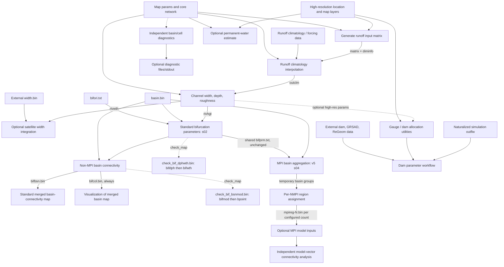

# CaMa-Flood v5 Parameter and Analysis Tools Migration Plan

**Status:** Phases B2.1, B2.2, the standard bifurcation workflow in Phase B2.3 and MPI preprocessing/analysis in Phase B2.4, and the v5 runoff-pair naming convention are implemented. `map/src/` remains the preserved historical v4 tool tree, and `gosh/` simulation scripts remain unchanged. The v5 workflows under `map/tools/` derive `inpdim_<ROFFTAG>.txt` and `inpmat_<ROFFTAG>.bin`; legacy workflows retain `diminfo_` names. Other parameter, allocation, and independent analysis migrations remain pending.

## Scope and evidence

This plan covers the legacy parameter tools in `map/src/src_param/`, the dam workflow in `map/src/src_dam/`, the existing shared code and regional workflow under `map/tools/`, and the registry in `map/map_variables.csv`. Source behavior below is marked **verified** when read directly from source or scripts. The family organization described below includes the maintainer-approved decision to place gauge and dam allocation wrappers in `script_params/`; other migration details remain proposals unless identified as approved. Filenames and defaults quoted below are source defaults, not recommendations for scientific use.

The repository is on `feature/map-data-tools` (Issue [#122](https://github.com/global-hydrodynamics/CaMa-Flood_v4/issues/122)). `map/src/` remains the legacy tree, and its Fortran calculations are not changed by the filename migration. The established v5 regional layout places shared executables in `map/tools/code/` and map-local wrappers in `map/tools/script_region/`; regional scripts rely on a map-local working directory and do not build tools themselves.

## Runoff-pair filename convention

The maintainer approved `ROFFTAG` as the identifier for a runoff product/input-mapping configuration. v5 producers and consumers derive the paired names `inpdim_${ROFFTAG}.txt` and `inpmat_${ROFFTAG}.bin`; record 7 in the text descriptor continues to name the paired matrix, and the descriptor's eleven-record format and the matrix binary layout are unchanged. `HIRES_TAG` is a separate selector for map-resolution directories such as `1min` or `15sec`; it must not be used to name runoff products. Legacy `diminfo_` descriptors are retained alongside the new Mekong v5 names so existing `gosh/` and package workflows continue to find their configured files. The model configuration key `diminfo_file` is not renamed.

The v5 scripts, shared input-matrix tool, registry, CTL descriptor lookup, and Mekong sample have been updated. The maintainer has clarified that `map/src/` is the historical v4 tool tree and should be preserved; its regional, parameter, and MPI workflows retain their historical `diminfo_` naming. The six `map/src/src_param/` shell templates temporarily changed during the ROFFTAG task were restored to their original v4 versions. Future v5 work should happen under `map/tools/`.

The standard non-MPI bifurcation migration (Phase B2.3) and MPI-preprocessing/analysis migration (Phase B2.4) are implemented under `map/tools/`. The v5 MPI workflow consumes standard `bifprm.txt`, writes `bifcol_mpi.bin` from MPI-aggregated basin IDs, and writes numbered `mpireg-N.bin` maps. `analysis_mpi_region_color` remains available for optional manual creation of `bsncol_mpi-N.bin`, but s04 does not invoke it. The historical v4 implementation remains unchanged under `map/src/`; this migration does not alter `gosh/` runtime scripts.

## Existing programs

The legacy `map/src/src_param/Makefile` builds 17 programs. `calc_outclmday.F90` is also present but is **not** in its target list. All legacy Fortran sources are retained under `map/src/` regardless of a future migration.

| Legacy source / proposed family name | Function; arguments and defaults (verified) | Inputs → outputs / side effects | CWD, workflow, dependencies and migration notes |
| --- | --- | --- | --- |
| `generate_inpmat.F90` → `param_inpmat_generate` | Map/runoff-grid remapping matrix. Positional arguments: `HIRES_TAG [GRSIZE WEST EAST NORTH SOUTH OLAT INPDIM INPMAT]`. The v5 wrapper derives the output names from one `ROFFTAG`; its retained example uses a 0.25-degree grid, global longitude bounds, 90 to -60 latitude bounds, and `NtoS`. | Reads `params.txt`, `<HIRES_TAG>/location.txt`, each area's `catmxy.bin`, and `grdare.bin` when present. Writes the configured descriptor and matrix, with record 7 naming the matrix. Does not read runoff values. | The v5 shared copy is `map/tools/code/param_inpmat_generate.F90`, built by `make -C map/tools/code param`; its wrapper template is `map/tools/script_params/s03-generate_inpmat.sh`. Requires map geometry and high-resolution catchment layers. It remains distinct from the fixed standard climatology product made by `region_default_inpmat`. The legacy source's first argument still means high-resolution map resolution. |
| `calc_outclm.F90` → `param_channel_calc_outclm` | Calculates annual mean discharge. CLI: `TYPE INTERP INPDIM CROF [NETCDF_VAR]`; the v5 source default is `./inpdim_test-1deg.txt`, while unchanged legacy source retains its `diminfo_` default. Runoff default and NetCDF variable remain source-defined; the v5 wrapper supplies `ELSE_GPCC_clm-1981-2010.one` in mm/s. Binary and optional NetCDF paths, plus `near`/`inpmat` interpolation, are retained. | Reads `nextxy.bin`, `ctmare.bin`, the supplied descriptor, input matrix in `inpmat` mode, and runoff; writes/replaces one-record float32 `outclm.bin` in m3/s. | Migrated mechanically to `map/tools/code/param_channel_calc_outclm.F90`; invoked by v5 `s01-channel_params.sh` from map-root CWD. NetCDF support depends on build configuration. |

The maintainer confirmed that `near` is a precautionary optional path and is not used by the standard channel workflow. The v5 `s01-channel_params.sh` explicitly selects `inpmat`; retain the existing `near` implementation unchanged.
| `calc_outclmday.F90` (legacy only) | Historical daily-climatology variant. The maintainer identifies it with the older maximum-30-day approach associated with Yamazaki et al. (2011); later evaluation favored annual mean runoff. | Reads daily runoff and writes `outclm.bin` plus an intermediate `tmp.bin`; not built by the legacy Makefile and not invoked by the active recipe. | Explicitly retained only under legacy `map/src/`; not migrated or used by v5. Its historical method was not scientifically revalidated by this task. |
| `calc_rivwth.F90` → `param_channel_calc_rivwth` | Empirical river width, depth, roughness and infinite-depth products. Args: `TYPE INPDIM HC HP HO HMIN WC WP WO WMIN`. Source defaults differ from the standard wrapper's explicit coefficient choices. | Reads `outclm.bin`, `nextxy.bin`, the supplied descriptor; writes/replaces `rivwth.bin`, `rivhgt.bin`, `rivman.bin`, `rivhgt_inf.bin`; CDF mode can write partial `rivpar.nc`. | Migrated mechanically to `map/tools/code/param_channel_calc_rivwth.F90`; called by v5 `s01-channel_params.sh` with the legacy standard workflow's coefficients and map-root CWD. Optional NetCDF behavior remains conditional on build configuration. |
| Legacy `set_gwdlr.F90` → v5 `param_channel_set_merit_width.F90` / `param_channel_set_merit_width` | Merges the power-law width with MERIT Hydro width using unchanged legacy thresholds; one descriptor path argument. | Reads the descriptor, `nextxy.bin`, power-law `rivwth.bin`, and `width.bin`; v4 writes `rivwth_gwdlr.bin`, v5 writes `rivwth_merit.bin`. Neither replaces power-law `rivwth.bin` or depth `rivhgt.bin`. | The shared utility is built by `make -C map/tools/code param` and called by v5 `s01-channel_params.sh` from map-root CWD. The v5 output is not automatically selected by the current core reader, which opens `rivwth.bin`; legacy scripts remain unchanged. |
| `calc_prmwat.F90` → `param_calc_prmwat` | Estimates permanent-water parameter from high-resolution maps; one high-resolution tag argument. | Reads root `params.txt`, `nextxy.bin`, `ctmare.bin`, and `<HIRES_TAG>/location.txt`, per-area `catmxy.bin`, optional `grdare.bin`, and `flddif.bin`; writes `prmwat.bin`. | Future `s05-permanent_water.sh`; not included in the v5 channel workflow. Requires auxiliary high-resolution products; not a standard prerequisite for every run. |
| `set_bifparam.F90` → `param_bif_set_params` | Derives standard bifurcation hydraulic parameters. Args: input river-height file, output text file, layer count, optional diminfo, optional `check_map` token. | Reads `nextxy.bin`, `basin.bin`, `bifori.txt`, and river height; always writes `bifprm.txt`; only with `check_map`, writes `check_bif_dphwth.bin` (two direct-access float32 records: depth and width). The legacy v4 source still writes `bifdph.bin`. | The new v5 `s02-bifurcation.sh` runs it from map-root CWD. It preserves `BIFLAYER=5`, the standard non-MPI output order, and regular outputs. MPI sorting is reserved for `s04-mpi_map_setup.sh`. |
| `set_bif_basin.F90` → `param_bif_set_basin` | Reconciles basin connectivity through registered pathways. Optional argument `check_map`. | Reads parent `params.txt`, `nextxy.bin`, `basin.bin`, and `bifprm.txt`; always writes `bifbsn.bin` and `bifcol.bin`; with `check_map`, writes `check_bif_bsnmod.bin` with two int32 records (`bifmod`, then `bpoint`). | The v5 wrapper runs it from map-local `script_params/`, which its `../` paths require. It performs only ordinary non-MPI processing. It does not write legacy `bifmod.bin` or `bpoint.bin`. |
| `set_bif_basin_mpi.F90` → `param_mpi_set_basin` | MPI-oriented basin aggregation. Optional `MaxMPI` argument selects the legacy 3% threshold instead of normal 6%; both retain the 0.1% small-basin exception. | Reads standard parent map inputs and the unchanged ordinary `bifprm.txt`; internally sorts parsed `ibsn`, `jbsn`, `elv`; writes `bifcol_mpi.bin` from MPI-aggregated basin IDs and temporary `bifbsn_mpi.tmp`. | Legacy v4 wrapper remains `s03-mpi_map_setup.sh`; v5 wrapper is `s04-mpi_map_setup.sh`. It does not modify standard bifurcation hydraulics or persist MPI-specific pathway tables. The color output is independent of region count but can vary by aggregation mode. |
| `set_mpi_region.F90` → `param_mpi_set_region` | Creates a region assignment for a requested processor count. Required `N_MPI` argument. | Reads `params.txt` and temporary basin groups; writes one-record int32 `mpireg-N.bin`; performs no coloring. The optional `analysis_mpi_region_color` separately reads a selected `mpireg-N.bin` and can manually create `bsncol_mpi-N.bin`. | The v5 implementation is invoked by `s04-mpi_map_setup.sh`; it no longer reads bifurcation tables or writes `bifprm-N.txt`. s04 does not invoke the region-color utility and does not create an unnumbered `mpireg.bin` alias. |
| `get_rivinfo.F90` → `analysis_get_rivinfo` | Prints river cell/network information. `xy IX IY` or `latlon LAT LON` (the `type` selects mode). | Reads parent params, `nextxy`, `basin`, `upgrid`, `uparea`, `ctmare`, `elevtn`, `lonlat`; lat/lon mode may read high-resolution `location.txt` and `catmxy`. Prints to stdout; no persistent output. | Standalone diagnostic, not part of the channel shell workflow. Legacy relative paths imply map-local `src_param/` CWD. High-resolution details depend on installed layers/tags. |
| `get_upbasin.F90` → `analysis_get_upbasin` | Produces upstream-basin mask from an outlet cell. Args `IX IY [OUTPUT]`; default output `../upbasin.bin`. | Reads parent params, `nextxy.bin`, `upgrid.bin`, `uparea.bin`; writes/overwrites selected binary. | Standalone diagnostic from map-local `src_param/`; output path default is CWD-relative. |
| `get_subbasin.F90` → `analysis_get_subbasin` | Extracts a basin using an upstream-area threshold. One numeric threshold argument is parsed; source has a nominal default but its empty-argument path stops, so a caller should pass the argument. | Reads parent params, `nextxy.bin`, `uparea.bin`; writes/overwrites `subbsn.bin`, `subcol.bin` in parent map. | Standalone analysis; map-local `src_param/` CWD. Do not encode a default that the source does not actually accept as a no-argument invocation. |
| `get_vecmap.F90` → `analysis_get_vecmap` | Prints network/outlet diagnostics for a geographic rectangle. Args west, east, south, north; source also supports a no-argument usage path. | Reads parent params, `nextxy`, `uparea`, `elevtn`, `lonlat`; emits stdout, no map output file. | Standalone analysis; relative paths require map-local `src_param/` CWD. |
| `wrte_ctl_map.F90` → candidate `analysis_wrte_ctl_map` or remain legacy-only | Writes a GrADS CTL description. Args binary path, CTL path, type, xy mode, west, east, south, north, grid size. | Writes the requested text CTL; does not read the binary. | No current parameter workflow calls it. V5 `map/tools/code/generate_ctl.py` is the active registry-aware tool. Preserve source; whether to build an additional legacy-named CTL executable is a maintainer choice. |
| `allocate_flow_gauge.F90` → `allocate_flow_gauge` | Allocates flow-gauge locations against map and high-resolution network. Args gauge-list path and optional mode (`multi`/`single`); any omitted or unrecognized mode defaults to `multi`. | Reads map `params`, `uparea`, `nextxy`, high-resolution location/uparea/catmxy/downxy; writes `gauge_alloc.txt` in CWD. | `t01-alloc_flow_gauge.sh` runs from map-local `src_param/`, moves output to map root's GRDC location. External gauge list required. Source expects a single high-resolution area in its handling; multi-area location is a compatibility risk. |
| `allocate_level_gauge.F90` → `allocate_level_gauge` | Allocates level/observation gauges using channel/elevation and high-resolution maps. One input list argument. | Reads map params, `uparea`, `elevtn`, `nextxy`, high-resolution `uparea`, `catmxy`, `downxy`, `elevtn`; writes `gauge_alloc.txt`. | `t03-alloc_level_gauge.sh`; map-local `src_param/` CWD; external observation list. Similar single-area limitation. |
| `allocate_dam.F90` → `allocate_dam` | Allocates a dam list to river and small-catchment locations. One dam-list argument. | Reads map params, `uparea`, `ctmare`, `nextxy`, high-resolution `uparea`, `catmxy`, `downxy`; writes `dam_alloc_river.txt`, `dam_alloc_small.txt`, `dam_alloc_error.txt` in CWD. | `t02-alloc_dams.sh` moves selected outputs to map root. External dam list and high-resolution maps required. Uses the same general high-resolution selection pattern as allocation tools. |

### Dam parameter workflow (Python; not a Fortran migration)

`map/src/src_dam/` is a separate workflow, not a program family to mechanically move into the Fortran executable build. `s00-link.sh` creates links under its local `inp/` from a configured map, allocated dam list, naturalized simulation outputs and external GRSAD/ReGeom datasets. `s01-calc_damparam.sh` then invokes:

1. `p01_get_annualmax_mean.py`: yearly `outflw` inputs and allocated dam cells → annual maxima and means.
2. `p02_get_100yrDischarge.py`: annual maxima → Gumbel 100-year discharge estimate.
3. `p03_est_fldsto_surfacearea.py`: dam list plus GRSAD surface-area history and ReGeom geometry → flood-control/total storage intermediate table.
4. `p04_complete_damcsv.py`: merges records, filters by `MINUPAREA`, handles multiple dams per map cell, writes a final table; wrapper prepends a count line as `dam_param.csv`.

The checked-in sample uses years 2000–2001 and is explicitly a demonstration setting. `modify_damloc.py` and `est_fldsto_totalsto.py` are separate utilities, not called by the main shell workflow. Inputs are external and may carry terms of use. Keep this workflow's Python dependencies, data provenance and scientific method separate from the Fortran `allocate_dam` location-allocation program. The approved `script_params/` family includes gauge and dam allocation; it does not by itself decide whether to move the legacy Python estimation templates from map-local `src_dam/`. A future template may remain there and be linked from `script_params/` documentation, or be organized as a clearly separate recipe within `script_params/`; no Python workflow migration is approved here.

## Approved shell-family organization

The maintainer approved merging the previously proposed allocation shell family into `script_params/`. Gauge and dam allocation are part of map preparation typically performed when creating a map, so the script templates belong with parameterization workflows. The three shell families are `script_region/` (regional map generation), `script_params/` (channel parameterization, runoff matrices, bifurcation/MPI setup, gauge and dam allocation), and `script_analysis/` (independent analysis and diagnostics). All Fortran sources and executables remain in `map/tools/code/`; executable prefixes may remain `region_*`, `param_*`, `analysis_*`, and `allocate_*`. This is an organizational decision only: it authorizes no implementation or algorithm/interface changes, and legacy tools under `map/src/` remain unchanged.

## Current shared v5 tools and regional comparison

`map/tools/code/Makefile` builds the `region_*` programs, including `region_default_inpmat`, migrated parameter tools under `param_*`, and MPI connectivity analysis under `analysis_*`; allocation tools under `allocate_*` remain pending. `generate_ctl.py` is a Python tool in the shared code directory. `map/tools/script_region/` holds generic regionalization and CTL scripts. The maintainer-approved target organization places channel parameters, user-configured input matrices, bifurcation/MPI setup, and gauge/dam allocation wrappers in `script_params/`; independent diagnostics belong in `script_analysis/`. The implemented v5 parameter templates are `s01-channel_params.sh`, `s02-bifurcation.sh`, `s03-generate_inpmat.sh`, and `s04-mpi_map_setup.sh`.

### Three `generate_inpmat` implementations are not interchangeable

| Implementation | Intended task and interface | Grid/path/output facts | Reuse risk |
| --- | --- | --- | --- |
| Legacy `map/src/src_param/generate_inpmat.F90` | General map-specific forcing-grid matrix; CLI accepts grid spacing, bounds, latitude order and output names. | Reads `params.txt` from current map-root CWD and high-resolution `location.txt`/`catmxy`; supports supplied `grdare` or a fallback area calculation; `nmax=100`. Writes dimension metadata and a matrix with 3×`mmax` direct records grouped as x-index, y-index, area. | Its caller controls the forcing grid and outputs; changing defaults or record order can break existing input workflows. |
| Legacy `map/src/src_region/generate_inpmat.F90` | The source-template regionalization variant (v4). | Implements the regional workflow's fixed example matrix settings and local source paths; output is the template's paired diminfo/matrix. | Distinct role/defaults from the general parameter utility; do not overwrite one implementation with the other based on the matching basename. |
| V5 `map/tools/code/region_default_inpmat.F90` | Standard distributed map-product generator used by v5 regionalization. Only high-resolution tag is passed; fixed settings produce the default 1-degree global N-to-S climatology matrix `inpmat_test-1deg.bin` and paired `inpdim_test-1deg.txt` (`ROFFTAG=test-1deg`). | Reads regional `params.txt`, `location.txt`, `catmxy`, optional `grdare`; constructs 3 grouped direct-access records. It does not read runoff data; the matrix is later used with the standard annual runoff climatology for channel cross-section estimation. | The legacy v4 regional generator remains under `map/src/src_region/generate_inpmat.F90` and its fixed descriptor filename remains `diminfo_test-1deg.txt`; general user-selected grids remain under `map/src/src_param/generate_inpmat.F90`. Do not consolidate these distinct tools. |

For B2.1, the general `src_param` source was copied without algorithm changes and compiled under the new executable name. Legacy and shared executables were run with identical settings on temporary copies of the Mekong map, including its available `grdare` input. Output metadata and matrix bytes were compared. The test covers this sample/settings only; synthetic edge cases, absent-`grdare` fallback, multi-area maps, 100+ contributors, and broader scientific validation remain future work. Reuse among the three distinct input-matrix implementations is still not proposed; any consolidation or intentional format difference requires separate evidence and approval.

## Workflow dependency graph

This graph depicts source/workflow dependencies, not an obligatory order implied by `s01`, `s02`, or `s03` numbering. Dashed boxes are optional or independent workflows.

The standard sequence intentionally runs `s02-bifurcation.sh` after `s01-channel_params.sh`, which produces the required `rivhgt.bin`. The `s02` basin merge is a general map-preparation operation, not an MPI operation. It merges basin IDs across pathways registered in `bifprm.txt`; `bifbsn.bin` represents potential connectivity through those pathways. `bifcol.bin` is an unconditional standard output because it is routinely used to visualize the merged map. With `check_map`, the two programs also write `check_bif_dphwth.bin` (`bifdph`, then `bifwth`) and `check_bif_bsnmod.bin` (`bifmod`, then `bpoint`). These diagnostic products are not simulation inputs and are not created or overwritten by the default invocation. The v5 workflow does not write separate `bifmod.bin` or `bpoint.bin`; those are retained as legacy v4 outputs. `biftag.bin` is excluded from the v5 product specification. The historical v4 MPI path separately produces `bifbsn_mpi.bin` and partition-specific pathway tables, but the v5 MPI workflow removes these unnecessary persistent intermediates. Ordinary `bifbsn.bin` is not a direct input to MPI basin aggregation. The v5 `s04` workflow is described in the implementation notes below.

The legacy v4 `map/src/src_param/s01-channel_params.sh` combines climatology, channel parameters, width fusion, bifurcation parameters, optional permanent water, and basin preparation in one recipe. The v5 `map/tools/script_params/s01-channel_params.sh` is intentionally narrower: it runs only annual mean discharge, power-law channel parameterization, and MERIT Hydro width merging. The v5 map-preparation numbering is maintainer-approved; it communicates a preferred process order without making every step mandatory.

## Inputs, outputs and execution-location matrix

| Workflow | Major inputs | Main products / overwritten files | Verified CWD and external dependency | Existing caller / duplication |
| --- | --- | --- | --- | --- |
| Runoff matrix | Root `params.txt`; high-res `location.txt`, `catmxy`, optional `grdare`; user-selected runoff grid | `inpmat_<ROFFTAG>.bin` plus `inpdim_<ROFFTAG>.txt` | Map root after wrapper `cd`; high-res selector is `HIRES_TAG`. Legacy `src_region` still writes its old fixed descriptor name. | `s02-*` legacy shell variants; v5 `s03-generate_inpmat.sh`; variants differ in grid bounds/resolution. Separate from v5 regional sample matrix. |
| Climatological discharge | `nextxy`, `ctmare`, `inpdim_<ROFFTAG>`, paired `inpmat_<ROFFTAG>` (unless nearest mode), binary or optional NetCDF runoff | `outclm.bin` | Map root after wrapper `cd`; external runoff dataset. | `s01-channel_params.sh`; daily program is not active in the wrapper/build target. |
| Channel parameterization | `outclm`, `nextxy`, `inpdim_<ROFFTAG>` and configured coefficients | `rivwth`, `rivhgt`, `rivman`, `rivhgt_inf`; optional `rivpar.nc` | Map root; compiler/NetCDF settings conditional. | `s01-channel_params.sh`; output files written directly. |
| Legacy v4 width merge | `rivwth`, `width.bin`, `nextxy`, diminfo | `rivwth_gwdlr.bin` | Map root; old `set_gwdlr.F90` and scripts remain unchanged. | Optional step in the legacy `s01`. |
| v5 MERIT Hydro width merge | power-law `rivwth.bin`, MERIT Hydro `width.bin`, `nextxy`, diminfo | `rivwth_merit.bin` | Map root; shared `param_channel_set_merit_width`. | Invoked as the third step by v5 `s01-channel_params.sh`; output is not automatically selected by the current model reader. |
| Permanent water | Core map and selected high-resolution `location`, `catmxy`, optional `grdare`, `flddif` | `prmwat.bin` | Map root; high-resolution map. | Legacy `s01` includes this optional step; planned v5 organization assigns it to `s05`. |
| Standard bifurcation | `params.txt`, `nextxy.bin`, `basin.bin`, `bifori.txt`, `rivhgt.bin`, `inpdim_<ROFFTAG>` | Always: `bifprm.txt`; optional check output: two-record `check_bif_dphwth.bin` | `param_bif_set_params` from map root; map dimensions in the descriptor must match `params.txt`. | v5 `s02`; uses default `ROFFTAG=test-1deg` and legacy `BIFLAYER=5`; check map only with `check_map`; no MPI sort or variant generation. Legacy v4 still writes `bifdph.bin`. |
| Standard basin connectivity | map-root params/network/basin and `bifprm.txt` | Always: `bifbsn.bin`, `bifcol.bin`; optional `check_bif_bsnmod.bin` (two int32 records: `bifmod`, `bpoint`) with `check_map` | Map-local `script_params/` CWD because executable inputs/outputs use `../`. | Second step of v5 `s02`; does not emit separate legacy `bifmod.bin` / `bpoint.bin`. |
| MPI setup | Parent `params.txt`, `basin.bin`, ordinary `bifprm.txt` | Persistent `bifcol_mpi.bin` from aggregated basin IDs; temporary `bifbsn_mpi.tmp`; `mpireg-N.bin` for each requested count; optional manually generated `bsncol_mpi-N.bin`; default-count connectivity report | Aggregation and partitioning run from map-local `script_params/`; connectivity runs from map root. Region coloring is a separate manual analysis command. | Implemented v5 `s04-mpi_map_setup.sh`; `bifcol_mpi.bin` does not depend on N, while its color classes may vary with `MPIMODE`. s04 does not invoke `analysis_mpi_region_color`. |
| Diagnostics | map params, network, selected derived basin/area rasters | stdout or optional `upbasin.bin`, `subbsn.bin`, `subcol.bin` | Source uses parent-relative paths; run from map-local `src_param/`. | Invoked independently, not included in parameter shell recipes. |
| Gauge/level/dam allocation | allocated input lists; core and high-resolution maps | generic `gauge_alloc.txt`; dam river/small/error tables | Map-local `src_param/` CWD; external gauge/dam lists. | `t01`–`t03` shell templates; independent of channel-parameter sequence. |
| Dam parameter estimation | naturalized simulation output, allocated dam table, GRSAD/ReGeom | temporary per-stage tables and final `dam_param.csv` | map-local `src_dam/`; external datasets and Python NumPy/pandas/SciPy. | Separate Python workflow; not called by `allocate_dam` or `s01`. |

All listed output programs open target paths directly; wrappers often move files afterward. Do not assume a tool protects existing outputs. A future wrapper must preserve current overwrite semantics unless a separate behavior change is explicitly approved.

### Existing shell entry points

The following table inventories legacy shell scripts under `map/src/src_param/`; their filenames remain, while the selected input-matrix wrappers and channel/MPI consumers now derive the new pair names. Fortran algorithms are retained. The new v5 templates are listed separately below.

| Script | Role/configuration actually in the script | Inputs, outputs and CWD observations |
| --- | --- | --- |
| `s01-channel_params.sh` | One sample channel recipe; configures runoff type/interpolation, `ROFFTAG`, runoff path and channel coefficients; invokes optional width fusion/permanent-water and bifurcation/basin steps. | Its actual `cd ..` and later executable paths mean it is launched from a map-local `src_param/` copy. Reads the derived metadata/matrix pair and needs external runoff climatology, possibly `width.bin`/high-res layers. Directly overwrites map products. |
| `s02-generate_inpmat.sh`, `sample_tej_s02-generate_inpmat.sh` | General and regional runoff-grid examples; select a `ROFFTAG` for paired output names and a separate `HIRES_TAG` for high-resolution lookup data. | Start in map-local `src_param/`, change to map root, invoke the legacy generator, and write a paired input descriptor/matrix. Require high-res map files. |
| `era5_hour_s02-generate_inpmat.sh`, `u01_era5_hour_generate_inpmat.sh` | ERA5 hourly matrix variants with substantially overlapping 0.1-degree grid configuration. | Both derive paired `inpdim_ERA5_hour.txt` / `inpmat_ERA5_hour.bin` by default and use map/high-res files. Their duplication appears configuration-level; compare exact settings before consolidating. |
| `u02_ERA5_sixmin_generate_inpmat.sh` | ERA5 six-minute forcing variant; uses a 0.1-degree global grid and a different longitude extent/origin convention from the other ERA5 scripts. | Derives the `ERA5_sixmin` pair and uses map/high-res files. Do not merge settings by script-name similarity. |
| `sample_tej_s02-generate_inpmat.sh` | Regional input-grid example for the Tej/Tapi-area setup (123–148°E, 24–46°N, 1/60-degree input spacing). | Same executable; map-specific high-res data required. Its bounds and grid are not a general default. |
| `s03-mpi_map_setup.sh` | Builds bifurcation/MPI support products, invokes bifurcation preparation, optionally selects `MaxMPI`, uses system `sort`, then creates several processor-count products and selects `mpireg.bin`. | The current script still references the legacy `diminfo_test-1deg.txt`; migration to `inpdim_<ROFFTAG>.txt` remains pending. Launch from map-local `src_param/`; it does not use runoff-matrix generation as a mandatory predecessor. |
| `t01-alloc_flow_gauge.sh` | Flow-gauge allocation. | Expects configured external gauge list under the map copy's relative `../../data`; invokes allocator in `src_param/`, then moves the allocation output into map data. |
| `t02-alloc_dams.sh` | Dam-list allocation. | Expects configured external dam list; invokes `allocate_dam`, then moves selected output(s) into map root. `dam_alloc_error.txt` under `src_param/` is an existing diagnostic/example file, not a Fortran source. |
| `t03-alloc_level_gauge.sh` | Level-gauge allocation. | Expects configured external level-gauge list under relative data path; invokes allocator and moves output to map root. |

### Implemented v5 scripts

| Script | Role and execution | Inputs / outputs |
| --- | --- | --- |
| `map/tools/script_params/s01-channel_params.sh` | Map-local template; resolves shared executables, runs with map-root CWD, and reports the failed stage. | Derives the standard `inpdim_test-1deg.txt` / `inpmat_test-1deg.bin` pair from `ROFFTAG=test-1deg`, and reads network/core map files, `width.bin`, and annual-mean runoff (default `../data/ELSE_GPCC_clm-1981-2010.one`). Writes `outclm.bin`, power-law channel products, and alternate `rivwth_merit.bin`. |
| `map/tools/script_params/s02-bifurcation.sh` | Standard non-MPI parameter and basin-connectivity workflow; calls the shared programs from their required CWDs. | Reads map geometry/network, `basin.bin`, `bifori.txt`, `rivhgt.bin`, and `inpdim_<ROFFTAG>.txt` (default `ROFFTAG=test-1deg`); validates the seventh-line paired matrix name. |
| `map/tools/script_params/s03-generate_inpmat.sh` | v5 map-local template for user-configured runoff grids; separate from the standard matrix. | `ROFFTAG` derives both filenames. `HIRES_TAG` selects high-resolution catchment inputs. Writes `inpdim_<ROFFTAG>.txt` and `inpmat_<ROFFTAG>.bin` with the metadata's seventh line matching the binary name. |

The v5 input-matrix wrapper was renumbered from `s02-generate_inpmat.sh` to `s03-generate_inpmat.sh` as a mechanical naming change approved by the maintainer. Selected legacy `src_param` wrappers retain their original v4 names and behavior; source-region scripts and `gosh/` likewise remain under the legacy naming convention.

The three grid-specific input-matrix scripts and the three allocation scripts are separate runnable examples, not a single ordered pipeline. Shell comments, executable relative paths and `cd` operations should be checked together when porting each wrapper; comments alone are not reliable CWD evidence.

## Migration mapping and deferred tools

The table records implemented v5 names as well as deferred target names. Future entries remain proposals unless explicitly marked as approved decisions. Legacy source files and map-local v4 copies remain intact.

| Legacy source | Proposed shared source / executable | Wrapper area | Notes |
| --- | --- | --- | --- |
| `generate_inpmat` (general `src_param`) | `param_inpmat_generate.F90` / `param_inpmat_generate` | `script_params/s03-generate_inpmat.sh` | Implemented in B2.1. User-selected runoff grids; distinct from the standard matrix produced by `region_default_inpmat`. |
| `calc_outclm` | `param_channel_calc_outclm.F90` / `param_channel_calc_outclm` | `script_params/s01-channel_params.sh` | Implemented in B2.2; preserves CLI and conditional NetCDF paths. The standard wrapper uses annual mean ELSE_GPCC runoff and the existing standard input matrix. |
| `calc_outclmday` | Legacy-only source | None | The maintainer approved keeping the historical daily/maximum-30-day implementation only under `map/src/`; it is not migrated or invoked by v5. |
| `calc_rivwth` | `param_channel_calc_rivwth.F90` / `param_channel_calc_rivwth` | `script_params/s01-channel_params.sh` | Implemented in B2.2; the wrapper's explicit coefficients and binary outputs match the legacy workflow. |
| Legacy `set_gwdlr` | `param_channel_set_merit_width.F90` / `param_channel_set_merit_width` | `script_params/s01-channel_params.sh` | Implemented in B2.2. v4 writes `rivwth_gwdlr.bin`; v5 writes `rivwth_merit.bin` using the unchanged merge calculation. |
| `calc_prmwat` | `param_calc_prmwat` | Future `script_params/s05-permanent_water.sh` | Not included in B2.2. |
| `set_bifparam`, `set_bif_basin` | `param_bif_set_params.F90` / `param_bif_set_basin.F90` | `script_params/s02-bifurcation.sh` | Implemented in B2.3 for ordinary non-MPI processing; preserves the legacy layer default and output order. |
| `set_bif_basin_mpi`, `set_mpi_region` | `param_mpi_set_basin`, `param_mpi_set_region` | Implemented `script_params/s04-mpi_map_setup.sh` | Consumes standard `bifprm.txt`, internally sorts parsed basin IDs/elevation, creates temporary basin groups and persistent region maps; no MPI-specific pathway tables are retained. |
| `get_rivinfo`, `get_vecmap`, `get_upbasin`, `get_subbasin` | `analysis_get_*` | `script_analysis/` | Standalone diagnostics; wrappers can offer stable user entry points. |
| `allocate_flow_gauge`, `allocate_level_gauge`, `allocate_dam` | `allocate_*` | `script_params/` | Allocation recipes are part of map preparation; preserve input schemas and generated filenames. |
| `wrte_ctl_map` | Retain under `map/src/`; no B2.2 migration | none | Python CTL generator is the v5 tool; the legacy program remains untouched. |
| `src_dam` Python scripts | No Fortran binary mapping | Keep the legacy workflow under `map/src/src_dam/`; any future `script_params/` recipe must remain distinct from allocation | Dam parameter estimation consumes simulation results and has external-data requirements; no migration is approved. |

## Shared build and CWD compatibility strategy

### Verified constraints

- `map/tools/code/Makefile` already builds shared binaries in that directory; it has `region_*` rules and a prepared `param_*` wildcard rule, but no `analysis_*` or `allocate_*` rules.
- Many old programs use hard-coded `../params.txt`, `../nextxy.bin`, etc. and therefore depend on starting in a map-local `src_param/` directory. Other channel programs use `./params.txt` and expect map-root CWD. Script comments are not uniformly consistent with their actual `cd`/path handling.
- The standard scripts and standalone programs sometimes have different CWD assumptions. The source file or binary directory does not imply the working directory.
- Executables in the shared directory must not be recompiled into a copied map directory. The map-local wrapper should point to `../../tools/code/<family>_*` while setting the working directory explicitly.

### Proposed compatibility approach

1. Treat each existing map-local shell script as an operational entry point. For B2.1, preserve the legacy general-matrix example's output names and runoff-grid geometry while routing it to the shared executable. For later migrations, preserve arguments, selected settings, output locations, recipe order, and CWD-sensitive behavior unless separately approved.
2. For each program, record an explicit input CWD and output CWD in wrapper comments/README. Use a subshell or explicit directory change so a wrapper cannot leak CWD changes to the caller. Do not impose one universal CWD on all executables.
3. Build every migrated executable once in `map/tools/code/` via family targets in the unified Makefile. Keep target families `region_*`, `param_*`, `analysis_*`, and `allocate_*`; avoid new directory layers unless a concrete build constraint appears.
4. Keep old map-local source copies and old Makefiles untouched. Do not add compatibility symlinks or rename public wrapper scripts without maintainer approval.
5. Preserve existing default output overwrite behavior in the first migration. Add safe guards or output-path changes only as separately reviewed interface changes.

## Suggested shell organization

- `map/tools/script_region/`: existing regional map workflow; no changes required for B2.
- `map/tools/script_params/`: the parameter and map-preparation family. Organize distinct recipes for runoff matrices, channel parameters, bifurcation/MPI preprocessing, and flow-gauge, level-gauge, and dam location allocation. Shell numbering may organize a recipe but must not imply all recipes are universally sequential. Keep dam **parameter estimation** visibly separate from location allocation.
- `map/tools/script_analysis/`: independent basin, vector/river-cell, and metadata/CTL inspection tools; each wrapper should document arguments, expected map-local CWD, optional output, and data requirements.

The approved organization has three shell-script families: `script_region/`, `script_params/`, and `script_analysis/`. Do not create `script_allocate/`. Executables remain centralized in `map/tools/code/`; retain distinct `region_*`, `param_*`, `analysis_*`, and `allocate_*` prefixes where useful. The allocation prefix identifies executable function and does not require a separate shell-script family.

Map-local copies of these scripts are usage/configuration templates, not executable sources. They should invoke built shared binaries using resolved paths. Existing v4 `map/src/src_param/` and `map/src/src_dam/` remain available to users and are not auto-rewritten.

## Current registry product groups

The maintained `map/map_variables.csv` uses `category_id` as its workflow-oriented sorting key. IDs 10–19 cover products distributed by default or created during regionalization; 900–999 cover high-resolution data. Parameter and auxiliary groups remain incrementally organized. Keep one row per logical variable for multi-record files and apply the same ID to all variables in a file.

| Current ID | Group | Relevant products and boundary |
| ---: | --- | --- |
| 20 | Unassigned | No product is currently assigned. |
| 21 | `param_cross-section` | `outclm.bin` and channel width/depth/roughness products from the `s01` workflow. |
| 22 | `bifurcation` | Standard non-MPI `bifprm.txt`, `bifbsn.bin`, and unconditional visualization output `bifcol.bin`; optional v5 `check_bif_dphwth.bin` (`bifdph`, `bifwth`) and `check_bif_bsnmod.bin` (`bifmod`, `bpoint`) diagnostics. Separate `bifmod.bin` and `bpoint.bin`, plus `bifdph.bin`, are legacy outputs; `biftag.bin` is excluded from v5. |
| 23 | `input_matrix` | User-configured input-matrix products and paired configuration. |
| 24 | `MPI` / `bifurcation` | MPI-specific basin aggregation and region products, including `bifcol_mpi.bin` and optional `bsncol_mpi-N.bin`. |
| 25 | Unassigned | No current product uses this ID. |
| 29 | `dam_reservoir` / `inflow_scheme` | Specialized dam/reservoir and inflow-boundary products in the current registry. |
| 52 | `input_matrix` | User-configured runoff-grid matrices and their dimension metadata; distinct from the standard regionalization matrix. |
| 62–63, 81, 99 | Supplementary, gauge, and NetCDF groups | Preserve existing assignments while their workflows are addressed. |
| 900–901 | High-resolution metadata and layers | High-resolution products remain separate from base-map resolution products. |

The Phase B2.3 registry update follows these current groups; it does not reorganize unrelated products or finalize the remaining IDs.

## Risks, unresolved questions and approval boundaries

### Technical risks verified from current code

- **Working directory:** hard-coded relative paths mean an otherwise successful executable can read or overwrite the wrong map products if invoked from the wrong directory.
- **Output replacement:** direct-access/formatted output is opened without a no-clobber contract in many programs; a wrapper that silently changes this behavior may break established workflows.
- **Input-matrix equivalence:** the three implementations have different purposes, arguments/defaults, area calculation details, boundary/index checks and direct-record grouping. Numerical/byte equivalence is not established.
- **Build variants:** `calc_outclm` and `calc_rivwth` include optional NetCDF paths; the shared build uses the same `adm/Mkinclude` compiler settings, but NetCDF linking remains conditional on the local build configuration. `calc_outclmday` has no existing Makefile target and is intentionally not migrated.
- **Allocation assumptions:** allocation tools inspect one high-resolution area from `location.txt` in code paths; generalized multi-area support must not be assumed.
- **Overlapping process concepts:** dam allocation is Fortran and input-location focused; dam parameter estimation is Python and simulation/GRSAD/ReGeom focused. A common folder name could obscure this difference.
- **Duplicate Fortran program-unit names:** several legacy files declare generic internal `PROGRAM` names (for example `set_gwdlr.F90` declares `calc_rivwth`; the two allocation sources both declare `allocate_gauge`). The v5 MERIT-width copy uses `param_channel_set_merit_width` internally. Build target names should be based on filenames; do not rename legacy program units as part of this migration.

### Maintainer decisions required before implementation

1. Should `wrte_ctl_map.F90` remain legacy-only because v5 has `generate_ctl.py`, or should a later task offer a distinct shared executable? B2.2 leaves it untouched.
2. Should the separate Python dam-parameter estimation workflow remain linked only from its legacy documentation, or also be surfaced as a distinct future `script_params/` recipe? It must remain distinct from dam-location allocation.
3. What representative datasets and tolerances should define broader scientific validation beyond the byte-identical mechanical migration checks recorded for B2.1 and B2.2?
4. What upstream license and attribution terms apply to ELSE_GPCC beyond the single `ELSE_GPCC_clm-1981-2010.one` sample now tracked in this repository at the maintainer's direction? The package guide identifies Kim et al. (2009), but the upstream terms were not located. The repository inclusion decision for this exact file is settled; do not infer permission for other ELSE_GPCC products or derivatives.

### Open question: sample-simulation inputs and distribution

The maintainer confirmed that the `inpmat` generated by v5 `s03-generate_inpmat.sh` will be needed for a later sample simulation. The sample map/runoff product and the supporting datasets to include in the GitHub repository versus the downloadable package have not been selected. This choice affects which input matrix and data must accompany a reproducible sample run. It can be deferred while utility migration continues; do not treat the current wrapper's 0.25-degree example as the selected sample-simulation specification or add datasets on that basis. The legacy v4 `s02-generate_inpmat.sh` remains unchanged.

Numerical methods, coefficients, public interfaces, output formats, and backward compatibility changes require maintainer approval under the project rules. This plan does not approve any such changes.

## Incremental implementation plan and checkpoints

| Phase | Small task | Validation checkpoint / stop condition |
| --- | --- | --- |
| B2.0: decisions and baseline | For each remaining workflow, resolve applicable questions and capture the legacy build, command line, input fixture identity, output hashes/sizes and CWD before migration. | Establish a reproducible baseline without modifying tracked sample data; list unsupported/external inputs. No further tool is copied until its own baseline and scope are clear. |
| B2.1: general input-matrix generator | **Implemented:** copied `generate_inpmat.F90` to `map/tools/code/param_inpmat_generate.F90`; unified `param` target builds it; created map-local wrapper retaining the legacy grid settings and output names. `map/src/` remains untouched. | Build succeeded. Legacy and shared programs ran in temporary map copies using the Mekong 1min sample; metadata and binary bytes matched. A clean temporary build also compiled all five `region_*` targets, including `region_default_inpmat`; existing int32-to-int16 conversion warnings remain in `region_combine_hires.F90`. No map products were overwritten. |
| B2.2: channel parameter workflow | **Implemented:** shared copies `param_channel_calc_outclm.F90`, `param_channel_calc_rivwth.F90`, and `param_channel_set_merit_width.F90`; added `s01-channel_params.sh`; renamed the v5 general matrix wrapper to `s03-generate_inpmat.sh`. Only program-unit names changed in the first two sources; the MERIT tool changes only its v5 name/output. The old daily-climatology program remains legacy-only. No changes were made under `gosh/` or `map/src/`. | Shared `param` build and shell syntax passed. On temporary Mekong input copies using package runoff, all six outputs matched the legacy workflow byte-for-byte. Historical note: the package sample was not committed during B2.2 because redistribution terms had not then been established. In a subsequent maintainer instruction, the exact `ELSE_GPCC_clm-1981-2010.one` sample was designated for Git tracking. This is implementation regression evidence, not scientific validation. |
| B2.3: standard bifurcation workflow | **Implemented:** copied `set_bifparam.F90` and `set_bif_basin.F90` to shared `param_*` sources, added `s02-bifurcation.sh`, and updated the product registry and workflow documentation. The standard workflow preserves `BIFLAYER=5`, ordinary `bifprm.txt` ordering, and basin/connectivity output names; the v5 diagnostic raster is separately named and opt-in. `map/src/` and `gosh/` remain unchanged. | The earlier B2.3 migration regression built the tools and compared the then-current six outputs byte-for-byte on isolated copies of the tracked Mekong sample; it also checked output sizes, caller-CWD behavior, input failures, shell syntax, registry, and research records. That historical result predates the optional check-map change. It verifies migration compatibility for the tested case, not scientific correctness. |
| B2.4: MPI map preprocessing and connectivity analysis | **Implemented:** created shared `param_mpi_set_basin` and `param_mpi_set_region`, v5 `s04-mpi_map_setup.sh`, standalone optional `analysis_mpi_region_color`, and independent `analysis_check_mpi_bifurcation`. The standard `bifprm.txt` remains common and unchanged. Persistent outputs are `bifcol_mpi.bin` from MPI-aggregated basins and `mpireg-N.bin` for configured counts; `bsncol_mpi-N.bin` is an optional manual visualization product, not generated by s04. No unnumbered `mpireg.bin` is written, and basin-group data is temporary. | Mekong v4.30 normal (373 groups) and `MaxMPI` (376 groups) basin-group rasters and all 4/8/16 region maps matched legacy outputs byte-for-byte; both groups cover 6,566 river cells and have a largest group of 1,414 cells. The default normal 16-region diagnostic classified 382 pathways: 355 retained by at least one rank's model-local vector, 27 dropped, 0 invalid (7.0681% dropped); `MaxMPI` classified 339 retained, 43 dropped, 0 invalid (11.2565%). The normal-mode 4/8/16 region load min/max counts were 1641/1642, 673/1414, and 231/1414 river cells; `MaxMPI` 16-region counts were 233/1414. No cross-label endpoint pair was retained by downstream vector extension in this sample; a synthetic test exercises the source-verified extension behavior. This is connectivity accounting, not a simulation-error estimate. See the B2.4 implementation note and `map/tools/tests/test_mpi_map_tools.py`. |
| B2.5: remaining analysis and allocation | **Allocation implemented:** flow, level, and dam allocation programs and wrappers migrated with the shared `allocate_*` build; standalone `get_*` analysis utilities remain for later review. | Regression compares all allocation products to v4 output baselines, covers selected synthetic classifications, CWD-safe wrappers, and single-area rejection; no sample data is overwritten. |
| B2.6: wrappers and documentation | **Allocation integration complete:** `script_params/` contains the three allocation wrappers and their usage/schema documentation; independent analysis recipes remain separate. Do not create `script_allocate/`. | Shared build, shell syntax, regression, current README links, sample/registry checks, and research validation passed. |
| B2.7: deferred utilities and validation | Decide whether to surface the separate Python dam-parameter estimation workflow in v5 documentation; define a later scientific-validation dataset/tolerance protocol; locate upstream attribution/license terms for reuse beyond the maintainer-authorized runoff sample. Keep `calc_outclmday` legacy-only per the maintainer decision. | Preserve v4 tools and the B2.2 mechanical baseline. Git tracking is approved only for `ELSE_GPCC_clm-1981-2010.one`; do not infer permission for other ELSE_GPCC products or derivatives. |

Routine CI can later cover compiler builds, shell syntax, synthetic CWD and input/output checks, and committed Mekong/sample metadata without invoking regionalization. Passing those checks is not scientific validation. Any scientific validation requires an independent agreed protocol.

### B2.4 implementation notes: MPI map preprocessing and connectivity analysis

**Approved design:** The MPI workflow consumes s02's ordinary `bifprm.txt` and never changes it. The shell wrapper sets `MPIMODE=normal`, `MPI_COUNTS="4 8 16"`, and `DEFAULT_MPI=16`; it checks that the default count is requested and supports `normal` (6% threshold) and `MaxMPI` (3%) modes. Both retain the legacy 0.1% small-basin exception and strict `<` size tests.

**Verified legacy and v5 behavior:** MPI basin aggregation first processes channel bifurcations, then remaining pathways in reverse order. The subsequent partitioner traverses basin IDs ascending and assigns each basin to the currently least-loaded region; ties go to the first region because the comparison is strict `<`. Pathway rows are sorted by parsed `ibsn`, `jbsn`, and `elv` before order-sensitive merging. This replaces the legacy fixed columns 15/16/6, which shift with `BIFLAYER`. For equal keys, the v5 sorter uses the source row text as a deterministic fallback, corresponding to the default whole-record fallback observed in the legacy sort. Mekong normal and `MaxMPI` generated basin groups and each 4/8/16 region map match their legacy outputs byte-for-byte. The 3-layer sorting test also verifies that input row order does not change the result when basin IDs occupy different text columns.

**Output contract:** `param_mpi_set_basin` writes `bifcol_mpi.bin` as one int32 `NX x NY` record with `-9999` outside basin classes. It colors the MPI-aggregated basin IDs, independently of region count N; colors can differ between `normal` and `MaxMPI` because those modes can produce different basin groups. Each requested count gets `mpireg-N.bin`, a one-record int32 `NX x NY` region raster. The optional `analysis_mpi_region_color` utility reads a selected `mpireg-N.bin` and writes `bsncol_mpi-N.bin` for region visualization, not basin-group visualization; s04 does not call it. The s04 wrapper runs connectivity analysis only for `DEFAULT_MPI`, using the explicit `mpireg-<DEFAULT_MPI>.bin` path, and writes no `mpireg.bin` alias. `bifbsn_mpi.tmp` is removed after generation. v5 does not persist `bifprm_mpi.txt`, `bifprm-N.txt`, `bifmod_mpi.bin`, `bpoint_mpi.bin`, or `bifcol.bin` from the legacy MPI workflow. The region partitioner performs no visualization work. Both v5 basin colors and optional region colors use the shared size-prioritized, adjacency-aware legacy `set_color` implementation.

**Model-side diagnostic criterion:** The model builds local 1-D river vectors by region in `src/cmf_ctrl_maps_mod.F90:CALC_1D_SEQ`, and `READ_BIFPARAM` makes a pathway active on a rank when both endpoint vector indices are positive. In `CALC_1D_SEQ`, the initial upstream count is restricted to cells in `REGIONTHIS`, but the subsequent downstream traversal does not check the downstream cell's region before appending it. Thus a downstream endpoint may receive a positive local vector index on the upstream region's rank even when its assigned map label differs. The inspected source establishes this specific downstream vector extension, not a general ghost-cell exchange mechanism. The analysis tool reproduces this membership algorithm for each region, reports such cross-label retained paths separately, drops pairs that never coexist on a rank, and classifies endpoints without their own-region vector as invalid/unassigned. In the Mekong 16-region sample, 382 pathways classify as 355 retained, 27 dropped, and 0 invalid; none of the 355 requires cross-label vector extension. The dropped set includes 7 channel and 20 floodplain-only pathways (7.0681% of all pathways). `s04` prints the default-partition report, and the independent wrapper can inspect another compatible map and optionally write only dropped paths to CSV. This measures pathway availability, not resulting discharge/storage/inundation error. Model runtime and `gosh/` integration are outside the current map-tools construction milestone and are not acceptance conditions. An incidental MPI-enabled build-only probe is recorded in VR-0044: serial compilation reached link but failed on unresolved external `conv_endi_` from `CALC_REGION` in `src/cmf_ctrl_maps_mod.F90`; no model source was changed. This observation does not block completion of the map-tools work.

## Files and source references inspected

- `map/src/src_param/*.F90`, `map/src/src_param/Makefile`, `map/src/src_param/*.sh`, `map/src/src_param/README.md`
- `map/src/src_dam/ReadMe.md`, `map/src/src_dam/s00-link.sh`, `map/src/src_dam/s01-calc_damparam.sh`, and the Python files under `map/src/src_dam/script/`
- `map/tools/code/Makefile`, `map/tools/code/generate_ctl.py`, `map/tools/code/region_*.F90`
- `map/tools/code/param_bif_set_params.F90`, `map/tools/code/param_bif_set_basin.F90`, and `map/tools/script_params/s02-bifurcation.sh`
- `map/tools/script_region/README.md`, `map/tools/script_region/s01-regional_map.sh`, `map/tools/script_region/s02-write_ctl.sh`
- `map/tools/script_params/README.md`, `map/tools/README.md`, `map/map_variables.csv`, `map/map_metadata_spec.md`
- Relevant shared source: `map/src/src_region/generate_inpmat.F90`

## High-resolution area handling

High-resolution-area requirements differ by operation: allocation intentionally requires one area, while parameter and regional input-matrix generation and permanent-water aggregation iterate over multiple areas. The reasons, source references, sample-testing boundary, and pending package-scale manual procedure are maintained in the [high-resolution area handling contract](map_data_tools_plan.md#high-resolution-area-handling-contract).
