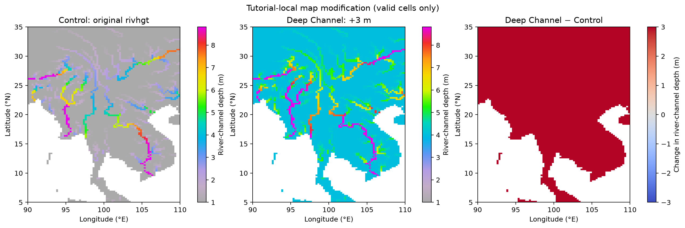
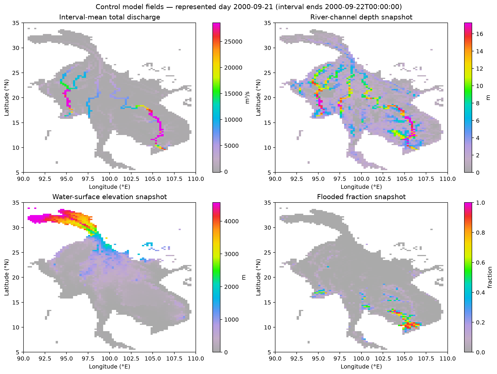
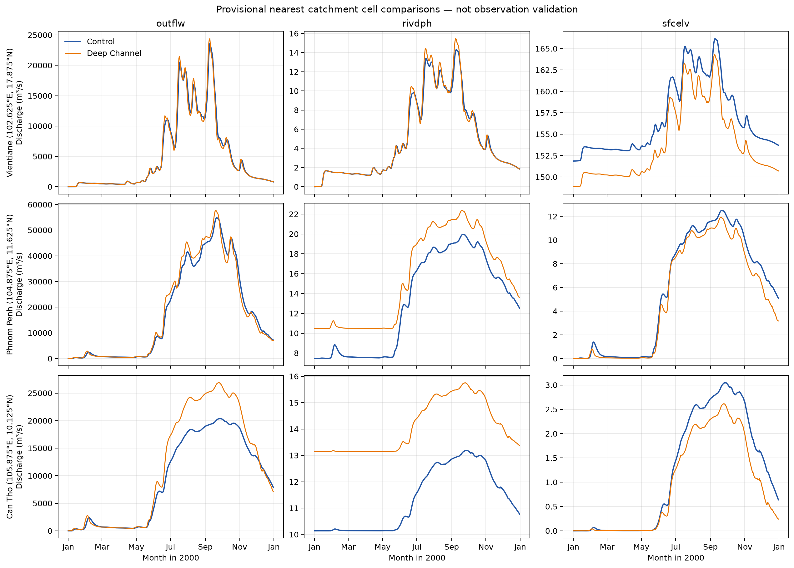
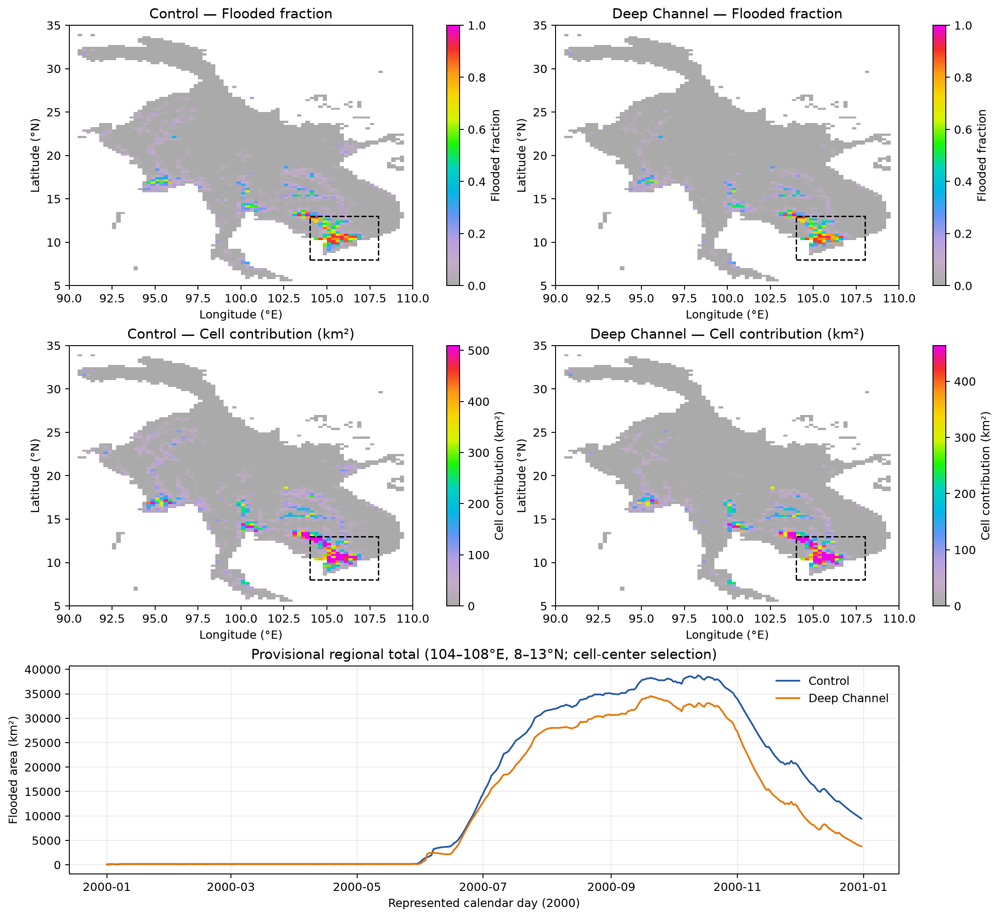
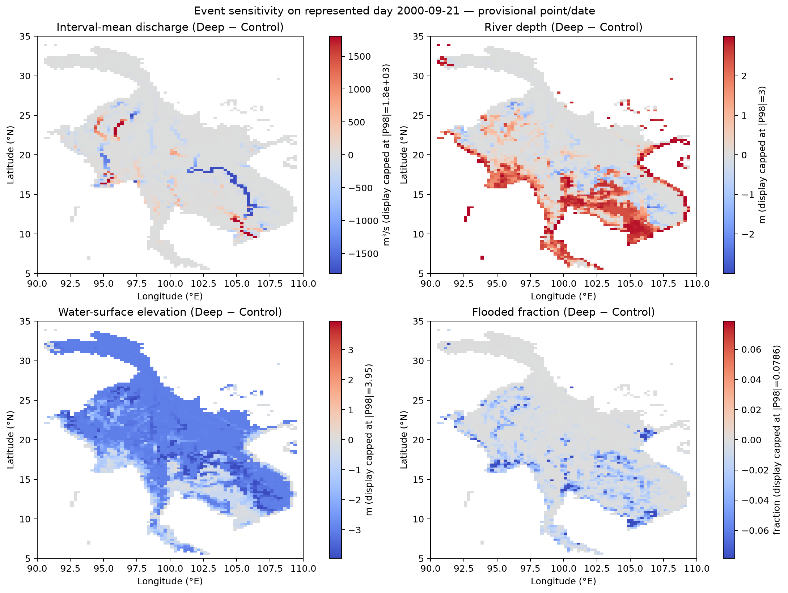
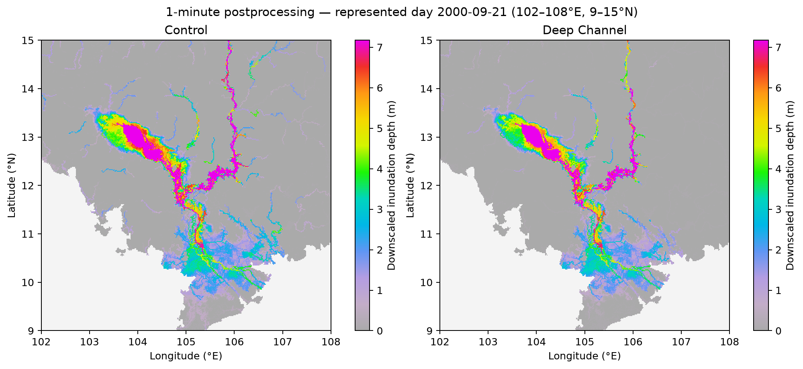

# Guide01 Workflow Example: A River-Depth Sensitivity Experiment

This learner manual follows a small, controlled CaMa-Flood sensitivity
experiment. The **Control** run uses the sample Mekong map. The **Deep
Channel** run changes valid `rivhgt` cells by `+3.0 m`; all other configured
run inputs are kept the same. The workflow prepares that map variant, runs the
two 2000 simulations, examines their NetCDF output, and applies the existing
one-minute flood-depth downscaler to one selected event.

Before looking at the figures, consider: *If the mapped river channel becomes
deeper, must river depth, water-surface elevation, discharge, and inundation
all increase together?* The figures let you examine that question. This is a
model sensitivity example, **not** observational validation or a forecast of
a real channel-engineering project.

## 1. What is being compared?

The `rivhgt` map parameter is river-channel depth in metres. The model
calculates channel-bed elevation from terrain elevation and `rivhgt`; river
water depth and absolute water-surface elevation are distinct quantities. The
two runs therefore help illustrate why a change in one variable does not
determine the direction of change in another.

The intended difference is the file selected by `CRIVHGT`:

| Case | `CRIVHGT` input |
| --- | --- |
| Control | Shared sample map, `map/mekong_15min/netcdf/rivhgt.nc` |
| Deep Channel | Tutorial-local `map_modify/rivhgt_deep.nc` |

Both are one-year cold starts for calendar year 2000, using the Tutorial02
`mek_default` physics configuration and daily NetCDF output. No prior-year
spin-up or Restart is used. The runoff, input matrix, map geometry, and other
settings are matched. These choices make the pair a controlled sensitivity
comparison, but the one-year cold start limits what can be concluded.

The example is a tutorial beside Tutorial01 and Tutorial02. The numbered
Guide01 directory explains how this example was developed. It is not a
separately validated production tutorial.
For Guide01's purpose and development workflow, see the
[Guide01 overview](../guide01_how_to_develop_tutorial/README.md). For the scientific and technical design,
see [the workflow design](tutorial_design.md). The implementation evidence
and unresolved choices are recorded in
[`22implementation_record.md`](../guide01_how_to_develop_tutorial/22implementation_record.md).

## 2. Prepare the repository and inputs

### Start at the repository root

Open a terminal and change to the root of your CaMa-Flood checkout. The
following commands assume that the checkout contains this Guide01 example.
Confirm the location before saving it in a shell variable:

```bash
cd /path/to/CaMa-Flood_v4
pwd
```

The printed path should end in your repository directory. Set `cmf_root` in
the same terminal session:

```bash
cmf_root="$(pwd)"
git branch --show-current
```

`cmf_root` is a shell variable, not a permanent setting; define it again in a
new terminal. The design and manual are in the GitHub source repository. The future learner
package excludes the developer-only `design/` directory; no dedicated tutorial
package assembler is available yet, so this is not a claim that an official
downloadable learner package has been built.

### Inspect the example files

```bash
cd "${cmf_root}"
cd tutorial/guide01_workflow_example
pwd
ls -lhF
```

The scripts are kept directly in the example directory. Developer references
under `design/` are retained in the GitHub checkout but excluded from a future
learner package. The directories have separate roles: `map_modify/` holds the changed map parameter, `out/` holds
model runs and downscaling products, `analysis/` holds derived tables and
NetCDF diagnostics, and `figure/` holds plots. `design/` contains development
records for tutorial authors, rather than steps needed by a learner.

An excerpt from a temporary learner-file snapshot's `ls -lhF` output is:

```text
-rw-r--r--  1 yamadai  wheel    12K Nov 10 05:28 a01-analyze_outputs.py
-rwxr-xr-x  1 yamadai  wheel   5.2K Nov 10 05:28 a02-prepare_downscale_input.py*
drwxr-xr-x  3 yamadai  wheel    96B Nov 10 08:52 analysis/
drwxr-xr-x  3 yamadai  wheel    96B Nov 10 08:50 figure/
-rw-r--r--  1 yamadai  wheel    24K Nov 10 13:21 manual_workflow_example.md
drwxr-xr-x  3 yamadai  wheel    96B Nov 10 08:52 map_modify/
-rwxr-xr-x  1 yamadai  wheel   4.0K Nov 10 08:48 run-experiment.sh*
-rwxr-xr-x  1 yamadai  wheel   5.9K Nov 10 08:48 s01-prepare_map.py*
... other entries omitted ...
drwxr-xr-x  8 yamadai  wheel   256B Nov 10 08:44 sample_figure/
-rw-r--r--  1 yamadai  wheel    20K Nov 10 13:36 tutorial_design.md
```

The `*` marker indicates an executable in this `ls -F` listing. Sizes and
timestamps can differ. This learner snapshot excludes `design/`, pre-generated
figures, the modified map, and model results. A direct GitHub checkout also
contains developer-only `design/` materials because no official tutorial
package assembler exists yet.

The sample inputs used by the runner are repository-level files:

- Mekong map files under `map/mekong_15min/netcdf/` and
  `map/mekong_15min/`;
- runoff file `inp/test-mek_1deg_nc/runoff2000.nc`;
- input matrix `map/mekong_15min/inpmat_test-mek_1deg.bin` and its dimension
  description `map/mekong_15min/inpdim_test-mek_1deg.txt`.

These are inputs, not files produced by this tutorial. The original
`rivhgt.nc` is read-only. The runner checks for its required inputs before
starting a simulation.

### Prepare Python and the model executable

The Python workflow uses NumPy, NetCDF4, xarray, pandas, Matplotlib, and the
repository's `cmf_colormap` package. The recommended environment is the
repository `.venv`:

```bash
cd "${cmf_root}"
bash s02-python_setup.sh
source .venv/bin/activate
```

The setup script is interactive when it needs to create or update the
environment; follow its displayed confirmation prompt. In a non-interactive
terminal it diagnoses the environment without changing it. See the
[Python environment guide](../../docs/python_environment.md) and the
repository [setup instructions](../../README.md#development-environment-setup)
for the existing-environment and troubleshooting options.

The run scripts expect the NetCDF-enabled executable at
`out/bin/MAIN_cmf_netcdf`. If that file is missing, prepare the compiler
configuration described in the [v5 build guide](../../config/README.md),
then build the separate NetCDF executable from the repository root:

```bash
cd "${cmf_root}"
bash gosh_test/compile_netcdf.sh
```

This build requires GNU Make, GNU Fortran, and NetCDF-Fortran tools including
`nf-config`. It writes `out/bin/MAIN_cmf_netcdf`; it does not run either
experiment. The example scripts use the repository `.venv` interpreter by
absolute path, so activate or prepare that environment before running them.

### Learning Check

- Which inputs are shared repository data, and which map file will this
  example generate?
- Why should the shared `rivhgt.nc` remain unchanged?

## 3. Create the Deep Channel map

**Question:** How can the experiment change one map parameter without
changing the shared map or its missing-cell pattern?

The preparation script is a learner starting file. It starts with
`RIVHGT_INCREMENT_M = 0.0` and stops until you edit the value. Set it to
`3.0`; this is the approved experiment perturbation, not a value to estimate.
The script then reads the shared `rivhgt.nc`, adds `3.0 m` to valid cells, and
writes `map_modify/rivhgt_deep.nc` while preserving the source map. It checks the data type, grid,
coordinates, missing mask, and increment, and checks that the shared source
checksum remains unchanged. The Deep Channel runner later supplies the
tutorial-local file directly through `CRIVHGT`; it does not copy the file into
the shared map directory.

From the repository root, open the script and make the required edit:

```bash
cd "${cmf_root}"
nano tutorial/guide01_workflow_example/s01-prepare_map.py
```

Change `RIVHGT_INCREMENT_M = 0.0` to `RIVHGT_INCREMENT_M = 3.0` and save.
Then run the preparation script:

```bash
cd "${cmf_root}"
./.venv/bin/python tutorial/guide01_workflow_example/s01-prepare_map.py
```

If the generated file already exists, the script stops instead of replacing
it. To deliberately regenerate this tutorial-owned product, add `--force`:

```bash
./.venv/bin/python tutorial/guide01_workflow_example/s01-prepare_map.py --force
```

The inspected run reported a 120 × 80 Float32 grid, 6,566 valid cells, 3,034
missing cells, and a `+3.0 m` change on valid cells. It also reported matching
grid and missing mask. These are checks of the generated file, not proof that
the modified parameter is scientifically preferable.



**Figure 1.** Shared `rivhgt`, the tutorial-local `+3 m` variant, and
Deep Channel minus Control. The difference applies to valid map cells; the
unchanged missing-cell mask is not a physical zero-depth result.

### Learning Check

- What does the map-generation check verify besides the numeric increment?
- Where is the modified map stored, and which case reads it?

## 4. Run the two simulations

**Question:** Which conditions must be matched to interpret a paired run as a
sensitivity comparison?

The provided `run-experiment.sh` is the Control configuration. To create the
required second experiment, copy it and edit only its project name and river
depth input path. The script writes a case-specific namelist and launches the
model from that case's run directory. The model configuration uses the same
2000 calendar-year period, runoff, input matrix, physics options, and daily
NetCDF output. The only intended scientific input difference is `CRIVHGT`.

First copy the provided Control configuration and edit the copy:

```bash
cd "${cmf_root}"
cp tutorial/guide01_workflow_example/run-experiment.sh tutorial/guide01_workflow_example/run-deep-channel.sh
nano tutorial/guide01_workflow_example/run-deep-channel.sh
```

In the copy, change `PROJ="control"` to `PROJ="deep_channel"`, and change
`RIVHGT="$MAP_NC/rivhgt.nc"` to
`RIVHGT="$SCRIPT_DIR/map_modify/rivhgt_deep.nc"`. Keep other experiment
settings unchanged. Now run both configurations:

```bash
cd "${cmf_root}"
sh tutorial/guide01_workflow_example/s02-run_control.sh
sh tutorial/guide01_workflow_example/run-deep-channel.sh
```

Each run is placed under `guide01_workflow_example/out/control/` or
`guide01_workflow_example/out/deep_channel/`. A successful script prints a
`[SUCCESS]` message. It also checks that all four non-empty NetCDF outputs
were created. If a run fails, inspect that case's `console_2000.log` and
`log_CaMa_2000.txt` before retrying. The scripts refuse to overwrite existing
case output by default. To rerun one case, pass `--force` to its script; the
runner replaces only the known outputs in that case's directory.

The expected output filenames are:

```text
o_outflw2000.nc
o_rivdph2000.nc
o_sfcelv2000.nc
o_fldfrc2000.nc
```

For this 2000 leap-year run, each file contains 366 daily records on the
sample's 80 × 120 map grid. The time coordinates are interval ends: the first
is `2000-01-02T00:00:00`, and the last is `2001-01-01T00:00:00`. Each record
represents the preceding daily interval. February 29 is included. The model
starts from a cold start rather than a prior-year Restart, so initial
conditions may influence the results.

The output folders also contain generated namelists, model logs, and a
Restart file. These large run products are kept under `out/`; the repository
ignore rules exclude that generated run directory.

### Learning Check

- What is the intended difference between the two namelists?
- Why do 366 records end at `2001-01-01T00:00:00` for a run covering 2000?

## 5. Inspect the four model outputs

**Question:** What does each output variable measure, and is it an interval
mean or a snapshot?

| File variable | Meaning | Time interpretation | Units |
| --- | --- | --- | --- |
| `outflw` | River and floodplain discharge | Mean over the daily output interval | m³/s |
| `rivdph` | River-channel water depth | Snapshot | m |
| `sfcelv` | Water-surface elevation | Snapshot | m |
| `fldfrc` | Flooded fraction of a unit catchment | Snapshot | fraction (0–1) |

Check that both cases contain the four expected files:

```bash
cd "${cmf_root}"
cd tutorial/guide01_workflow_example
pwd
ls -lhF out/control
ls -lhF out/deep_channel
```

For example, the checked Control directory contained the four `o_*2000.nc`
files, `input_cmf_2000.nam`, `log_CaMa_2000.txt`, and
`restart2001010100.nc`. File sizes depend on the platform and build. To inspect
dimensions, coordinates, and units with the configured Python environment:

An excerpt from the checked `ls -lhF out/control` output was:

```text
-rw-r--r--@ 1 yamadai  staff   3.0M Nov  9 16:40 o_fldfrc2000.nc
-rw-r--r--@ 1 yamadai  staff   5.2M Nov  9 16:40 o_outflw2000.nc
-rw-r--r--@ 1 yamadai  staff   5.0M Nov  9 16:40 o_rivdph2000.nc
-rw-r--r--@ 1 yamadai  staff   4.9M Nov  9 16:40 o_sfcelv2000.nc
[… other entries omitted …]
```

Sizes and timestamps are an example from one inspected run; they can vary.

```bash
"${cmf_root}/.venv/bin/python" - <<'PY'
from pathlib import Path
import xarray as xr

root = Path("tutorial/guide01_workflow_example/out")
for case in ("control", "deep_channel"):
    for name in ("outflw", "rivdph", "sfcelv", "fldfrc"):
        path = root / case / f"o_{name}2000.nc"
        with xr.open_dataset(path) as ds:
            var = ds[name]
            print(case, name, var.dims, var.shape,
                  "units=", var.attrs.get("units"),
                  "first/last=", str(ds.time.values[0]), str(ds.time.values[-1]))
PY
```

Figure 2 shows the Control values for all four variables at the selected
event. Compare the variables with their time meanings in the table: a daily
mean discharge is not the same type of quantity as a water-level snapshot.



**Figure 2.** Control discharge (`outflw`, daily interval mean), channel-water
depth (`rivdph`), water-surface elevation (`sfcelv`), and flooded fraction
(`fldfrc`). The three latter fields are snapshots for the represented day
2000-09-21; their stored interval-end time is 2000-09-22. Color scales are
chosen per variable and should not be compared across panels as if they shared
one unit.

### Learning Check

- Which field is averaged over a day, and which three are snapshots?
- What should you compare before subtracting one case's NetCDF field from the
  other?

## 6. Compare river response through time

**Question:** Does a deeper channel necessarily produce a higher water-surface
elevation?

The model's elevation relationship is

```text
sfcelv = elevtn - rivhgt + rivdph
```

For corresponding cells in these runs, the `+3 m` change in `rivhgt` lowers
the calculated bed term. A change in `rivdph` therefore does not by itself
determine the sign of the change in absolute `sfcelv`. Discharge, river depth,
and water-surface elevation can respond differently; this experiment does
not isolate a particular hydrodynamic mechanism.

The analysis script selects the nearest valid model cell to each reference
coordinate and marks those selections as provisional. Rebuild the analysis
tables after the simulations, then inspect `analysis/provisional_sites.csv`
and `analysis/provisional_timeseries.csv`:

```bash
cd "${cmf_root}"
./.venv/bin/python tutorial/guide01_workflow_example/a01-analyze_outputs.py --validate-only
./.venv/bin/python tutorial/guide01_workflow_example/a01-analyze_outputs.py
```

The first command checks aligned grids and timestamps and reports selected
cells. The second writes comparison products. In the checked run, the
reference coordinates selected nearest valid cells near Vientiane, Phnom
Penh, and Can Tho. Their exact locations and approximate offsets are in the
CSV; they should not be treated as surveyed gauge locations. The event is
selected from the Control `sfcelv` peak at the provisional Phnom Penh cell:
the checked selection was interval end 2000-09-22, representing September
21. This is a reproducible selection rule, not a claim that it is the most
important flood event.



**Figure 3.** Daily interval-mean discharge and daily snapshot river depth and
water-surface elevation for the two cases at the three provisional cells.
The selected points are nearest valid catchment cells, not an observational
validation dataset. In some locations a deeper channel coincides with
increased discharge or channel depth while water-surface elevation decreases;
the figure is a case-specific response, not a universal rule.

### Learning Check

- Use the elevation relationship to explain how `rivdph` could increase while
  `sfcelv` decreases.
- What does “provisional nearest valid cell” mean for interpreting Figure 3?

## 7. Interpret flooded fraction and area

**Question:** Is a flooded fraction the same as flooded area?

`fldfrc` is a fraction for a unit catchment. The example estimates the
catchment's flooded area contribution as

```text
cell_flooded_area = fldfrc × ctmare
```

Here `ctmare` is the catchment area in square metres; dividing the product by
1,000,000 converts it to km². Summing selected catchment contributions gives
the regional estimate. The script uses a provisional rectangle from 104°E to
108°E and 8°N to 13°N and includes catchments by cell-center coordinates; the
east and north boundaries are exclusive. This rectangle is not an official
Mekong Delta boundary, and results depend on the region and its boundary-cell
rule.

The analysis table `analysis/provisional_flooded_area.csv` stores the two
regional series. The checked event-selection record gives about 38,149 km²
for Control and 34,383 km² for Deep Channel in that selected region at the
selected event. These are model sensitivity results for this setup and mask,
not a general prediction that deeper channels reduce flooding.



**Figure 4.** Top panels show snapshot `fldfrc`; middle panels show each
catchment's contribution `fldfrc × ctmare` in km²; the bottom panel sums
contributions in the provisional 104–108°E, 8–13°N cell-center region. The
rectangle is an analysis choice, not an authoritative delta outline.

### Learning Check

- What additional quantity is needed to turn `fldfrc` into an area?
- Why should the region and cell-selection rule accompany a regional-area
  number?

## 8. Read spatial differences and one-minute downscaling

### Spatial sensitivity

**Question:** Does the effect of the map change have the same sign everywhere?

`analysis/difference_at_event.nc` stores Deep Channel minus Control for the
four output fields at the common Control-selected event. Figure 5 uses a
symmetric color range clipped at the 98th percentile of absolute values for
display. The clipping makes the central spatial pattern easier to see but
means the most extreme values can lie beyond the displayed range. A positive
color means Deep Channel is larger than Control; a negative color means it is
smaller. The inspected fields show spatially mixed responses, so avoid
generalizing from a single sign or location.



**Figure 5.** Event-time Deep Channel minus Control for interval-mean
discharge and snapshot river depth, water-surface elevation, and flooded
fraction. The common event is selected from Control at a provisional cell.
The symmetric display limit is capped at each field's absolute 98th
percentile; colorbar labels identify that cap.

### One-minute postprocessing

The example then uses the existing Fortran tributary downscaler. Its input
preparation script reads the selected NetCDF `rivdph` record and the matching
static `rivhgt`, checks their grid, units, and time, and derives floodplain
depth as

```text
flddph = max(rivdph - rivhgt, 0)
```

Missing cells remain unassigned. The adapter writes one little-endian
Float32 Binary grid, which is consumed by the existing downscaler along with
the sample's high-resolution map data. This workflow adapts NetCDF model
output to the existing Binary downscaler; it does not change the
downscaling algorithm or run a separate one-minute hydrodynamic simulation.

The checked event is the same Control-selected event for both cases. Figure 6
uses the requested crop 102–108°E and 9–15°N (360 × 360 pixels at one-minute
spacing). The downscaler uses an additional five model-cell buffer around
the crop to provide context. The output's 129,600 pixels include 95,543
assigned and 34,057 unassigned pixels in each case. The large-scale patterns
look similar in this view, but no numerical identity or general similarity
has been established.

Run from the repository root. On a first run, omit `--force`:

```bash
cd "${cmf_root}"
sh tutorial/guide01_workflow_example/s04-downscale_event.sh
```

This step needs the two model runs, generated event table, `.venv`, and
existing Mekong one-minute map layers. It builds the existing downscaler
locally under the example's `out/bin/` if needed, then writes each case's
input and downscaled output under `out/downscaling/`. When outputs already
exist and you intentionally want to replace them, use:

```bash
sh tutorial/guide01_workflow_example/s04-downscale_event.sh --force
```

To regenerate the six figures from the saved model, analysis, and downscaling
products:

```bash
./.venv/bin/python tutorial/guide01_workflow_example/v01-plot_results.py
```

The plotting script reads saved results; it does not rerun the model or
downscaler. A checked output-validation run reported 360 × 360 values per
case, 95,543 assigned pixels, and depth ranges from 0 to 17.5362 m for
Control and 0 to 16.0039 m for Deep Channel. The downscaling is
postprocessing based on high-resolution terrain and its assumptions; it is
not independent validation.



**Figure 6.** Downscaled inundation depth in metres for the common event,
shown over 102–108°E, 9–15°N. Both panels use the same display scale. Unassigned
pixels are masked; the result adds spatial detail but is not an independent
one-minute simulation or evidence that either experiment is observationally
correct.

### Learning Check

- What does the Python adapter calculate before calling the Fortran
  downscaler?
- What additional information does one-minute postprocessing provide, and
  what does it not validate?

## 9. Discussion: what can this experiment establish?

Use the figures and CSVs to discuss how the two configurations differ. Keep
the interpretation tied to the evidence:

- River depth and absolute water-surface elevation are different quantities;
  the `rivhgt` change enters the elevation relationship directly.
- Discharge and water-depth responses vary spatially. A deeper mapped channel
  does not guarantee a uniform response.
- Flooded fraction is not an area until combined with catchment area, and a
  regional total depends on the chosen region and mask.
- Downscaling adds spatial detail through terrain-based postprocessing, not
  independent hydrodynamic evidence.

No observations were used to validate these simulations. They cover only
calendar year 2000, start from a cold start, use provisional reference cells,
and calculate regional area over a provisional rectangle. The example does
not establish spin-up adequacy, isolate a single physical mechanism, or
predict the outcome of a real intervention. Review the design and
implementation record before reusing any of these choices in a research
analysis.

### Learning Check

- Name two reasons why these results should be described as a sensitivity
  example rather than as a validated prediction.
- Which provisional choice would you review first before applying the workflow
  to a new study, and why?

## Reproduce the complete workflow

After the Python environment and executable are ready, complete the two edits
described in Sections 3 and 4, then run the workflow from the repository root.
The first run of each step should not need `--force` in a fresh example
directory.

```bash
cd "${cmf_root}"
./.venv/bin/python tutorial/guide01_workflow_example/s01-prepare_map.py
cp tutorial/guide01_workflow_example/run-experiment.sh tutorial/guide01_workflow_example/run-deep-channel.sh
sh tutorial/guide01_workflow_example/s02-run_control.sh
sh tutorial/guide01_workflow_example/run-deep-channel.sh
./.venv/bin/python tutorial/guide01_workflow_example/a01-analyze_outputs.py --validate-only
./.venv/bin/python tutorial/guide01_workflow_example/a01-analyze_outputs.py
sh tutorial/guide01_workflow_example/s04-downscale_event.sh
./.venv/bin/python tutorial/guide01_workflow_example/v01-plot_results.py
```

The model runs take substantially longer than the inspection and plotting
steps. Existing outputs are protected from accidental replacement; use the
individual `--force` options only when deliberately regenerating their
products. For detailed evidence, exact selected cells, and unresolved
research choices, consult [`22implementation_record.md`](../guide01_how_to_develop_tutorial/22implementation_record.md).
