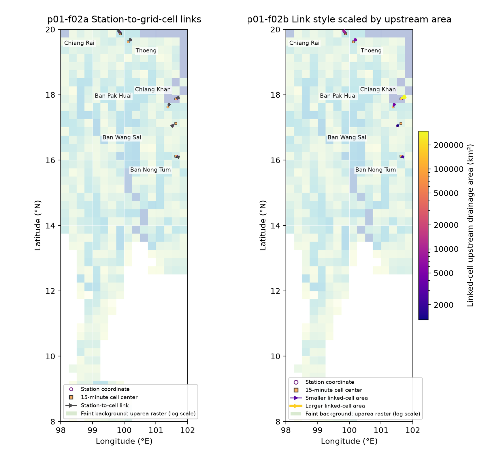

# CaMa-Flood Visualization Gallery

Browse approved CaMa-Flood figures. Each published image is a reviewed copy;
rerunning a project script does not change it.

## Gallery

### p01-f02 — Station-to-grid-cell linkage

Two panels show station-to-cell correspondence and scale the link styling by
the linked cell's upstream drainage area. See the [generating Shell script](river_map/f02-station-grid-linkage.sh)
and the [project explanation](river_map/README.md#p01-f02-station-to-grid-cell-linkage).
