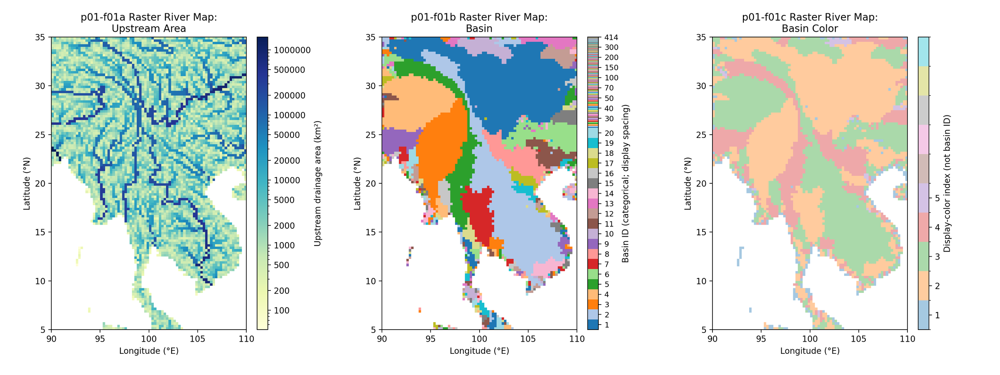
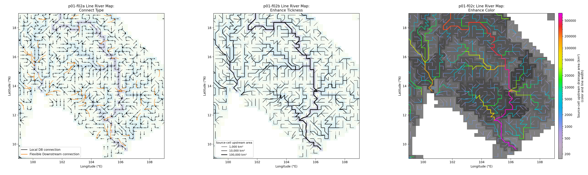
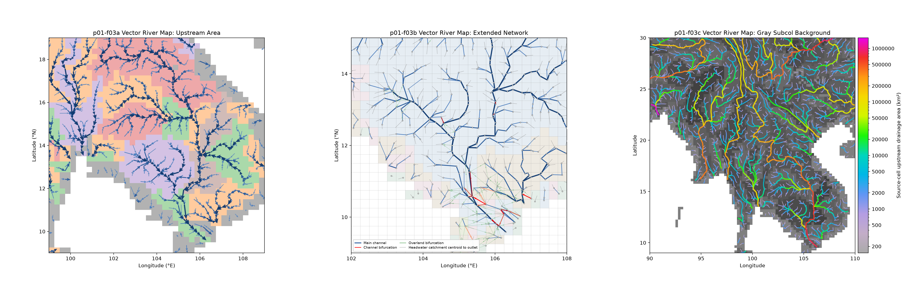
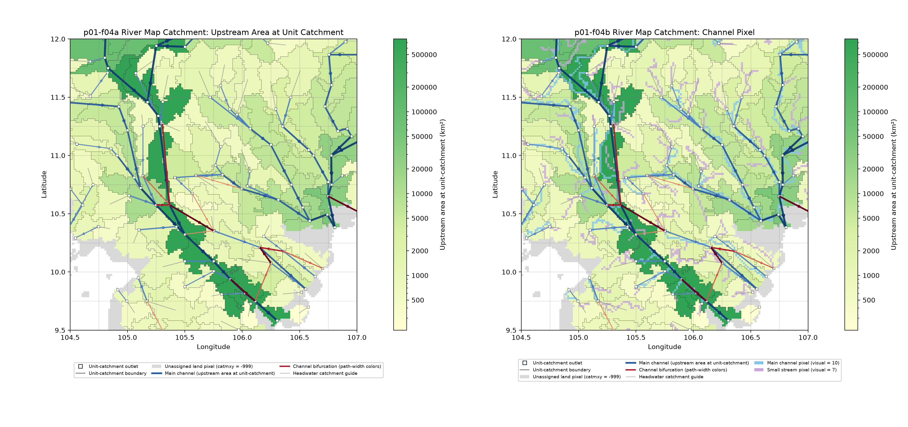
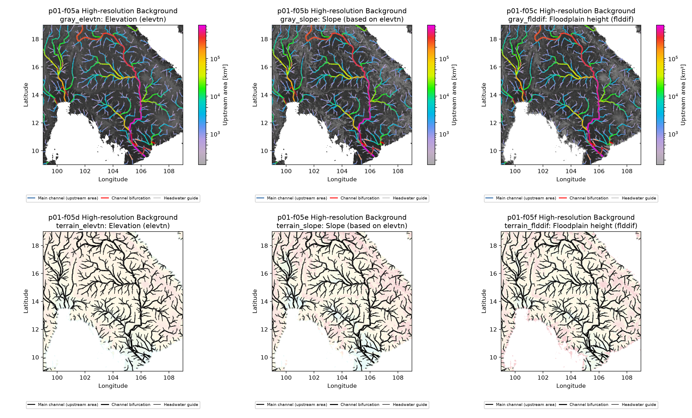
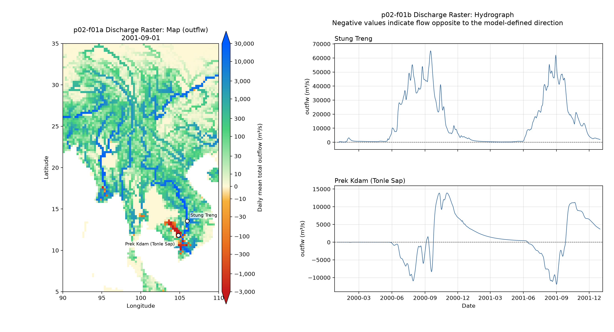
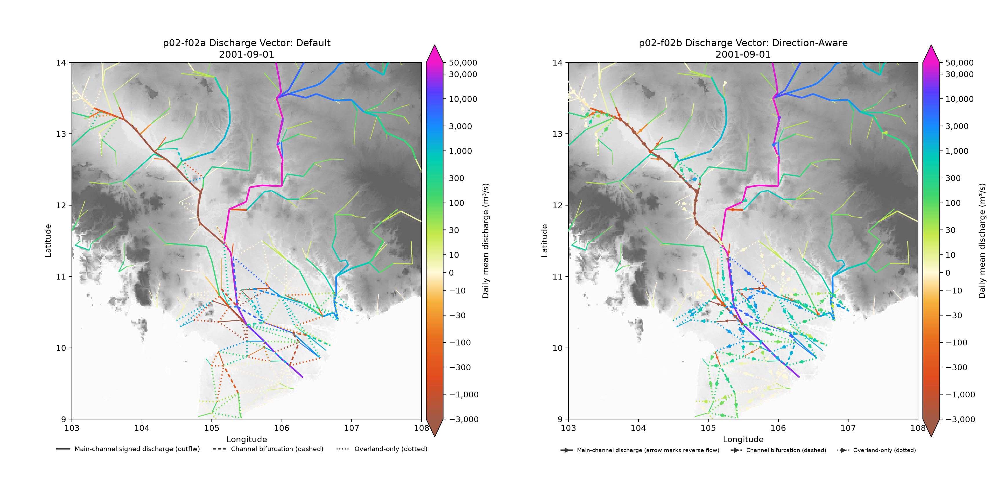

# CaMa-Flood Visualization Gallery

Browse CaMa-Flood figures explicitly selected for Gallery publication.
Project-local figures are tracked and documented in their project READMEs;
the combined p01-f01 through p01-f05 figures below are the current
Gallery selections.

## Gallery

### p01 — River Map

#### p01-f01 — Raster River Map

Four raster panels show Mekong upstream drainage area, basin IDs, basin
display colors, and subbasin display colors. See the
[figure script](river_map/f01-raster_river_map.sh)
and the [project explanation](river_map/README.md#p01-f01--raster-river-map).

#### p01-f02 — Line River Map

Three panels compare ways to display CaMa-Flood's local and Flexible
Downstream river connections. See the [figure script](river_map/f02-line_river_map.sh)
and the [project explanation](river_map/README.md#p01-f02--line-river-map).

#### p01-f03 — Vector River Map

Two panels show outlet-to-outlet main-channel links, with the second panel
adding mapped channel and overland bifurcations and catchment-centroid guides.
See the [figure script](river_map/f03-vector_river_map.sh) and the
[project explanation](river_map/README.md#p01-f03--vector-river-map).

#### p01-f04 — River Map Catchment

Two panels combine 1-minute Mekong unit-catchment pixels with the stored
outlet-based main-channel network and channel bifurcations. Panel a colors
catchments by upstream area; panel b additionally marks source-defined main-
channel and small-stream pixels. Observation stations are omitted. See the
[figure script](river_map/f04-rivmap_catchment.sh) and the
[project explanation](river_map/README.md#p01-f04--river-map-catchment).

#### p01-f05 — High-resolution Background

Six panels compare elevation, a derived eight-neighbor elevation-difference
field, and floodplain height (`flddif`) beneath the same outlet-based
river network. The first row uses grayscale terrain backgrounds and
upstream-area-colored channels; the second uses the `pale_terrain` palette
and black channels. See the [figure script](river_map/f05-hires_background.sh)
and the [project explanation](river_map/README.md#p01-f05--high-resolution-background).

### p02 — Output Analysis

#### p02-f01 — Discharge Raster

The two-panel Figure combines a 2001-09-01 Mekong river-discharge raster with
2000–2001 daily discharge hydrographs for Stung Treng and Prek Kdam. The
Tonle Sap series shows modeled flow reversal as negative `outflw`. Its options
are `discharge_raster-map` (a) and `discharge_raster-hydrograph` (b); see the
[figure script](output_analysis/f01-discharge_raster.sh) and the
[project explanation](output_analysis/README.md#p02-f01--discharge-raster).

#### p02-f02 — Discharge Vector

Panels (a) and (b) compare two views of complex signed flow on 2001-09-01.
Both sum signed `pthflw` across all pathway layers and include channel and
overland-only bifurcations. Dashed links have positive width in layer 1;
dotted links have no layer-1 width. Panel `discharge-vector_default` colors
the signed `outflw` and `pthflw` sum without direction markers or sign
reversal. Panel `discharge-vector_direction-aware` uses arrows to show net
path flow direction, including reversals, and colors bifurcations by the
magnitude of their layer sum. Both use `diverge_asymmetry` over 103–108°E,
9–14°N. This pair demonstrates how visualization choices can make reversals
and branching flows easier to interpret.
See the [Figure script](output_analysis/f02-discharge_vector.sh) and the
[project explanation](output_analysis/README.md#p02-f02--discharge-vector).
