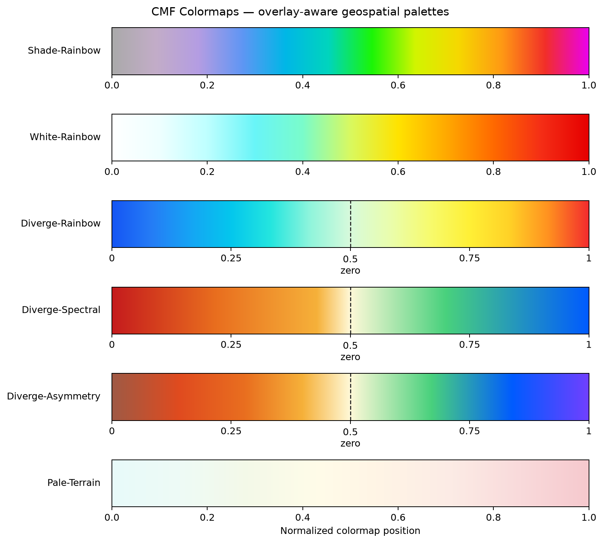
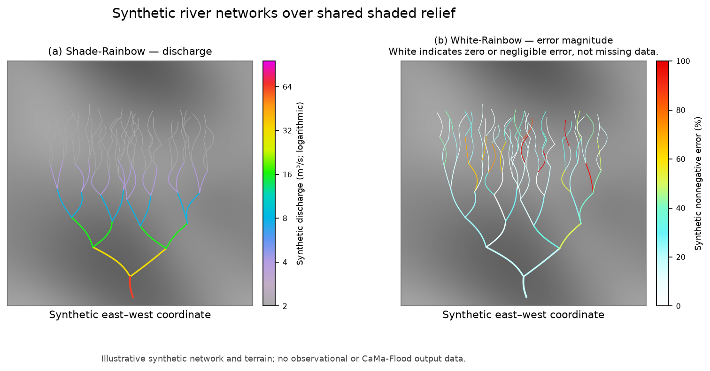
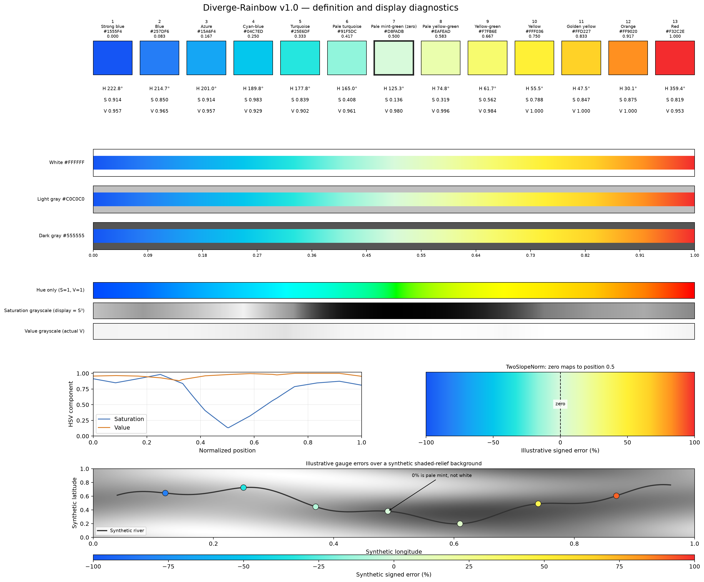
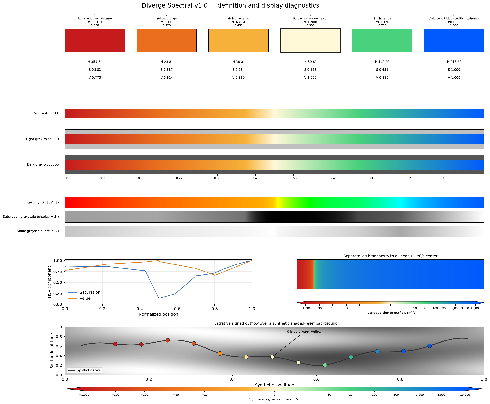
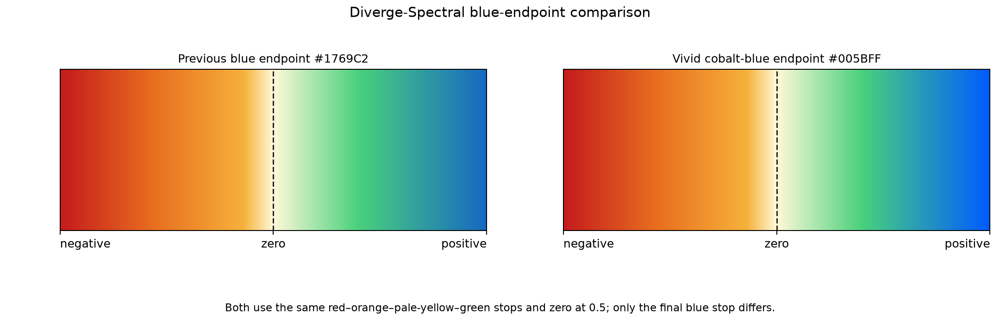
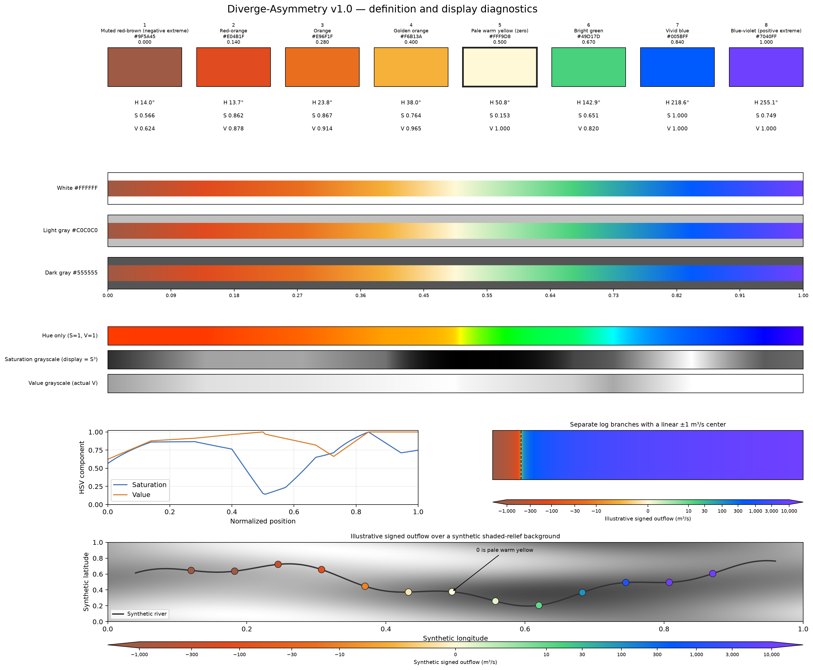
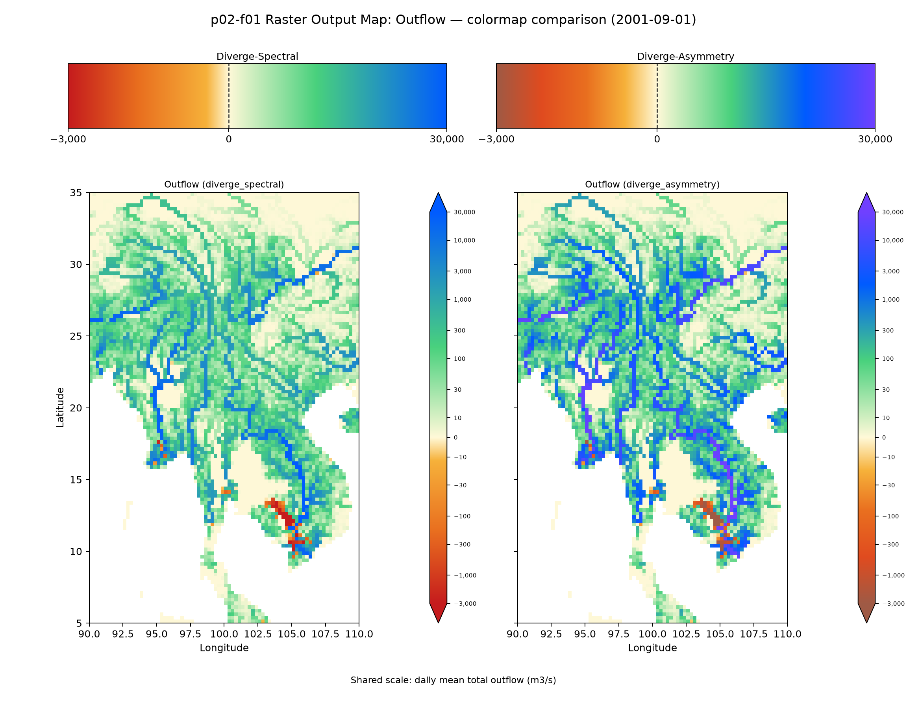
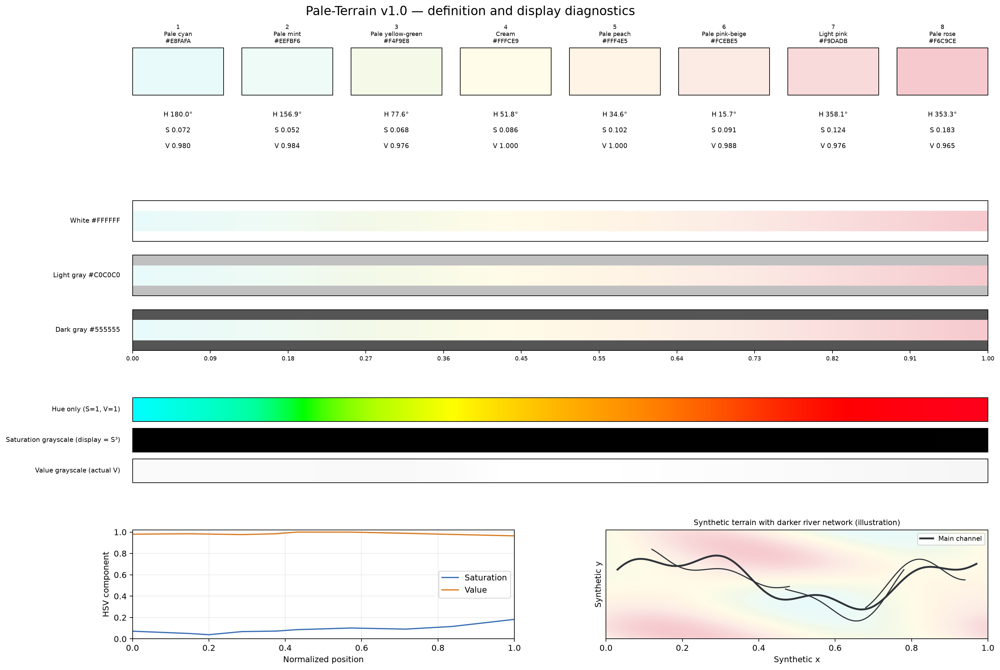

# CMF Colormaps

CMF Colormaps is a small, reusable Python library of palettes for scientific
visualization of rivers, river basins, floodplains, and related geospatial
information. Its six colormaps have different visual roles; they are not
universal replacements for other palettes.

## Overlay-Aware Colormap Design

> CMF Colormaps are designed primarily for layered scientific visualization of
> rivers, river basins, and floodplains. Rather than optimizing a colormap
> solely for displaying a single scalar field, the design considers how colors
> interact with background terrain, river networks, water bodies, observation
> points, and other geospatial layers. Each colormap aims to control visual
> prominence so that the intended scientific information remains readable
> without unnecessarily obscuring other layers.

This is a design philosophy, not a claim that every CMF colormap is optimal for
all backgrounds, displays, or viewers. The palette designs consider visual
hierarchy, compatibility with common map backgrounds, foreground layer
visibility, reproducibility of color definitions, and the scientific meaning
of visual prominence. These choices involve trade-offs with perceptual
uniformity, color-vision accessibility, and quantitative comparability.

## General Colormap Gallery

The gallery uses the canonical presentation order: Shade-Rainbow,
White-Rainbow, Diverge-Rainbow, Diverge-Spectral, Diverge-Asymmetry, and
Pale-Terrain. The first five are intended primarily for foreground scientific
data; Pale-Terrain is intended primarily for background visualization.



Presentation order is stored in the registry's `display_order` field. The
public `list_colormaps()` API retains its original CSV row order for
compatibility; that API order is separate from gallery and documentation
presentation order.

## Examples of Layered River Visualization

These reproducible examples use synthetic data only. They do not represent
observations or CaMa-Flood simulation results.

### Shade-Rainbow and White-Rainbow on the same river network

Both panels use the same connected synthetic drainage network and grayscale
shaded-relief background. Shade-Rainbow uses logarithmic synthetic discharge
that accumulates downstream, so larger channels become more prominent.
White-Rainbow shows spatially varying nonnegative error magnitudes: near-zero
errors remain visible as white or pale cyan lines, while larger errors become
yellow, orange, and red. White represents zero or negligible error here; it
does not mean missing data. Missing values should be masked separately.



### Diverge-Rainbow signed errors

Diverge-Rainbow maps negative and positive synthetic gauge errors around a pale
mint-green zero value. The center remains distinct from the grayscale terrain
and dark river linework.



### Diverge-Spectral signed flow

Diverge-Spectral assigns negative flow to red and orange, zero to pale warm
yellow, and positive flow to bright green and vivid cobalt blue. Its stops are inspired by
Spectral-style diverging palettes, but this is a custom polarity-emphasizing
design, not the standard Spectral palette.



The endpoint comparison below keeps all other stops and the zero center fixed;
only the positive extreme changes from the previous `#1769C2` blue to the more
saturated `#005BFF` cobalt blue.



### Diverge-Asymmetry signed flow

Diverge-Asymmetry transitions from muted red-brown through red-orange and
golden orange for negative values, pale warm yellow at zero, and bright green
through cobalt blue to blue-violet for positive values. Its control colors are
independent of units, limits, and normalization. This is a custom diverging
palette, not a standard named scheme. The authoritative definition is
[`src/cmf_colormap/data/diverge_asymmetry.json`](src/cmf_colormap/data/diverge_asymmetry.json).



The following comparison applies the existing p02-f01 `outflw` data, limits,
ticks, and asymmetric signed-log normalization to both Diverge-Spectral and
Diverge-Asymmetry. It uses the current f01 range (−3,000 to +30,000 m³/s),
`LINTHRESH=10`, and `LINEAR_FRAC=0.10`; only the palette changes between map
panels.



### Pale-Terrain background

Pale-Terrain provides subtle topographic context while the darker river network
remains prominent. The terrain and channels in this detailed preview are
synthetic.



## Install

From a CaMa-Flood checkout:

```bash
python -m pip install -e ./visualization/cmf_colormap
```

From a standalone clone of this repository directory:

```bash
python -m pip install -e .
```

Matplotlib is the only runtime dependency. NumPy, used for examples and tests,
is already a Matplotlib dependency. The package is distributed under Apache
License 2.0; see [`LICENSE`](LICENSE).

## Use

```python
import matplotlib.pyplot as plt
from matplotlib.colors import LogNorm
from cmf_colormap import get_cmap

image = ax.pcolormesh(
    longitude, latitude, discharge,
    cmap=get_cmap("shade_rainbow"),
    norm=LogNorm(vmin=5, vmax=1_000_000, clip=True),
)
fig.colorbar(image, ax=ax, label="Discharge (m³/s)")
```

The package does not choose a variable, unit, or data range. Select a
normalization that suits the plotted quantity. `LogNorm` and its range above
are examples only.

Available names and optional Matplotlib registration:

```python
from cmf_colormap import get_cmap, list_colormaps, register_colormaps

print(list_colormaps())  # Stable API order: shade, white, pale, diverge, spectral, asymmetry
cmap = get_cmap("diverge_rainbow")
flow_cmap = get_cmap("diverge_spectral")
asymmetry_cmap = get_cmap("diverge_asymmetry")
register_colormaps()     # Optional global names: cmf.<name>
```

Importing the package does not modify Matplotlib's global registry.
Registration is explicit and safe to repeat. Unknown names raise `ValueError`
and list the available choices.

## Colormap roles and definitions

### Shade-Rainbow

Shade-Rainbow is a sequential multihue map transitioning from muted gray through
rainbow colors. It is designed primarily for foreground quantities such as
river discharge over gray or terrain backgrounds: small values are subdued and
larger values become visually prominent. Its authoritative colors are in
[`src/cmf_colormap/data/shade_rainbow.json`](src/cmf_colormap/data/shade_rainbow.json).
Use an appropriate normalization, often logarithmic for positive quantities
spanning orders of magnitude.

### White-Rainbow

White-Rainbow is a sequential map for nonnegative error magnitudes, anomaly
magnitudes, and severity indicators. It transitions from white through cyan,
yellow, orange, and red. White denotes zero or negligible values, not missing
data; mask missing values separately. It is not a diverging map and should not
be used directly for signed errors. Its authoritative colors are in
[`src/cmf_colormap/data/white_rainbow.json`](src/cmf_colormap/data/white_rainbow.json).

### Diverge-Rainbow

Diverge-Rainbow is a diverging multihue map for signed errors, biases, and
anomalies, including relative drainage-area errors and differences in river
discharge or water level. Blue tones represent negative values, pale
mint-green represents the center, and yellow-to-red tones represent positive
values. The pale center remains visible against light map backgrounds where
white could blend in. The branches are not perfectly symmetric in perceived
brightness; this is a design trade-off, not a claim of perceptual uniformity.
The authoritative definition is in
[`src/cmf_colormap/data/diverge_rainbow.json`](src/cmf_colormap/data/diverge_rainbow.json).

Use a diverging normalization to map scientific zero to the color midpoint,
including when numeric limits are asymmetric:

```python
import matplotlib.pyplot as plt
from matplotlib.colors import TwoSlopeNorm
from cmf_colormap import get_cmap

norm = TwoSlopeNorm(vmin=-50, vcenter=0, vmax=100)
plt.scatter(longitude, latitude, c=signed_error,
            cmap=get_cmap("diverge_rainbow"), norm=norm)
plt.colorbar(label="Signed error")
```

The `-50` to `100` range is illustrative only. Set limits for the variable and
comparison being shown.

### Diverge-Spectral for asymmetric signed flow

The palette contains only color stops; it does not contain a unit, value range,
or logarithmic transformation. For signed flow, use a normalization that maps
zero to position `0.5` even when the negative and positive ranges differ. This
example maps `−1,000` to 0 and `+10,000 m³/s` to 1, with a continuous linear
interval from `−1` to `+1 m³/s` and logarithmic branches outside it. The 5%
central color allocation is a display setting, separate from the colormap:

```python
import numpy as np
import matplotlib.pyplot as plt
from matplotlib.colors import FuncNorm
from cmf_colormap import get_cmap

vmin, vmax = -1000.0, 10000.0
linthresh = 1.0
linear_fraction = 0.05

def forward(values):
    values = np.asarray(values, dtype=float)
    result = np.empty_like(values)
    negative = values < -linthresh
    central = (values >= -linthresh) & (values <= linthresh)
    positive = values > linthresh
    result[negative] = -linear_fraction - (1 - linear_fraction) * (
        np.log10(np.abs(values[negative]) / linthresh)
        / np.log10(abs(vmin) / linthresh)
    )
    result[central] = linear_fraction * values[central] / linthresh
    result[positive] = linear_fraction + (1 - linear_fraction) * (
        np.log10(values[positive] / linthresh)
        / np.log10(vmax / linthresh)
    )
    return result

def inverse(values):
    values = np.asarray(values, dtype=float)
    result = np.empty_like(values)
    negative = values < -linear_fraction
    central = (values >= -linear_fraction) & (values <= linear_fraction)
    positive = values > linear_fraction
    result[negative] = -linthresh * 10 ** (
        ((-linear_fraction - values[negative]) / (1 - linear_fraction))
        * np.log10(abs(vmin) / linthresh)
    )
    result[central] = linthresh * values[central] / linear_fraction
    result[positive] = linthresh * 10 ** (
        ((values[positive] - linear_fraction) / (1 - linear_fraction))
        * np.log10(vmax / linthresh)
    )
    return result

norm = FuncNorm((forward, inverse), vmin=vmin, vmax=vmax)
image = ax.pcolormesh(
    longitude, latitude, outflw,
    cmap=get_cmap("diverge_spectral"), norm=norm,
)
fig.colorbar(image, ax=ax, label="Outflow (m³/s)", extend="both")
```

The same normalization can be used with `get_cmap("diverge_asymmetry")`; the
palette provides colors only and does not define or change the data transform.

The transform is continuous and monotonic: `−1,000`, `−1`, `0`, `+1`, and
`+10,000` map to `0`, `0.475`, `0.5`, `0.525`, and `1`. The inverse lets
Matplotlib place colorbar ticks at their corresponding data values. `extend`
marks values outside the display range; choose bounds from the data and report
any out-of-range values rather than silently treating the limits as data
clipping.

### Pale-Terrain

Pale-Terrain is a low-saturation sequential map for background topographic
fields. Its subtle colors provide terrain context without competing with
foreground rivers, water bodies, or observation points. It is not intended to
strongly distinguish adjacent values and is not perceptually uniform. The
authoritative definition is in
[`src/cmf_colormap/data/pale_terrain.json`](src/cmf_colormap/data/pale_terrain.json).

The map is generic: users choose the variable, normalization, range, and any
class boundaries. These example slope classes are visualization settings, not
part of the colormap definition:

```python
import numpy as np
import matplotlib.pyplot as plt
from matplotlib.colors import BoundaryNorm, ListedColormap

class_cmap = ListedColormap([
    "#E8FAFA", "#EEFBF6", "#F4F9E8", "#FFFCE9",
    "#FFF4E5", "#FCEBE5", "#F9DADB", "#F6C9CE",
])
boundaries = [0, 2, 5, 7, 10, 20, 30, 50, np.inf]  # Example slope (cm/m)
class_norm = BoundaryNorm(boundaries, ncolors=class_cmap.N)
plt.imshow(slope, cmap=class_cmap, norm=class_norm)
plt.colorbar(label="Slope (cm/m)")
```

## Preview and tests

Detailed previews include control HEX/HSV diagnostics, background comparisons,
HSV component strips, and illustrative application scales. Regenerate the
registry gallery and detail images with:

```bash
python examples/plot_colormap_gallery.py
python examples/plot_river_overlay_examples.py
```

The plotting scripts read color definitions from package data; they do not
duplicate palette colors. Recreate the p02-f01 comparison from the CaMa-Flood
repository root with:

```bash
source .venv/bin/activate
python visualization/cmf_colormap/examples/compare_p02_f01_colormaps.py
```

It reads `visualization/output_2d_maps/out_sample/outflw_2001-09-01.nc` and
writes `diverge_outflow_comparison.png` beside the other examples. Install test
dependencies and run the focused tests
from this directory:

```bash
python -m pip install -e '.[test]'
python -m unittest discover -s tests -v
```

## Limitations

None of the maps is designed to be perceptually uniform. Multihue transitions
may be difficult for some viewers with color-vision deficiencies, and hue
changes can suggest boundaries that are not present in the data. White-Rainbow
can blend into a white background at its low end; Pale-Terrain is intentionally
subtle; Diverge-Rainbow is not perfectly symmetric in perceived brightness;
and Diverge-Spectral is a custom Spectral-inspired palette rather than the
standard Spectral colors. Diverge-Asymmetry's strong hue changes likewise do
not encode a perceptually uniform magnitude scale.
Overlay-aware design is not a claim of universal superiority. Consider the
data, background, audience, accessibility, and alternative palettes; do not
interpret the colors as scientific classifications by themselves.

## Development and subtree synchronization

This directory is both the package path in CaMa-Flood and the root of the
standalone [`global-hydrodynamics/cmf_colormap`](https://github.com/global-hydrodynamics/cmf_colormap)
repository. CaMa-Flood integrates it with Git subtree at
`visualization/cmf_colormap`; no submodule is required. The standalone default
branch is checked from the remote before synchronization.

Commit package changes before subtree operations. From CaMa-Flood, pull
standalone changes using the verified default branch, or push the committed
subtree to that branch:

```bash
git subtree pull --prefix=visualization/cmf_colormap cmf-colormap master
git subtree push --prefix=visualization/cmf_colormap cmf-colormap master
```

These are non-squashed operations. Do not edit both copies independently,
force-push, or resolve history conflicts automatically. If a pull reports
conflicts, inspect the histories, resolve as a normal merge, run package tests,
and commit before continuing.
