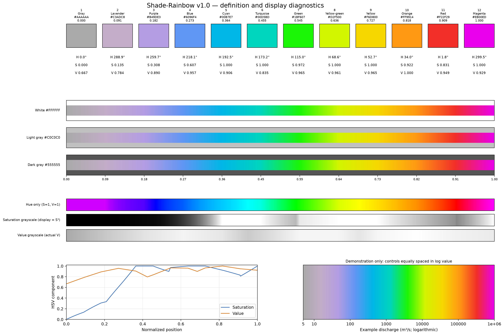
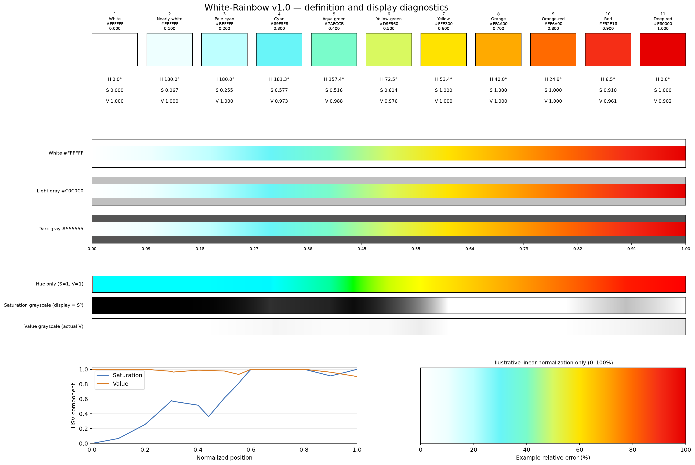

# CMF Colormaps

CMF Colormaps is a small, reusable Python library for palettes developed for
CaMa-Flood visualizations. It currently provides four independently
selectable colormaps: the sequential **Shade-Rainbow**, **White-Rainbow**, and
**Pale-Terrain**, plus the diverging **Diverge-Rainbow**. They serve different
display purposes and are not universal replacements for other palettes.

## Overlay-Aware Colormap Design

> CMF Colormaps are designed primarily for layered scientific visualization of
> rivers, river basins, and floodplains. Rather than optimizing a colormap
> solely for displaying a single scalar field, the design considers how colors
> interact with background terrain, river networks, water bodies, observation
> points, and other geospatial layers. Each colormap aims to control visual
> prominence so that the intended scientific information remains readable
> without unnecessarily obscuring other layers.

This is a design philosophy, not a claim that every CMF colormap is optimal on
all backgrounds, displays, or for all viewers. The palettes balance several
considerations:

1. **Visual hierarchy:** important scientific information should draw attention
   while supporting information remains visually subordinate.
2. **Background compatibility:** evaluate colors against common white, light
   gray, dark gray, and shaded-terrain backgrounds.
3. **Controlled prominence:** low, near-zero, or background values may be muted
   while important magnitudes or anomalies are emphasized.
4. **Layer compatibility:** account for overlaid rivers, coastlines, basin
   boundaries, water bodies, and observation markers.
5. **Reproducibility:** record and test control colors, interpolation methods,
   and normalized positions explicitly.
6. **Scientific interpretation:** visual prominence should suit the intended
   interpretation, rather than act as a universal indicator of increasing
   numerical magnitude.

These choices involve trade-offs with perceptual uniformity, color-vision
accessibility, and quantitative comparability. Choose a map and normalization
for the particular data, background, audience, and scientific question.

## Install

From a CaMa-Flood checkout:

```bash
python -m pip install -e ./visualization/cmf_colormap
```

The package can also be installed from a standalone clone of this directory:

```bash
python -m pip install -e .
```

Matplotlib is the only runtime dependency. NumPy is used by the gallery example
and is already a Matplotlib dependency.

The package is distributed under Apache License 2.0; see [`LICENSE`](LICENSE).

## Use

```python
import matplotlib.pyplot as plt
from matplotlib.colors import LogNorm

from cmf_colormap import get_cmap

cmap = get_cmap("shade_rainbow")
image = ax.pcolormesh(lon, lat, discharge, cmap=cmap,
                      norm=LogNorm(vmin=5, vmax=1_000_000, clip=True))
fig.colorbar(image, ax=ax, label="Discharge (m³/s)")
```

The package does not select a variable, unit, or normalization range. Choose a
normalization appropriate to the plotted quantity: `Normalize` for a linear
scale, `LogNorm` for positive values spanning orders of magnitude, or another
Matplotlib norm where appropriate. The `LogNorm` range above is only an example.

Available maps come from the package registry:

```python
from cmf_colormap import get_cmap, list_colormaps, register_colormaps

print(list_colormaps())  # ['shade_rainbow', 'white_rainbow', 'pale_terrain', 'diverge_rainbow']
cmap = get_cmap("shade_rainbow")

# Optional global Matplotlib lookup as "cmf.<name>" for all four maps.
register_colormaps()
```

Importing the package does not modify Matplotlib's global registry. Registration
is explicit and safe to repeat. A pre-existing unrelated `cmf.<name>` entry is
reported as a collision. Unknown names raise `ValueError` and list registered
choices.

## Shade-Rainbow definition

The authoritative colors and metadata are in
[`src/cmf_colormap/data/shade_rainbow.json`](src/cmf_colormap/data/shade_rainbow.json).
Twelve controls are evenly spaced on normalized `[0, 1]`; adjacent RGB channel
values are interpolated piecewise-linearly in numerical sRGB values. There is no
HSV, HSL, Lab, perceptual-space, or gamma-corrected light interpolation. The
first and last control colors are the exact endpoints. HSV values in the detail
preview are derived for diagnostics only; they do not define the palette.

Matplotlib exposes finite lookup tables for colormap objects. This adapter uses
131,072 entries to keep lookup sampling fine; the JSON interpolation rule remains
the mathematical source of truth.

Shade-Rainbow transitions from muted gray at low normalized values to vivid
rainbow colors at high values. It is designed primarily for river discharge or
other magnitudes over gray or terrain backgrounds, keeping small values subdued
and making large values prominent. Select a suitable normalization, such as
`LogNorm` for positive values spanning orders of magnitude.

## White-Rainbow

White-Rainbow is intended primarily for nonnegative error magnitudes, anomaly
magnitudes, and severity indicators. Pure white represents zero; pale cyan marks
small positive values, followed by yellow, orange, and deep red as normalized
values increase. It is sequential, not diverging, and should not be applied to
signed errors without first choosing an appropriate transformation, such as an
absolute error or a separately defined signed-error display.

The authoritative 11-color definition is in
[`src/cmf_colormap/data/white_rainbow.json`](src/cmf_colormap/data/white_rainbow.json).
Controls are evenly spaced from 0 to 1 and interpolated piecewise-linearly in
numerical sRGB values, following the same convention as Shade-Rainbow.
Normalization from physical values to `[0, 1]` remains the caller's choice.

```python
import matplotlib.pyplot as plt
from matplotlib.colors import Normalize
from cmf_colormap import get_cmap

plt.imshow(
    error_magnitude,
    cmap=get_cmap("white_rainbow"),
    norm=Normalize(vmin=0, vmax=100),
)
plt.colorbar(label="Relative error (%)")
```

The `0–100%` range is illustrative only, not part of the colormap definition.

## Pale-Terrain

Pale-Terrain is a subtle, low-saturation sequential colormap for topographic
background fields, especially when dark river networks, water bodies, or other
foreground features should remain prominent. It transitions from pale cyan
through mint, cream, and peach to pale rose. It is not designed for strong
perceptual separation of adjacent values and is not perceptually uniform.

The authoritative eight-color definition is in
[`src/cmf_colormap/data/pale_terrain.json`](src/cmf_colormap/data/pale_terrain.json).
The colors are equally spaced and piecewise-linearly interpolated in numerical
sRGB. The colormap itself is generic: users choose the variable, normalization,
physical range, or class boundaries. Terrain-slope thresholds are an example
visualization configuration, not intrinsic properties of Pale-Terrain.

Use the continuous map with any suitable Matplotlib normalization:

```python
import matplotlib.pyplot as plt
from matplotlib.colors import Normalize
from cmf_colormap import get_cmap

plt.imshow(slope, cmap=get_cmap("pale_terrain"), norm=Normalize(vmin=0, vmax=50))
plt.colorbar(label="Slope (cm/m)")
```

For an optional eight-class slope display, explicitly use the eight control
colors with `ListedColormap`; this keeps class-to-color assignments independent
of the continuous map's lookup-table sampling:

```python
import numpy as np
import matplotlib.pyplot as plt
from matplotlib.colors import BoundaryNorm, ListedColormap

class_cmap = ListedColormap([
    "#E8FAFA", "#EEFBF6", "#F4F9E8", "#FFFCE9",
    "#FFF4E5", "#FCEBE5", "#F9DADB", "#F6C9CE",
])
boundaries = [0, 2, 5, 7, 10, 20, 30, 50, np.inf]
class_norm = BoundaryNorm(boundaries, ncolors=class_cmap.N)
plt.imshow(slope, cmap=class_cmap, norm=class_norm)
plt.colorbar(label="Slope (cm/m)")
```

These boundaries illustrate one slope application only; users may choose other
classes, variables, and units.

## Diverge-Rainbow

Diverge-Rainbow is a diverging multihue map for signed errors, biases, and
anomalies, including relative drainage-area errors and differences in river
discharge or water level. Blue tones represent negative values, pale
mint-green represents the center, and yellow-to-red tones represent positive
values. The pale center remains visible against light map backgrounds where a
white zero color could blend in with the background. Its branches are not
perfectly symmetric in perceived brightness; that is a deliberate design
trade-off, not a claim of perceptual uniformity.

The authoritative 13-color definition is in
[`src/cmf_colormap/data/diverge_rainbow.json`](src/cmf_colormap/data/diverge_rainbow.json).
Control points are equally spaced on `[0, 1]`, with the pale mint center at
`0.5`; numerical sRGB channels are interpolated piecewise-linearly. The
colormap contains no units or physical range. Use a diverging normalization to
map the scientific zero to the color midpoint, including when the limits are
asymmetric:

```python
import matplotlib.pyplot as plt
from matplotlib.colors import TwoSlopeNorm
from cmf_colormap import get_cmap

cmap = get_cmap("diverge_rainbow")
norm = TwoSlopeNorm(vmin=-50, vcenter=0, vmax=100)
plt.scatter(longitude, latitude, c=signed_error, cmap=cmap, norm=norm)
plt.colorbar(label="Signed error")
```

The `-50` to `100` range is an illustrative setting; choose limits and center
for the variable and comparison being shown.

## Previews

The registry-driven gallery shows each available map on a normalized 0–1 axis.
The registry-driven gallery shows all four colormaps on normalized axes and
marks the Diverge-Rainbow midpoint. Detailed previews include control
HEX/HSV/position diagnostics, bars over white/light gray/dark gray, HSV
component strips, saturation and value curves, and illustrative applications.
The discharge, error, slope, and signed-error ranges and the synthetic
background examples are demonstrations only.







Regenerate the gallery and all detailed previews after changing or adding a
registry entry:

```bash
python examples/plot_colormap_gallery.py
```

Install the test dependency and run the focused tests from this package
directory:

```bash
python -m pip install -e '.[test]'
python -m unittest discover -s tests -v
```

The plotting program reads definitions from package data and writes preview PNGs
beside itself. It does not maintain separate color definitions.

## Add a colormap

1. Add a JSON definition under `src/cmf_colormap/data/` with a unique name,
   version, type, interpolation rule, description, and named HEX controls.
2. Add one row to `colormaps.csv`, pointing to that JSON file.
3. Keep units and data normalization outside the definition.
4. Add focused definition/API tests and regenerate the gallery.

The implementation currently accepts `linear_srgb` definitions with at least
two named HEX controls. Add other interpolation methods only with an explicit
definition and matching tests.

## Limitations

None of the colormaps is designed to be perceptually uniform: equal normalized
steps need not appear equally different. Their multihue transitions may be
difficult for some viewers with color-vision deficiencies, and changing hues
can suggest boundaries that are not present in the data. White-Rainbow's white
low end can blend into a white background; Pale-Terrain is intentionally subtle
and may not distinguish nearby values strongly. Diverge-Rainbow is not exactly
symmetric in perceived brightness. The overlay-aware approach is not a claim of
universal superiority. Consider the data, background, audience, accessibility,
and alternative palettes when choosing a map; do not interpret these colors as
scientific classifications by themselves.

## Development and subtree synchronization

This directory is both the package location in CaMa-Flood and the root of the
standalone [`global-hydrodynamics/cmf_colormap`](https://github.com/global-hydrodynamics/cmf_colormap)
repository. CaMa-Flood integrates it with Git subtree at the prefix
`visualization/cmf_colormap`; no submodule is needed by CaMa-Flood users. The
standalone repository uses `master` as its default branch.

### Initial subtree import

The package was first developed and committed inside CaMa-Flood. For the first
publication, export its path history, rejoin the split history to the existing
CaMa-Flood branch, then push the exported commit to the empty standalone
`master` branch. `--rejoin` is important here: the initial split by itself does
not connect the standalone history to the CaMa-Flood branch for a later subtree
pull. Rejoining adds a merge commit to the CaMa-Flood branch; it does not rewrite
or replace existing commits.

From the CaMa-Flood repository:

1. Commit package changes on the approved CaMa-Flood development branch. Subtree
   operations include committed content only.
2. Add the standalone remote locally if it is not already configured:

   ```bash
   git remote add cmf-colormap git@github.com:global-hydrodynamics/cmf_colormap.git
   ```

3. Split and rejoin the subtree history, then publish that split to the
   standalone default branch. This direct push is for the initial import into
   an empty repository only; do not force-push.

   ```bash
   git subtree split --rejoin --prefix=visualization/cmf_colormap
   git subtree push --prefix=visualization/cmf_colormap cmf-colormap master
   ```

The independent repository must still be empty before the initial push. If it
already has commits or files, stop and agree on a history integration plan.
Never use `git subtree add` over the existing package directory, and do not
squash, rebase, or force-push shared history.

### Routine synchronization

Choose one repository for a change and synchronize before editing the other.
Commit all package changes first; subtree operations do not include uncommitted
files. Do not independently edit both copies and reconcile them later.

From CaMa-Flood, pull standalone changes:

```bash
git subtree pull --prefix=visualization/cmf_colormap cmf-colormap master
```

To send CaMa-Flood changes back, push the subtree split to standalone `master`:

```bash
git subtree push --prefix=visualization/cmf_colormap cmf-colormap master
```

These are non-squashed subtree operations. Synchronize before editing in the
other repository, and do not independently edit both copies. Never synchronize
with uncommitted package changes. If a pull reports conflicts, resolve them as
an ordinary merge, run the package tests, and commit the merge before
continuing. If a standalone change is based on history not yet present in the
CaMa-Flood subtree, first inspect the histories; do not force-push or use
automatic conflict resolution.

### Standalone continuous integration

The standalone repository runs the package unit tests on pushes and pull
requests. The workflow installs the package and its test dependencies from
`pyproject.toml`; it does not need CaMa-Flood model data or executables.
