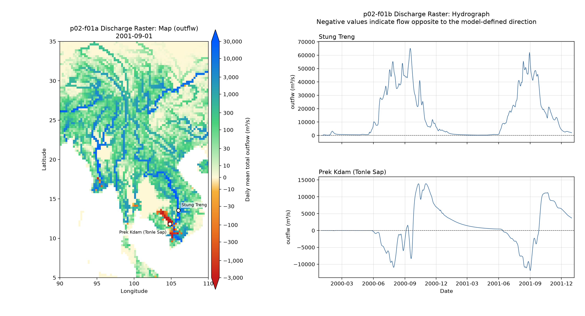
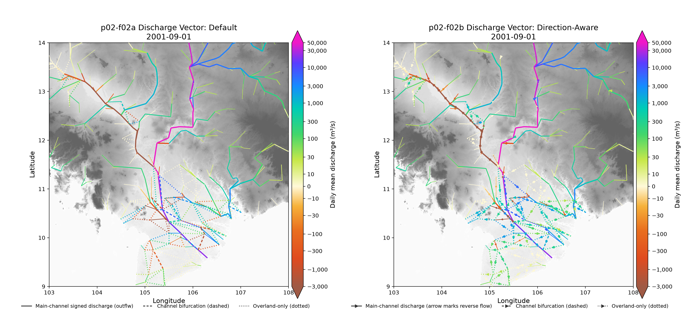
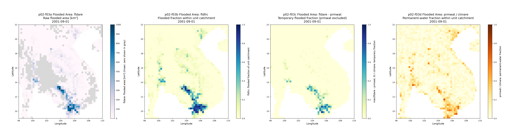
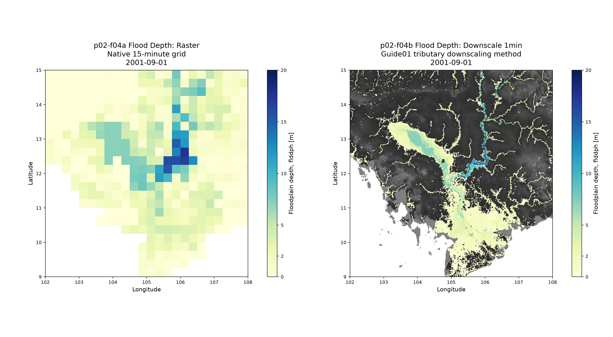

# output_analysis

Project number: `p02`.

This project demonstrates standard approaches for visualizing two-dimensional
maps of CaMa-Flood simulation outputs, including downscaled visualization.

## Data source

The input source is the simulation output from
`gosh_test/mek02-2year_netcdf`. The initial visualization date is
2001-09-01.

Simulation data are not copied when this project is created. When developing
each figure, copy or extract only the data required for that figure from the
input source.

## Run a figure

From the repository root, prepare and activate the standard Python environment
once, then run the Figure's Shell entry point:

```bash
./s02-python_setup.sh
source .venv/bin/activate
./visualization/output_analysis/f01-discharge_raster.sh
./visualization/output_analysis/f02-discharge_vector.sh
./visualization/output_analysis/f03-flooded_area.sh
./visualization/output_analysis/f04-flood_depth.sh
```

The entry point resolves repository paths relative to its own location. It
stores compact extracted inputs in `out_sample/` and generated project figures
in `figure/`. The standalone extractor can also be run directly when preparing
samples for later figures.

## p02-f01 — Discharge Raster




Method: `discharge_raster`.

| Option | Option identifier | Variable |
| --- | --- | --- |
| Panel | Option name | Variable |
| --- | --- | --- |
| (a) River discharge raster | `discharge_raster-map` | `outflw` |
| (b) River discharge hydrograph | `discharge_raster-hydrograph` | `outflw` |

The Figure contains two panels. Panel (a) shows the full-grid outflow map with
the Stung Treng and Prek Kdam station coordinates and names from
`station_map_locations.csv`. Panel (b) shows the corresponding daily modeled
outflow series, with Stung Treng above Prek Kdam. The panels are also saved
individually for reuse.

### Purpose and interpretation

Panel (a) shows the complete Mekong model grid for the daily mean `outflw`
field at the CF time coordinate 2001-09-01 00:00. CaMa-Flood defines
`outflw` as total discharge (`m3/s`) from the river and floodplain pathways.
The sign follows the model's downstream-positive direction: when a reversed
water-level gradient drives flow upstream, `outflw` becomes negative. The
Tonle Sap River near Prek Kdam is a prominent Mekong example of seasonal flow
reversal. The plotted series are model output, not observed discharge.
The timestamp is the end of the averaging interval, so this record represents
the mean from 2001-08-31 00:00 through 2001-09-01 00:00. Negative values
indicate flow opposite to the model-defined positive direction. Negative and
zero values are retained; finite negative values are not treated as missing.

Panel (a) uses the native 80 × 120 grid at 0.25° resolution, with longitude
centers increasing eastward and latitude rows ordered north to south. The map
extent is 90–110°E and 5–35°N. Cells are drawn without interpolation. Missing
cells are white. The custom `diverge_spectral` palette maps negative flow to
red and orange, zero to pale warm yellow, and positive flow to green and blue.
This diverging palette was selected to make the direction change around zero
easy to see while retaining graduated flow magnitude on both sides.
The Shell entry point exposes the colorbar ticks and range as `CELV`, the
zero-centered linear interval half-width as `LINTHRESH`, and the colormap
fraction assigned to that interval as `LINEAR_FRAC`. The default range is
asymmetric (`−3,000` to `+30,000 m3/s`): the two outer branches are logarithmic
and the interval `−10` to `+10 m3/s` is linear. The central interval occupies
10% of the colormap, with zero exactly at its center. The remaining 90% is
split between the negative and positive logarithmic branches in proportion to
their `log10` spans. For the defaults, the negative side including half the
linear interval occupies about 42.5% of the colorbar, and the positive side
about 57.5%; the zero tick is therefore left of the bar's midpoint. The
registered palette is reparameterized for this figure so zero still receives
its pale-yellow center. `CELV` supplies the colorbar ticks and its first and
last values set the range. Tick positions use the same nonlinear transform as
the map. Both colorbar ends extend to disclose out-of-range values. No offset
is added and values are not clipped in the data.
The default `CELV` is `−3,000, −1,000, −300, −100, −30, −10, 0, 10, 30,
100, 300, 1,000, 3,000, 10,000, 30,000 m3/s`.

### Input data and preparation

The source is `out/mek02-2year_netcdf/o_outflw2001.nc`, produced by the
`gosh_test/mek02-2year_netcdf` simulation. The Shell wrapper
`s01-extract_output_variables.sh` calls
`script/extract_output_variables.py`. It reads the CF time coordinate and
selects the unique midnight record for the requested date; it does not infer
the record index from the start date. For f01, it extracts variable `outflw`
at 2001-09-01 00:00 from `o_outflw2001.nc` and writes a one-record NetCDF
containing `time`, `lat`, `lon`, and `outflw` to
`out_sample/outflw_2001-09-01.nc`. For f02, it extracts `pthflw` at the same
CF timestamp to `out_sample/pthflw_2001-09-01.nc`, preserving the layer and
path dimensions and static metadata such as `pth_id`, endpoints, and widths.
These samples retain their source attributes, time-coordinate definition, and
provenance identifying the selected record.

The standalone `s01-extract_output_variables.sh` defaults also extract
`fldare`, `fldfrc`, and `flddph` at the same requested CF timestamp into
`out_sample/fldare_2001-09-01.nc`, `out_sample/fldfrc_2001-09-01.nc`, and
`out_sample/flddph_2001-09-01.nc`. These are one-record 120 × 80 fields with
units m², 1, and m, respectively. Their `time: point` metadata identifies
output snapshots; unlike daily-mean `outflw`, they are not interval means.
Extraction preserves their `lat`/`lon` grid, source attributes, fill values,
and selected CF timestamp.

The same Shell workflow also calls `script/extract_station_outflw.py`. It reads
the six selected locations in `station_map_locations.csv` and extracts each
location's daily modeled `outflw` from `o_outflw2000.nc` and
`o_outflw2001.nc`. The CSV's explicitly labeled zero-based Python row/column
indices are used, and checked against the map-cell centers in the source
NetCDF. CaMa-Flood timestamps daily means at interval end, so each sample is
labeled with the preceding represented calendar day. The resulting 2000–2001
series is written as the long-form
`out_sample/station_outflw_daily_2000-2001.csv` and as
`out_sample/station_outflw_daily_2000-2001.nc` with a `(time, station)` flow
array and station metadata. These are simulated flows sampled at station
locations; they are not observed discharge records.

Each extraction is also appended to `out_sample/extraction_log.csv`. The row
records the variable, requested date and selected CF time, source file and
zero-based record index, destination, grid dimensions, data type, and units.
This makes the extraction reproducible and identifies exactly which output
record was used. The extractor accepts comma-separated `--variables` and
`--dates` lists for `outflw`, `pthflw`, `fldare`, `fldfrc`, and `flddph`, so
additional dates can be extracted without changing the Python source. Output filenames use
`<variable>_<YYYY-MM-DD>.nc`; annual source files use
`o_<variable><year>.nc`.

The model output variable registry identifies `outflw` as an alias of
`totout`; in the current model output implementation it combines river and
floodplain discharge and does not include bifurcation outflow. The extracted
record has 6,566 valid cells and 3,034 missing cells. Valid values range
from −12,080.566 to 61,059.098 m3/s, with 84 negative and 226 zero cells.
With the default display range, 15 values are below −3,000 m3/s
(−12,080.567 to −3,006.261 m3/s), and 26 are above +30,000 m3/s
(+31,433.152 to +61,059.105 m3/s).

Panel (b) plots daily modeled `outflw` sampled at the two allocated map cells
for 2000–2001. Stung Treng is the Mekong mainstream location. Prek Kdam on the
Tonle Sap River is used as the reverse-flow example: negative values are
retained and indicate flow opposite to the model-defined positive direction,
as can occur when the water-level gradient reverses. Both hydrographs use the
same line color; station names and panel order identify the series. These are
simulated model samples, not observed station discharge.

### Run and output

Run `./visualization/output_analysis/f01-discharge_raster.sh`. It invokes the
extraction wrapper, draws both panels, then assembles the complete Figure.
To prepare the dated map sample and two-year station series without drawing
f01, run `./visualization/output_analysis/s01-extract_output_variables.sh`; its
defaults are `VARIABLES="outflw,pthflw,fldare,fldfrc,flddph"` and
`DATES="2001-09-01"`. Edit those settings or pass `--variables` and `--dates`
to select more output variables and CF dates. Edit
`TARGET_DATE` in the f01 wrapper to select another daily CF timestamp. Edit
`CELV`, `LINTHRESH`,
and `LINEAR_FRAC` in the same Shell script to adjust the scale without changing
the Python implementation. `CELV` must be a strictly ascending comma-separated
list containing negative values, zero exactly once, and positive values; its
endpoints must extend beyond `±LINTHRESH`. `LINEAR_FRAC` must be between 0 and
1. The script creates compact NetCDF samples and these PNGs:

- `figure/f01a-discharge_raster-map.png`
- `figure/f01b-discharge_raster-hydrograph.png`
- `figure/f01-discharge_raster.png` (panels (a) and (b), side by side)

Negative values indicate flow opposite to the model-defined positive
direction.


## p02-f02 — Discharge Vector




Method: `discharge-vector`.

| Panel | Option identifier | Flow variable |
| --- | --- | --- |
| (a) Default signed-flow view | `discharge-vector_default` | `outflw`, sum of `pthflw` layers |
| (b) Direction-aware view | `discharge-vector_direction-aware` | `outflw`, sum of `pthflw` layers |

Both panels show 2001-09-01 daily-mean flow on outlet-to-outlet network
segments over the subdued 1-minute elevation background used in the Tutorial02
network figure. The default extent is 103–108°E and 9–14°N. Main connections
follow `nextxy_noedge` and use outlet coordinates from `lonlat.nc`; their line
widths increase by source-cell upstream-area quartile. Small-area connections
are drawn first so larger downstream channels remain visible. Both panels
sum signed `pthflw` across all five pathway layers for each path, without
reversing signs before summation. They include paths with positive width in at
least one `bifprm.nc` layer, including channel and overland-only bifurcations.
Dashed paths have positive width in layer 1; dotted paths have no layer-1
width and are overland-only.

The panels demonstrate two ways to present complex signed flow. Panel (a),
`discharge-vector_default`, colors signed `outflw` and the signed sum of
`pthflw` layers with `diverge_asymmetry`. The sum retains its positive or
negative sign, and no direction markers are drawn. Negative values use the
negative side of the scale and indicate flow opposite to the model-defined
positive direction.

Panel (b), `discharge-vector_direction-aware`, keeps signed `outflw` colors and
adds midpoint arrows to negative main-channel links, pointing opposite to the
stored `nextxy_noedge` direction. For bifurcation paths, it first sums the
signed `pthflw` values across all five pathway layers for each path, then colors
by the absolute value of that total on the positive side of the shared scale.
Midpoint arrows follow net flow: positive sums follow the stored `bifprm.nc`
source-to-destination direction, while negative sums point in reverse. Color
communicates net pathway magnitude while arrow direction communicates its sign.
The same dashed/dotted path styles and all-layer sum are used in both
panels; panel (a) retains the signed sum colors without direction markers.
Both panels use the same default `CELV`, `LINTHRESH`, and `LINEAR_FRAC` scale
as f01; zero is the palette's pale-yellow neutral color. Path IDs and endpoint
indices are checked against `bifprm.nc`.

The one-day pthflw sample preserves `pth_id`, endpoint indices, path
coordinates, and width layers alongside `pthflw`. The model sample's
`CVARSOUT` now includes `pthflw` so future simulation runs produce the annual
source file. The pthflw file used for this dated sample was generated from the
2001 start restart with the same model settings; the regenerated annual
`outflw` values matched the existing file exactly.

Run `./visualization/output_analysis/f02-discharge_vector.sh` to extract both
CF-timestamped records, render the panels, and assemble the Figure. The Shell
script exposes `WEST`, `EAST`, `SOUTH`, and `NORTH` for the map extent,
`COLORMAP` for palette selection, `LINE_WIDTH_SCALE` for main and bifurcation
line widths, and `CELV`, `LINTHRESH`, and `LINEAR_FRAC` for scale adjustment.
`TITLE_SIZE`, `AXIS_LABEL_SIZE`, `TICK_LABEL_SIZE`, `LEGEND_SIZE`, and
`COLORBAR_LABEL_SIZE` control typography; review the assembled Figure at its
intended display size when adjusting them.
It creates:

- `figure/f02a-discharge-vector_default.png`
- `figure/f02b-discharge-vector_direction-aware.png`
- `figure/f02-discharge-vector.png` (panels (a) and (b), side by side)

The pthflw panel requires `o_pthflw<year>.nc` alongside the annual outflw
file. The extractor selects both records by their CF time coordinates.


## p02-f03 — Flooded Area



Method: `flooded_area`.

| Panel | Option identifier | Variable / measure |
| --- | --- | --- |
| (a) Raw flooded area | `flooded_area-area_raw` | `fldare` [km²] |
| (b) Unit-catchment flooded fraction | `flooded_area-flood_frac` | `fldfrc` [1] |
| (c) Temporary flooded fraction | `flooded_area-season_frac` | `max(fldare - prmwat, 0) / ctmare` [1] |
| (d) Permanent-water fraction | `flooded_area-prmwat` | `prmwat / ctmare` [1] |

The Figure compares the 2001-09-01 snapshot over 98–110°E and 9–22°N. Panel
(a) shows `fldare` converted from m² to km² on a linear 0–1,000 km² scale;
zero-area cells are gray and missing or out-of-network cells are white. Raw
area depends on the size of each unit catchment, so it should not be read as a
direct comparison of inundation fraction. Panel (b) shows `fldfrc`, the flooded
fraction within each unit catchment. Panel (c) subtracts the mapped permanent
water area `prmwat` from `fldare` before dividing by `ctmare`, showing the
temporary flooded fraction with permanent water excluded. Panel (d) shows the
permanent-water fraction `prmwat / ctmare`. Panels (b), (c), and (d) share a
0–1 color scale for direct comparison. Panel (d) uses the `YlOrBr` sequential
palette; panels (b) and (c) retain `YlGnBu`. No figure legend is displayed.

The dated `fldare_2001-09-01.nc` and `fldfrc_2001-09-01.nc` samples are reused
from `out_sample/`; this Figure does not re-extract or duplicate them.
`ctmare.nc` and `prmwat.nc` are read as static 15-minute map fields. The
NetCDF attributes confirm that `fldare`, `ctmare`, and `prmwat` use m², while
`fldfrc` is dimensionless. Both static maps and the output samples use the
same 80 × 120 cell-center grid. For valid cells, `fldfrc` agrees with
`fldare / ctmare` to a maximum absolute difference of `3.64×10⁻⁸` for this
snapshot. The plotted raw flooded area ranges from 0 to 985.443 km², within the
linear color scale. The temporary fraction ranges from 0 to 0.872 and the
permanent-water fraction from 0 to 0.807; no valid cells in either derived
fraction fall outside [0, 1]. Values are not clipped.

Run `./visualization/output_analysis/f03-flooded_area.sh` to regenerate the
four panels and their map-area-aligned single-row combined Figure. The Shell
settings control the geographic extent, linear `fldare` range and ticks in
km², shared fraction range and ticks, colormaps, zero-area color, and output
dimensions. `TITLE_SIZE`, `AXIS_LABEL_SIZE`, `TICK_LABEL_SIZE`, and
`COLORBAR_LABEL_SIZE` control text size and are reviewed on the assembled
Figure.
Individual panels are saved as `figure/f03a-flooded_area-area_raw.png`,
`figure/f03b-flooded_area-flood_frac.png`, and
`figure/f03c-flooded_area-season_frac.png`, and
`figure/f03d-flooded_area-prmwat.png`.


## p02-f04 — Flood Depth



Method: `flood_depth`.

| Panel | Option identifier | Variable / method |
| --- | --- | --- |
| (a) Native-grid raster | `flood_depth-raster` | `flddph` [m] |
| (b) 1-minute downscaling | `flood_depth-downscale_1min` | `flddph` [m] |

The Figure compares the 2001-09-01 floodplain-depth snapshot over
102–108°E and 9–15°N. Panel (a) displays the native 15-minute cells without
interpolation. Panel (b) applies the existing Tutorial guide01
`downscale_flddph_trib.F90` tributary downscaling method at 1-minute
resolution. The `flddif` map is shown beneath downscaled positive depths in a
dark gray stretch to provide high-resolution terrain context; dry pixels show
the background. The same YlGnBu scale (0–20 m) is used in both panels, and
colorbar extensions disclose any values outside that range.

The source `out_sample/flddph_2001-09-01.nc` is reused. The Shell entry point
converts its single CF-timestamped record to the little-endian Float32 direct
record expected by the existing downscaler, builds that program in a temporary
directory, links the Mekong map directory as `map/`, and runs the requested
domain. It saves the downscaled result as
`out_sample/flddph_1min_2001-09-01.nc`, including the date, coordinates, units,
and method provenance. The 1-minute raster is 360 × 360 cells, north to south
in latitude and west to east in longitude. For this sample, `flddph` ranges
from 0 to 17.878 m on the native grid and 0 to 17.526 m among assigned
downscaled pixels; 95,543 of 129,600 1-minute pixels are assigned. No values
are outside the shared 0–20 m display scale.

The downscaler uses the existing 15-minute `nextxy.bin` and `uparea.bin`, plus
1-minute `catmxy`, `downxy`, `flddif`, and `rivwth` map files. Its domain and
resolution are read from the existing map metadata. The project script does
not change those maps or the downscaling algorithm.

Run `./visualization/output_analysis/f04-flood_depth.sh` to regenerate the two
panels and the side-by-side, map-area-aligned Figure. Shell settings control
the date, extent, common depth range and ticks, YlGnBu palette, figure size,
DPI, and text sizes. The project-local outputs are
`figure/f04a-flood_depth-raster.png`,
`figure/f04b-flood_depth-downscale_1min.png`, and
`figure/f04-flood_depth.png`.
