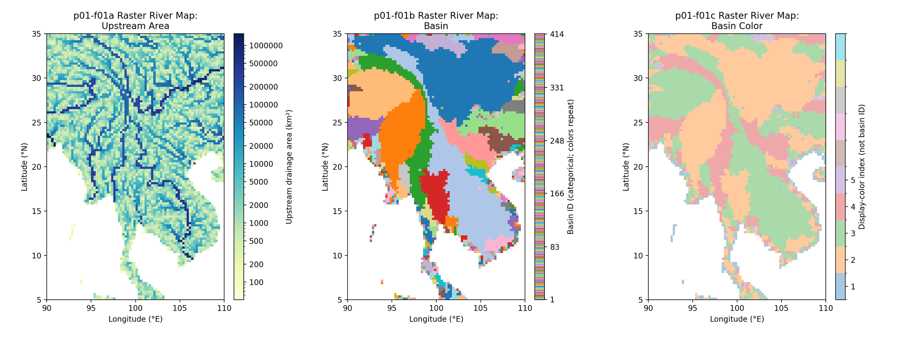
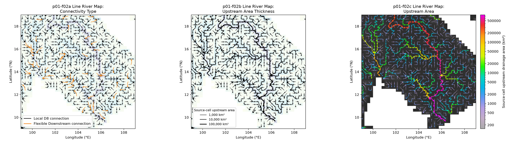

# River Map Visualizations

This project contains raster and network visualizations of CaMa-Flood river maps.
Each Figure has a project-root Shell entry point with editable settings and
Python implementations under `script/`. Working images are written to
`figure/`; only separately authorized copies are published in the Gallery.

## Run a figure

From the repository root, prepare and activate the standard Python environment
once, then run a Figure's Shell entry point:

```bash
./s02-python_setup.sh
source .venv/bin/activate
./visualization/river_map/f01-raster_river_map.sh
```

Entry points resolve repository paths relative to their own location, so they
can also be run from another current directory. Extend this README with a
descriptive section for each Figure added to the project.

## p01-f01 — Raster River Map

Method identifier: `raster_river_map`.

| Panel | Option | Option identifier | Map variable |
| --- | --- | --- | --- |
| p01-f01a | Upstream Area | `upstream_area` | `uparea` |
| p01-f01b | Basin | `basin` | `basin` |
| p01-f01c | Basin Color | `basin_color` | `bsncol` |

### Purpose and interpretation

This three-panel Figure shows upstream drainage area, the original basin ID
field, and precomputed basin display colors on the same Mekong 15-minute map.
Upstream area describes contributing land area, not discharge. **Basin IDs are
categorical identifiers**, not continuous physical quantities: numeric
separation and color ordering have no physical interpretation. The Basin panel
preserves the original stored IDs without replacing or renumbering them.

The Basin Color panel instead displays **`bsncol`**, a precomputed display-color
index derived from basin information. It is not the basin ID. It reuses a
small set of colors, considering neighboring basins, to support clear basin
visualization. Its soft opaque palette is suitable as a background for future
map overlays. Different basins can share a display index; the color map cannot
recover their original IDs. The current sample has 414 basin IDs and five
used display-color indices.

CaMa-Flood uses Flexible Downstream connections beyond immediate grid
neighbors. Apparent gaps in an upstream-area raster do not necessarily mean
that the modeled river network is disconnected; connectivity is stored in
`nextxy` rather than inferred from geographic proximity. No simulation or
observation-station data are required.



### Inputs, units, and methods

| Panel | File and variable | Display |
| --- | --- | --- |
| f01a | `map/mekong_15min/netcdf/uparea.nc`: `uparea(lat, lon)`, m² | Convert to km²; mask missing/non-finite/non-positive values; retain `YlGnBu` with logarithmic normalization over all valid map cells. |
| f01b | `map/mekong_15min/netcdf/basin.nc`: `basin(lat, lon)`, unitless | Display original positive integer IDs with one discrete bin per original integer value. Repeat the qualitative `tab20` palette across IDs; no conversion to `bsncol`. A display-only pseudo-log categorical legend expands IDs 1–20 and labels representative higher IDs. |
| f01c | `map/mekong_15min/netcdf/bsncol.nc`: `bsncol(lat, lon)`, unitless | Display the precomputed indices directly with discrete bins for 1–10. Mix the base `tab10` RGB colors with 60% opaque white to obtain distinguishable pastel colors; only used indices are labeled. |

All three Git-tracked inputs share an 80 × 120 grid at 0.25°. Coordinates are
cell centers, longitude increases eastward, latitude decreases southward,
and the missing value is `-9999`. `params.txt` checks coordinates and map
geometry. Missing cells stay white; valid basin IDs are retained exactly.
Repeated raw-ID colors in f01b are a display choice, not adjacency-aware basin
coloring or unique identifiers. Use the numeric raster to identify a basin.
In f01c, neighboring regions with different display indices retain different
colors after lightening; the plot does not recalculate boundaries or indices.

The f01b legend uses **display-only pseudo-log categorical spacing**. IDs 1–20
each occupy a full slot with an individual label. Above 20, intervals ending
at 30, 40, 50, 70, 100, 150, 200, 300 and the maximum ID share one slot each;
only these representative IDs are labeled. Every integer's swatch still uses
its existing map color, but higher-ID swatches are compressed. This custom
legend changes display geometry only: the map retains its discrete
`BoundaryNorm`, original categorical IDs and repeating palette. There is no
`LogNorm`, continuous scientific scale, or physical meaning to legend spacing.
Tick text adapts to configured panel height to avoid overlaps.

### Basin preparation and provenance

The regional preparation workflow is
[`map/tools/script_region/s01-regional_map.sh`](../../map/tools/script_region/s01-regional_map.sh),
documented in the [regional-map guide](../../map/tools/script_region/README.md).
It calls [`region_set_map.F90`](../../map/tools/code/region_set_map.F90), whose
basin/color section labels network paths, orders basin IDs by upstream-grid
count, and then assigns a small set of display colors using neighboring-color
checks. Single-cell basins have a special display color. The plotted `basin`
values are the original IDs already stored in the prepared map; visualization
does not perform that preprocessing again. See the source for the full rules,
rather than interpreting `bsncol` as a separate physical field or basin ID.

The individual-map NetCDF preparation template is
[`map/tools/script_bin2nc/s02-convert_netcdf.sh`](../../map/tools/script_bin2nc/s02-convert_netcdf.sh),
using [`convert_map_binary_to_netcdf.py`](../../map/tools/code/convert_map_binary_to_netcdf.py).
The three NetCDF inputs are already tracked, so plotting requires neither
conversion nor map generation.

### Settings and execution

Run `./visualization/river_map/f01-raster_river_map.sh` after the standard
Python setup. It generates these tracked project assets:

- `figure/f01a-raster_river_map-upstream_area.png`
- `figure/f01b-raster_river_map-basin.png`
- `figure/f01c-raster_river_map-basin_color.png`
- `figure/f01-raster_river_map.png`

Defaults are a horizontal three-panel arrangement, 6-inch total panel height,
200 DPI, and maximum assembled dimensions of 12 × 8 inches. The common extent
remains 90–110°E, 5–35°N, with the existing equal-degree raster aspect.
The Shell settings expose input files, palettes, white mixing, spacing and
size limits. Titles wrap between method and option to stay readable.

All panels reuse the verified explicit map/colorbar layout from f02 through
`script/river_network_layout.py`, with identical reserved colorbar space and
complete canvases. Each f01 panel has a real colorbar; none reduces map height
or triggers independent tight-layout/cropping. Colorbar ends align with map
axes. The unchanged combiner proportionally fits the full horizontal Figure
to its size limits. Generation does not update the Gallery.

Run `python visualization/river_map/script/test_raster_river_map.py` to check
raw IDs, data masks, pastel distinguishability, labels and common map geometry.

## p01-f02 — Line River Map

Method identifier: `line_river_map`. Vector visualization remains a separate
future method.

| Panel | Option | Option identifier |
| --- | --- | --- |
| p01-f02a | Connectivity Type | `connectivity_type` |
| p01-f02b | Upstream Area Thickness | `upstream_area_thickness` |
| p01-f02c | Upstream Area | `upstream_area` |

### Purpose and interpretation

All three panels show directed `nextxy` river-network connections over
**99–109°E, 9–19°N**, with the same map geometry and aligned panel heights.
Upstream drainage area is contributing land area, not discharge.

- **f02a:** thicker black arrows show local D8 connections; orange curved
  arrows distinguish nonlocal Flexible Downstream connections. A faint
  upstream-area raster provides context. Flexible arrowheads are slightly
  smaller (7-point mutation scale), with stronger curvature (`rad=0.22`).
- **f02b:** all arrows are black, with enhanced shaft thickness representing
  source-cell upstream area. A logarithmic six-class width scale makes larger
  rivers stand out while retaining small links. A legend gives representative
  areas; the faint raster is the same as f02a. Arrowheads stay at the standard
  size instead of enlarging with shaft thickness: local heads match f02a
  (0.050-inch width/length); flexible heads use the same 7-point mutation scale.
- **f02c:** `cmf_colormap` **shade-rainbow** (`get_cmap("shade_rainbow")`) arrow colors represent source-cell
  upstream area on a logarithmic scale. Moderate area-based widths reinforce
  the network. Precomputed `bsncol` display indices form a darker charcoal-gray
  categorical background, keeping colored arrows in the foreground.



### Inputs, units, and methods

All inputs are Git-tracked under `map/mekong_15min/`; no simulation output,
station data, external download, or map preparation is needed.

| Input | Meaning and use |
| --- | --- |
| `netcdf/uparea.nc`: `uparea(lat, lon)`, m² | Convert to km²; read source-cell areas for arrows and a faint logarithmic background in a/b. Missing, non-finite and non-positive areas are excluded. |
| `netcdf/nextxy_noedge.nc`: `nextx`, `nexty` | One-based destination indices; paired non-positive terminal/sentinel values do not define links. |
| `netcdf/bsncol.nc`: `bsncol(lat, lon)`, unitless | Precomputed categorical display indices 1–10 for c's gray background. Missing/out-of-range cells stay white. These are not basin IDs or a physical magnitude. |
| `params.txt` | Grid dimensions, resolution and bounds, checked against NetCDF cell-center coordinates. |

The current map contains 3,150 valid links (3,022 local and 128 Flexible
Downstream). Every valid link is passed to plotting; the axes clip the display
without filtering connections by extent. Link direction comes directly from
`nextxy`, never geographic proximity. A link is Flexible Downstream if either
source/destination grid-index offset exceeds one. Local arrows are straight;
flexible arrows curve between their exact original endpoints.

For b and c, normalize log10(source area) over all valid links in the map,
independently of the plotting extent. Divide the normalized range into six
equal classes, with the maximum in the last class. In b, shaft widths range
from 0.008 to 0.032 inches; in c, from 0.008 to 0.022 inches. Local quivers
use actual shaft widths; flexible strokes use the corresponding widths in
points. In b, head size is independent of area; c retains its existing
proportional heads. Narrow local links are drawn before wider
ones. The full-map area range is also used for c's continuous logarithmic
colorbar. Inputs are never modified.

The charcoal shades in c range from `#2b2b2b` to `#3b3b3b`, roughly halving
the prior gray RGB intensities while preserving categorical distinctions.
The gray shades in c distinguish display classes only; their brightness has
no ordered basin meaning. Repeated `bsncol` values do not uniquely identify
basins. See [f01 basin preparation](#basin-preparation-and-provenance) for
preprocessing provenance. The background has no separate quantitative scale.

### Settings and execution

After the standard Python setup (including `cmf_colormap`), run:

```bash
./visualization/river_map/f02-line_river_map.sh
```

One wrapper invokes three independent panel scripts, then one unchanged
`visualization/script/combine_panels.py` assembly step. It creates these
tracked project assets:

- `figure/f02a-line_river_map-connectivity_type.png`
- `figure/f02b-line_river_map-upstream_area_thickness.png`
- `figure/f02c-line_river_map-upstream_area.png`
- `figure/f02-line_river_map.png`

The former colored f02b is now f02c; f02b's descriptive option name identifies
its thickness-only foreground encoding. The wrapper exposes input paths,
common extent, layout, spacing, assembled size limits, DPI and Python.
Defaults remain horizontal, maximum 12 × 8 inches, 200 DPI. No Gallery outputs
are created or updated.

#### Virtual-colorbar layout

All three panels reserve identical map and vertical-colorbar rectangles using
`script/river_network_layout.py`. The colorbar axes in a/b are invisible;
c fills the same slot with its area colorbar. All retain equal-degree map
aspect and save the full canvas without tight layout or cropping. The
unchanged combiner preserves their alignment during proportional resizing.

For each panel, `--max-height H --max-width 0` sets total height to H inches;
automatic width includes map aspect, margins and colorbar space. A positive
width limit proportionally reduces the complete panel. The wrapper's limits
apply to the assembled Figure, including spacing and margins. Each panel
prints exported canvas/map/colorbar pixel bounds.

Run `python visualization/river_map/script/test_river_network_layout.py` for
five sizing scenarios across all three real panels, including export geometry,
labels, hidden slots, extent, link counts and foreground encodings.
