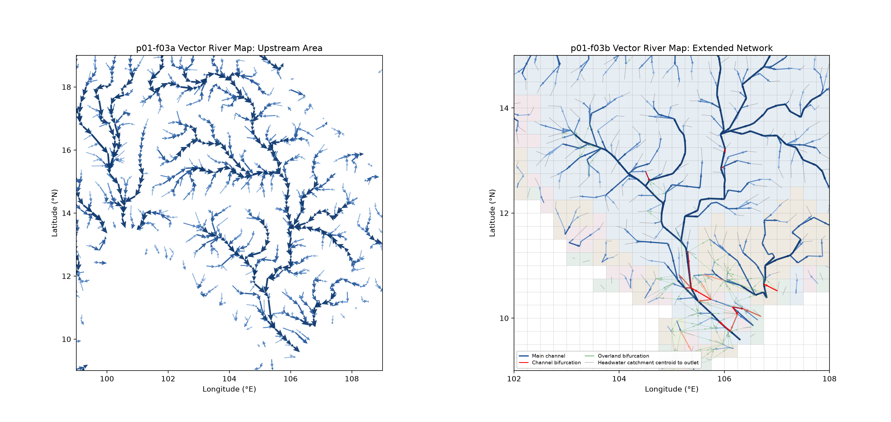

# River Map Visualizations

This project contains raster and network visualizations of CaMa-Flood river maps.
Each Figure has a project-root Shell entry point with editable settings and
Python implementations under `script/`. Working images are written to
`figure/`; only separately authorized copies are published in the Gallery.

## Run a figure

From the repository root, prepare and activate the standard Python environment
once, then run a Figure's Shell entry point:

```bash
./s02-python_setup.sh
source .venv/bin/activate
./visualization/river_map/f01-raster_river_map.sh
```

Entry points resolve repository paths relative to their own location, so they
can also be run from another current directory. Extend this README with a
descriptive section for each Figure added to the project.

## p01-f01 — Raster River Map

Method identifier: `raster_river_map`.

| Panel | Option | Option identifier | Map variable |
| --- | --- | --- | --- |
| p01-f01a | Upstream Area | `upstream_area` | `uparea` |
| p01-f01b | Basin | `basin` | `basin` |
| p01-f01c | Basin Color | `basin_color` | `bsncol` |
| p01-f01d | Subbasin Color | `subbasin_color` | `subcol` |

### Purpose and interpretation

This four-panel Figure shows upstream drainage area, the original basin ID
field, basin display colors, and subbasin display colors on the same Mekong
15-minute map.
Upstream area describes contributing land area, not discharge. **Basin IDs are
categorical identifiers**, not continuous physical quantities: numeric
separation and color ordering have no physical interpretation. The Basin panel
preserves the original stored IDs without replacing or renumbering them.

The Basin Color panel instead displays **`bsncol`**, a precomputed display-color
index derived from basin information. It is not the basin ID. It reuses a
small set of colors, considering neighboring basins, to support clear basin
visualization. Its soft opaque palette is suitable as a background for future
map overlays. Different basins can share a display index; the color map cannot
recover their original IDs. The current sample has 414 basin IDs and five
used display-color indices.

The Subbasin Color panel compares `subcol` against the original basin coloring
in `bsncol`. Here a subbasin is a segment of the directed river network produced
by the upstream-area-increase analysis, not necessarily an independent whole
river basin. `subbsn` stores segment IDs; `subcol` stores reusable display-color
indices assigned to those segments. Neither `bsncol` nor `subcol` is a physical
quantity or a unique identifier. These are optional analysis/visualization
products, not required model simulation inputs.

In f01d, **the main fill remains `subcol`**. Thin black lines mark shared
cell edges where two adjacent positive original `basin` IDs differ, showing
higher-level basin boundaries independently of the display colors. These are
categorical grid boundaries, not interpolated numerical contours. Gray cells
are excluded/missing in `nextxy_noedge`; this is a network-validity mask, not a
land/sea classification. Valid negative terminal codes (`-9` and `-10`) remain
valid network cells. A small key identifies the boundary and mask overlays.

CaMa-Flood uses Flexible Downstream connections beyond immediate grid
neighbors. Apparent gaps in an upstream-area raster do not necessarily mean
that the modeled river network is disconnected; connectivity is stored in
`nextxy` rather than inferred from geographic proximity. No simulation or
observation-station data are required.


### Inputs, units, and methods

| Panel | File and variable | Display |
| --- | --- | --- |
| f01a | `map/mekong_15min/netcdf/uparea.nc`: `uparea(lat, lon)`, m² | Convert to km²; mask missing/non-finite/non-positive values; retain `YlGnBu` with logarithmic normalization over all valid map cells. |
| f01b | `map/mekong_15min/netcdf/basin.nc`: `basin(lat, lon)`, unitless | Display original positive integer IDs with one discrete bin per original integer value. Repeat the qualitative `tab20` palette across IDs; no conversion to `bsncol`. A display-only pseudo-log categorical legend expands IDs 1–20 and labels representative higher IDs. |
| f01c | `map/mekong_15min/netcdf/bsncol.nc`: `bsncol(lat, lon)`, unitless | Display the precomputed indices directly with discrete bins for 1–10. Mix the base `tab10` RGB colors with 60% opaque white to obtain distinguishable pastel colors; only used indices are labeled. |
| f01d | `map/mekong_15min/subcol-30000.bin`: `subcol`, unitless | Read the prepared little-endian int32 raster directly; use the same `tab10` palette and 60% opaque white mix as f01c. Discrete categories only, nearest-neighbor rendering, no log normalization; only present display indices appear in the colorbar. Overlay original basin-ID boundaries in black and the `nextxy_noedge` mask in neutral gray. |

All main and overlay rasters are Git-tracked and share an 80 × 120 grid at
0.25°. Coordinates are cell centers, longitude increases eastward, latitude
decreases southward, and the missing value is `-9999`. NetCDF coordinates are
checked against `params.txt`; binary geometry comes directly from that file.
Unassigned main-fill cells are white, except where the explicit gray no-edge
mask overlays them in f01d. Valid basin IDs are retained exactly.
Repeated raw-ID colors in f01b are a display choice, not adjacency-aware basin
coloring or unique identifiers. Use the numeric raster to identify a basin.
In f01c, neighboring regions with different display indices retain different
colors after lightening; the plot does not recalculate boundaries or indices.

The f01d binary has exactly one 38,400-byte record: 80 × 120 little-endian
int32 values in Fortran array order, with x varying fastest. Its first row is
the northern row, matching the existing map orientation. `-9999` and any
unassigned zero cells are white in the main fill; the no-edge overlay takes
precedence and shows excluded cells in gray. The sample contains display indices 2–6;
non-sentinel values outside the registered 1–10 range are rejected. The paired
`subbsn-30000.bin` has 64 positive segment IDs, plus zero for unassigned network
cells and `-9999` outside the network. Shared colors do not identify a segment;
use `subbsn` for identity. Plotting reads `subcol`, geometry, the original `netcdf/basin.nc` for boundaries,
and `netcdf/nextxy_noedge.nc` for the gray mask. It never recalculates segmentation
or converts the binary to NetCDF. A cell is gray when either downstream-index
component is missing/non-finite; finite terminal codes are not masked. The
no-edge product excludes boundary-affected river networks as prepared by
[`region_cut_domain.F90`](../../map/tools/code/region_cut_domain.F90). Black
boundaries use basin IDs rather than `bsncol` or `subcol`, whose repeated colors
cannot uniquely identify basin units.

The f01b legend uses **display-only pseudo-log categorical spacing**. IDs 1–20
each occupy a full slot with an individual label. Above 20, intervals ending
at 30, 40, 50, 70, 100, 150, 200, 300 and the maximum ID share one slot each;
only these representative IDs are labeled. Every integer's swatch still uses
its existing map color, but higher-ID swatches are compressed. This custom
legend changes display geometry only: the map retains its discrete
`BoundaryNorm`, original categorical IDs and repeating palette. There is no
`LogNorm`, continuous scientific scale, or physical meaning to legend spacing.
Tick text adapts to configured panel height to avoid overlaps.

### Basin preparation and provenance

The regional preparation workflow is
[`map/tools/script_region/s01-regional_map.sh`](../../map/tools/script_region/s01-regional_map.sh),
documented in the [regional-map guide](../../map/tools/script_region/README.md).
It calls [`region_set_map.F90`](../../map/tools/code/region_set_map.F90), whose
basin/color section labels network paths, orders basin IDs by upstream-grid
count, and then assigns a small set of display colors using neighboring-color
checks. Single-cell basins have a special display color. The plotted `basin`
values are the original IDs already stored in the prepared map; visualization
does not perform that preprocessing again. See the source for the full rules,
rather than interpreting `bsncol` as a separate physical field or basin ID.

The individual-map NetCDF preparation template is
[`map/tools/script_bin2nc/s02-convert_netcdf.sh`](../../map/tools/script_bin2nc/s02-convert_netcdf.sh),
using [`convert_map_binary_to_netcdf.py`](../../map/tools/code/convert_map_binary_to_netcdf.py).
The three NetCDF inputs are already tracked, so plotting requires neither
conversion nor map generation.

### Subbasin preparation and threshold meaning

The reusable [s06 subbasin workflow](../../map/tools/script_params/s06-subbasin.sh)
calls [`analysis_subbasin.F90`](../../map/tools/code/analysis_subbasin.F90).
The [Mekong example](../../map/mekong_15min/script_params/s06-subbasin.sh) uses
`AREA_THRESHOLD_KM2=30000` and names the outputs `subbsn-30000.bin` and
`subcol-30000.bin`. A qualifying link is cut when the current cell's upstream
area exceeds 30,000 km² **and** its downstream cell's upstream area exceeds the
current area by more than 30,000 km². This is an upstream-area-increment
segmentation threshold, not a universal minimum subbasin size: the output
segments are not guaranteed to have at least 30,000 km² each. See the
[river-network analysis documentation](../../map/tools/script_params/README.md#river-network-analysis)
for the workflow and full algorithm references rather than treating display
colors as physical basin attributes.

The prepared binary is already distributed with the Git-tracked Mekong sample.
Users do not need to run this generation workflow merely to make the Figure.

### Settings and execution

Run `./visualization/river_map/f01-raster_river_map.sh` after the standard
Python setup. It generates these tracked project assets:

- `figure/f01a-raster_river_map-upstream_area.png`
- `figure/f01b-raster_river_map-basin.png`
- `figure/f01c-raster_river_map-basin_color.png`
- `figure/f01d-raster_river_map-subbasin_color.png`
- `figure/f01-raster_river_map.png`

Defaults are a **2 × 2 grid**, `FIG_HEIGHT=8` inches, automatic `FIG_WIDTH=0`,
and 200 DPI. The complete Figure includes gaps and margins; the wrapper derives
equal panel cells before rendering. Set either physical dimension to zero for
automatic sizing, or specify both to fit the complete Figure in a fixed box.
`GAP`, `MARGIN`, layout and columns remain editable. The common extent stays
90–110°E, 5–35°N with the existing equal-degree raster aspect. Existing f01a–c
scientific calculations, palettes and titles are unchanged. The grid changes
their allocated physical panel size, not their scientific styling.

`SUBCOL_FILE`, `SUBCOL_CMAP` and `SUBCOL_WHITE_MIX` control the new panel;
defaults are the prepared sample, `tab10` and `0.60`, matching f01c. `BASIN_FILE`
also supplies the boundary IDs; `NEXTXY_NOEDGE_FILE` supplies the exclusion mask. All four
panels reuse `script/river_network_layout.py`, reserving identical map and
colorbar rectangles. Colorbars align with map height. Full canvases are saved
without tight cropping, then the shared combiner assembles the Figure without
resizing its content. The published Gallery remains a separately approved
snapshot; this four-panel development update does not replace it.

Run `python visualization/river_map/script/test_raster_river_map.py` to check
raw IDs, binary orientation, masks, matching pastel palettes, labels and common
geometry under legacy limits and the physical sizing modes.

## p01-f02 — Line River Map

Method identifier: `line_river_map`. Vector visualization remains a separate
future method.

| Panel | Option | Option identifier |
| --- | --- | --- |
| p01-f02a | Connect Type | `connect_type` |
| p01-f02b | Enhance Tickness | `enhance_tickness` |
| p01-f02c | Enhance Color | `enhance_color` |

### Purpose and interpretation

All three panels show directed `nextxy` river-network connections over
**99–109°E, 9–19°N**, with the same map geometry and aligned panel heights.
Upstream drainage area is contributing land area, not discharge.

- **f02a:** thicker black arrows show local D8 connections; orange curved
  arrows distinguish nonlocal Flexible Downstream connections. A faint
  upstream-area raster provides context. Flexible arrowheads are slightly
  smaller (7-point mutation scale), with stronger curvature (`rad=0.22`).
- **f02b:** black lines without arrowheads have enhanced thickness representing
  source-cell upstream area. A logarithmic six-class width scale makes larger
  rivers stand out while retaining small links. A legend gives representative
  areas; the faint raster is the same as f02a. Both straight local links and
  curved flexible links omit arrowheads in this trial. Line widths and exact
  endpoints are preserved; flow direction is not explicitly marked in b.
- **f02c:** `cmf_colormap` **shade-rainbow** (`get_cmap("shade_rainbow")`) arrow colors represent source-cell
  upstream area on a logarithmic scale. Moderate area-based widths reinforce
  the network. Precomputed `bsncol` display indices form a darker charcoal-gray
  categorical background, keeping colored arrows in the foreground.


### Inputs, units, and methods

All inputs are Git-tracked under `map/mekong_15min/`; no simulation output,
station data, external download, or map preparation is needed.

| Input | Meaning and use |
| --- | --- |
| `netcdf/uparea.nc`: `uparea(lat, lon)`, m² | Convert to km²; read source-cell areas for arrows and a faint logarithmic background in a/b. Missing, non-finite and non-positive areas are excluded. |
| `netcdf/nextxy_noedge.nc`: `nextx`, `nexty` | One-based destination indices; paired non-positive terminal/sentinel values do not define links. |
| `netcdf/bsncol.nc`: `bsncol(lat, lon)`, unitless | Precomputed categorical display indices 1–10 for c's gray background. Missing/out-of-range cells stay white. These are not basin IDs or a physical magnitude. |
| `params.txt` | Grid dimensions, resolution and bounds, checked against NetCDF cell-center coordinates. |

The current map contains 3,150 valid links (3,022 local and 128 Flexible
Downstream). Every valid link is passed to plotting; the axes clip the display
without filtering connections by extent. Link direction comes directly from
`nextxy`, never geographic proximity. A link is Flexible Downstream if either
source/destination grid-index offset exceeds one. Local arrows are straight;
flexible arrows curve between their exact original endpoints.

For b and c, normalize log10(source area) over all valid links in the map,
independently of the plotting extent. Divide the normalized range into six
equal classes, with the maximum in the last class. In b, shaft widths range
from 0.008 to 0.032 inches; in c, from 0.008 to 0.022 inches. Local quivers
use actual shaft widths; flexible strokes use the corresponding widths in
points. In b, arrowheads are disabled; c retains its existing
proportional heads. Narrow local links are drawn before wider
ones. The full-map area range is also used for c's continuous logarithmic
colorbar. Inputs are never modified.

The charcoal shades in c range from `#2b2b2b` to `#3b3b3b`, roughly halving
the prior gray RGB intensities while preserving categorical distinctions.
The gray shades in c distinguish display classes only; their brightness has
no ordered basin meaning. Repeated `bsncol` values do not uniquely identify
basins. See [f01 basin preparation](#basin-preparation-and-provenance) for
preprocessing provenance. The background has no separate quantitative scale.

### Settings and execution

After the standard Python setup (including `cmf_colormap`), run:

```bash
./visualization/river_map/f02-line_river_map.sh
```

One wrapper invokes three independent panel scripts, then one unchanged
`visualization/script/combine_panels.py` assembly step. It creates these
tracked project assets:

- `figure/f02a-line_river_map-connect_type.png`
- `figure/f02b-line_river_map-enhance_tickness.png`
- `figure/f02c-line_river_map-enhance_color.png`
- `figure/f02-line_river_map.png`

The option identifiers are maintainer-specified: `connect_type`,
`enhance_tickness` (spelling retained as requested), and `enhance_color`.
The wrapper exposes input paths, common extent, layout, spacing, complete
Figure dimensions, DPI and Python. `FIG_WIDTH=0` selects automatic width;
`FIG_HEIGHT=8` sets the complete Figure height to 8 inches at 200 DPI. The
layout reserves the requested dimensions across panel cells, including gaps
and margins. Set either dimension to `0` for automatic sizing. No Gallery
outputs are created or updated.

#### Virtual-colorbar layout

All three panels reserve identical map and vertical-colorbar rectangles using
`script/river_network_layout.py`. The colorbar axes in a/b are invisible;
c fills the same slot with its area colorbar. All retain equal-degree map
aspect and save the full canvas without tight layout or cropping. The
combiner pads panels to the requested complete-Figure dimensions without
resizing their content.

`FIG_WIDTH` and `FIG_HEIGHT` are independent complete-Figure dimensions in
inches; `0` selects automatic sizing. Fixed dimensions include panel gaps and
margins. With one dimension automatic, the layout uses it to preserve the
map plotting area and its aspect. Existing `--max-width` and `--max-height`
CLI options remain maximum bounds for older direct callers and may resize the
completed image. Each panel prints exported canvas/map/colorbar pixel bounds.

Run `python visualization/river_map/script/test_river_network_layout.py` for
five sizing scenarios across all three real panels, including export geometry,
labels, hidden slots, extent, link counts and foreground encodings.

## p01-f03 — Vector River Map

The two options show the main network at geographic unit-catchment outlets.
f03a encodes source-cell upstream area; f03b adds mapped bifurcations and
headwater catchment-centroid guides. Both use stored `nextxy` topology and
`outlon`/`outlat` locations rather than estimating links from geographic
proximity. Tutorial02 Figure 1c is the original implementation reference.



Method identifier: `vector_river_map`.

| Panel | Option | Option identifier | Extent |
| --- | --- | --- | --- |
| p01-f03a | Upstream Area | `upstream_area` | 99–109°E, 9–19°N |
| p01-f03b | Extended Network | `extended_network` | 102–108°E, 9–15°N |

### f03a — Upstream Area

This panel draws main-channel links from each source cell's outlet to the
outlet of its `nextxy` downstream cell. The source cell's `uparea` determines
line color and thickness. Square metres are converted to km² for display; the
log-transformed areas of valid source links across the full map are divided
into four quartiles. Numeric cutoffs depend on the input map and are not fixed
physical thresholds. These are stored network connections, not traced
river-centerline paths: straight segments join exact outlet endpoints.
The legend is omitted to keep the panel uncluttered; color and line width still
encode the four full-map upstream-area quartiles described above.

### f03b — Extended Network

This panel keeps the outlet-based main-channel network and its four upstream
area classes, then adds two kinds of bifurcation from `bifprm.nc`. The table's
one-based `(ix, iy)` and `(jx, jy)` indices select the start and end map cells;
those cells' `outlon`/`outlat` values provide the plotted endpoints. A positive
`width` in the first floodplain layer identifies a channel bifurcation. These
connections use four colors grouped by quartiles of channel width in metres;
the widest class is vivid red (`#FF0000`) for visibility where links overlap.
Remaining valid paths are shown in subdued green as overland
bifurcations, following Tutorial02 Figure 1c's classification. These width
classes are independent of the main-channel upstream-area classes.
The compact legend identifies only the network feature types; it omits detailed
upstream-area and bifurcation-width class entries. Both classifications remain
encoded by the line colors and widths described above.
Full links retain their exact outlet-to-outlet geometry, while small direction
arrows sit near each link's midpoint to reduce arrowhead crowding at junctions.

Thin gray guides connect a candidate headwater cell's unit-catchment centroid
to that cell's river outlet. Candidates are river cells with no incoming valid
main-channel `nextxy` link in the regional map. For each candidate, the script
finds the high-resolution pixels assigned to its coarse cell by `catmxy`,
computes the geographic center of each pixel from `location.txt`, then takes
the mean of those pixel-center coordinates. The regional map has 220 such
candidate cells on its outer grid boundary. Some may lack upstream links only
because those connections lie outside this regional map, so the guides do not
assert that every candidate is a physical headwater.

The f03b extent is intentionally zoomed to 102–108°E and 9–15°N to make the
delta bifurcation network legible. It is independent of f03a's wider default
extent. Pale categorical basin colors and subtle grid lines provide context;
they do not define connectivity. Main and bifurcation arrows follow stored
map links, while straight gray guides summarize catchment geometry. None of
these lines are terrain-traced river paths or observed flows.

#### Required map data

| Relative path | Variables and format | Use |
| --- | --- | --- |
| `map/mekong_15min/netcdf/nextxy_noedge.nc` | NetCDF `nextx`, `nexty` (`lat × lon`); one-based indices | Supplies every valid main-channel source-to-downstream-cell relationship. |
| `map/mekong_15min/netcdf/lonlat.nc` | NetCDF `outlon`, `outlat` (`lat × lon`); degrees east/north | Gives outlet coordinates for main links, bifurcation endpoints, and headwater guide termini. |
| `map/mekong_15min/netcdf/uparea.nc` | NetCDF `uparea` (`lat × lon`); m² | Provides main-channel source-cell area classes and identifies valid river cells. |
| `map/mekong_15min/netcdf/bsncol.nc` | NetCDF `bsncol` (`lat × lon`); categorical indices | Pale basin-color background for f03b; it is display context, not connectivity. |
| `map/mekong_15min/netcdf/bifprm.nc` | NetCDF `ix`, `iy`, `jx`, `jy`, `width(layer, path)` | Defines bifurcation endpoints and channel width. Width is in metres; first-layer width distinguishes channel from overland paths. |
| `map/mekong_15min/1min/1min.catmxy.bin` | Binary little-endian int16; two `1200 × 1800` planes (`catmx`, `catmy`) | Assigns each 1-minute pixel to a one-based coarse cell. `-999` and `-9999` sentinel indices are excluded from centroids. |
| `map/mekong_15min/1min/location.txt` | Text grid metadata; 1-minute resolution and bounds | Converts high-resolution pixel row/column positions to geographic pixel-center coordinates. |
| `map/mekong_15min/params.txt` | Text metadata; 80 × 120 grid at 0.25° | Checks the coarse grid geometry shared by the NetCDF products and catchment assignments. |

All listed inputs are Git-tracked; no model output, station data, or map
preparation is required. The figures reconstruct topology from stored
`nextxy` and `bifprm` links, not from geographic outlet proximity. The
high-resolution `catmxy` allocation independently supplies the pixels used
for headwater-centroid guides.

#### Settings and execution

After the standard Python setup, run:

```bash
./visualization/river_map/f03-vector_river_map.sh
```

Edit the input paths and the separate `A_*` / `B_*` extent settings in the
Shell entry point as needed. Defaults preserve f03a at 99–109°E, 9–19°N and
set f03b to 102–108°E, 9–15°N. `FIG_WIDTH` and `FIG_HEIGHT` set the complete
combined Figure size in inches (`0` selects automatic sizing); `DPI` controls
PNG resolution. The script writes both panels and the combined Figure under
`visualization/river_map/figure/`. Gallery images are not changed.
